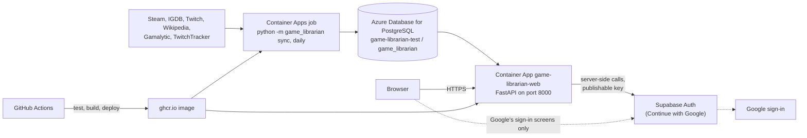

# Deploying Game Librarian to Azure

**Status.** Version 0.21 runs in Azure (email-and-password accounts through Supabase Auth; you set its two Supabase
variables), and since 2026-11-22 every push to `main` deploys the new image to the website and the daily job
automatically (section 5). Version **0.22 is prepared, not deployed**: sign-in becomes **Continue with Google** only,
through the same Supabase project. There is no password and no email code, so no domain and no SMTP service are
needed. This work created, changed or deployed nothing in Azure, Google Cloud or Supabase; every step below is for
you to do. **Because a push deploys, do the configuration steps of
[section 12](#12-upgrade-from-021-to-022-in-order) before you push 0.22**, and turn off Supabase's Email provider only
after Google sign-in works on the hosted site (step 12.8). Values in angle brackets, such as `<app-fqdn>` (your
container app's address, without `https://`) or `<project-ref>` (your Supabase project's id), are placeholders. Never
paste a password, key or client secret into a file that is committed, a chat, or a saved command line.

1. [Architecture](#1-architecture)
2. [Settings](#2-settings)
3. [Prepare PostgreSQL and copy the catalog](#3-prepare-postgresql-and-copy-the-catalog)
4. [Let Azure reach PostgreSQL](#4-let-azure-reach-postgresql)
5. [Build, publish and deploy the image](#5-build-publish-and-deploy-the-image)
6. [Run the website in the existing container app](#6-run-the-website-in-the-existing-container-app)
7. [Accounts with Supabase: Continue with Google](#7-accounts-with-supabase-continue-with-google)
8. [The daily sync job](#8-the-daily-sync-job)
9. [Verify](#9-verify)
10. [Backups, costs and limits](#10-backups-costs-and-limits)
11. [Testing safely](#11-testing-safely)
12. [Upgrade from 0.21 to 0.22, in order](#12-upgrade-from-021-to-022-in-order)

## 1. Architecture



| Part | What it is | Notes |
| --- | --- | --- |
| Website | The container app `game-librarian-web`, environment `managed-canadacentral-e7t4cu8`, Consumption, 0 to 1 replicas | `serve --host 0.0.0.0 --port 8000`; target port **8000**. |
| Database | The flexible server `game-librarian-test`, database `game_librarian` | Catalog, history, Gamalytic and TwitchTracker figures, accounts and wishlists. TLS `verify-full`. |
| Daily sync | The Container Apps job `game-librarian-sync`, schedule trigger | The same image, arguments `sync`. |
| Accounts | Your Supabase Free project (Canada Central), **Auth only** (the Data API stays off), with its **Google** provider | The website's server calls Supabase Auth with the publishable key and keeps the session in HttpOnly cookies. The browser visits Supabase only on the way to and from Google's sign-in screens. No secret or service-role key is used; Google's client secret is entered in Supabase only. |
| Image and deployment | `ghcr.io/scottphung/game-librarian`, built and deployed by `.github/workflows/container.yml` | A push to `main` tests, publishes and deploys (section 5). |

Not used, because nothing needs them: Azure Container Registry, Key Vault, Blob Storage, Data Factory, Data Lake,
Snowflake, a VM, Caddy, a domain of your own, an SMTP (email-sending) service, and Container Apps' built-in
authentication (remove it in step 12.10).

## 2. Settings

| Variable | Website | Job | Secret? | Purpose |
| --- | --- | --- | --- | --- |
| `GAME_LIBRARIAN_DATABASE_URL` | yes | yes | no | `postgresql://gl_app@game-librarian-test.postgres.database.azure.com:5432/game_librarian`. No password in it; `sslmode=verify-full` is the default and nothing weaker is accepted for a remote server. |
| `PGPASSWORD` | yes | yes | **yes** | The `gl_app` password. |
| `GAME_LIBRARIAN_HOSTED` | set by the image | set by the image | no | `1`: needs PostgreSQL, marks cookies `Secure` with the `__Host-` prefix, sends HSTS, and makes `sync` fail when a source lacks its credentials. |
| `GAME_LIBRARIAN_SUPABASE_URL` | yes | no | no | The Supabase **Project URL**, such as `https://<project-ref>.supabase.co` (no path, no trailing slash). |
| `GAME_LIBRARIAN_SUPABASE_PUBLISHABLE_KEY` | yes | no | optional | The project's **publishable** key (`sb_publishable_...`; the legacy `anon` key also works until Supabase retires it). Supabase calls it safe to expose; the site only uses it on the server. **Never** the secret or `service_role` key. Both Supabase variables set: accounts are offered (Continue with Google appears only while the Google provider is on in Supabase); neither: no accounts, the wishlist stays in each browser. |
| `GAME_LIBRARIAN_ALLOWED_USERS` | optional | no | no | Email addresses that may keep an account, comma-separated, compared without case: the address of each person's Google account, which Google has verified before anyone signs in with it. Empty: everyone who signs in. 0.20's GitHub user names are refused at start. |
| `STEAM_API_KEY` | no | yes | **yes** | Steam catalog discovery. |
| `IGDB_CLIENT_ID`, `IGDB_CLIENT_SECRET` | yes ("Watch it live") | yes (Trending lists, and Most watched's categories) | **yes** (the secret) | A Twitch application's credentials. |
| `GAME_LIBRARIAN_CONTACT` | no | yes | store as a secret | Wikipedia's User-Agent contact. |

**0.22 adds no variable and changes none.** Google's client ID and secret go into Supabase, not into Azure. Removed in
0.21: `GAME_LIBRARIAN_SIGN_IN_PROVIDERS` (GitHub sign-in); if it is still set, the website logs a warning and ignores
it. Gamalytic and TwitchTracker need no setting or key: they are free APIs (see the README's "Data sources and terms"
for their restrictions).

## 3. Prepare PostgreSQL and copy the catalog

Done for 0.20. For reference: create the database and the `gl_app` role as the server administrator, then from your
computer, in PowerShell in the project folder, for that window only:

```powershell
$env:GAME_LIBRARIAN_DATABASE_URL = "postgresql://gladmin@game-librarian-test.postgres.database.azure.com:5432/game_librarian"
$secure = Read-Host "gladmin password" -AsSecureString
$env:PGPASSWORD = [System.Net.NetworkCredential]::new("", $secure).Password
.\.venv\Scripts\python.exe -m pip install -r requirements.txt
.\.venv\Scripts\python.exe -m game_librarian init-postgres --grant-to gl_app
.\.venv\Scripts\python.exe -m game_librarian migrate-to-postgres --check
.\.venv\Scripts\python.exe -m game_librarian migrate-to-postgres
Remove-Item Env:PGPASSWORD, Env:GAME_LIBRARIAN_DATABASE_URL
```

`init-postgres` creates or upgrades the tables and lets `gl_app` read and write rows only. `migrate-to-postgres` opens
the SQLite file read-only, checks it, copies every catalog table (since 0.21 also `sales_estimates` and
`twitchtracker_summaries`) in one transaction, compares every table's row count and checksum, and refuses a database
that already holds catalog rows. **`--replace` is destructive** (it empties the catalog tables, discarding what the
hosted sync collected since); accounts and wishlists are always kept. The 0.20 copy left the two tables out:
**`--only`** (step 12.10) adds just their missing rows and is not destructive. 0.22 changes no table.

## 4. Let Azure reach PostgreSQL

Done for 0.20 (your choice among "Allow public access from any Azure service", firewall rules for the environment's
outbound addresses, or a private network). Nothing changes in 0.22: neither Supabase nor Google ever connects to your
database.

## 5. Build, publish and deploy the image

A push to `main` runs `.github/workflows/container.yml`:

1. **test:** the tests on SQLite and on PostgreSQL. A failure stops here; nothing is published or deployed.
2. **publish:** builds the `Dockerfile` and pushes `ghcr.io/scottphung/game-librarian:sha-<commit>` and `:latest`.
   A pull request is tested but publishes nothing.
3. **deploy** (pushes to `main` only, added on 2026-11-22): signs in to Azure with OpenID Connect, as the
   user-assigned managed identity `game-librarian-github-deploy` (its federated credential trusts this repository's
   `main` branch; it has **Contributor** on `game-librarian-web` and on the job `game-librarian-sync`; GitHub keeps
   its ids as the repository secrets `AZURE_CLIENT_ID`, `AZURE_TENANT_ID` and `AZURE_SUBSCRIPTION_ID`). It skips an
   older commit when a newer push exists, sets the website's image to the `sha-` tag, waits up to 10 minutes for the
   new revision to run (`Running`, `RunningAtMaxScale` or `ScaledToZero`; `ActivationFailed` or `Degraded` fails the
   run), then sets the job's image to the same tag.

The deploy job changes **only the image**. Environment variables, secrets, scale, ingress and authentication stay as
you set them in the portal, so a version that needs a new setting must have it **before** you push. Watch each run
under the repository's **Actions** tab. To go back, open the container app, **Containers > Edit and deploy**, and
choose the previous `sha-` tag (the job likewise under its **Containers**); the next push deploys again.

## 6. Run the website in the existing container app

Done for 0.20 (image from GHCR, `gl_app` URL and password, IGDB variables, probes `/healthz` and `/readyz` on port
8000, ingress target port 8000, HTTPS only, scale 0 to 1). Since 0.21 it also has the two Supabase variables. 0.22
needs no change here.

## 7. Accounts with Supabase: Continue with Google

**How it works.** The header's person icon opens `/account` (**Welcome back**); **Create an account** opens
`/account/sign-up`. Both show one button, **Continue with Google**; the first Google sign-in creates the account, so
only the words differ. Signing in is optional: every page, and the wishlist saved in the browser, works without it.

* `/auth/google`: the server makes a PKCE code verifier, keeps it in an HttpOnly cookie for 10 minutes, and sends the
  browser to Supabase's `/authorize` with the verifier's SHA-256 challenge. Supabase sends the browser to Google,
  Google back to Supabase, and Supabase back to `https://<app-fqdn>/auth/callback?code=...`.
* `/auth/callback`: the server exchanges that one-time code, with the verifier, for the session. A code that another
  browser started cannot be used here (no matching verifier), which is what stops someone from signing you in to
  their account. When Google or Supabase refuses, the page says why in the site's own words: cancelled on Google's
  screen, new accounts turned off, an address Google has not verified, or a sign-in that did not finish. Supabase's
  error code goes to the log, never the person's address.
* The button is a link only while Supabase's settings say the Google provider is on (checked at most every 5 minutes).
  When the provider is off, or Supabase does not answer, the button is shown disabled with a sentence that says why,
  and the log says so.

There are no passwords and no email codes. The session is kept in two cookies that page scripts cannot read
(HttpOnly; on the hosted site `Secure` and `__Host-`, so another app under `azurecontainerapps.io`, which is not on the
Public Suffix List, cannot plant them), checked on every request with Supabase's published signing keys (JWKS) and
renewed with the refresh token. A person's account row and wishlist in PostgreSQL are keyed by Supabase's user id,
never by an email address. The sign-out form carries a per-browser token (CSRF) and must come from this site; the
wishlist API takes JSON only. The site allows each visitor 20 Google sign-ins per 10 minutes, because Supabase sees
one address (this server's) for every visitor and its token limit is shared by everyone's sign-ins and renewals.
**Sign out** ends the session at Supabase and deletes the cookies. "Delete my account data" removes the account and its
wishlist from PostgreSQL and signs out; the Supabase user stays until you delete it in Supabase (the site holds no key
that could). The site calls only Supabase's settings, signing keys, token exchange, renewal and sign-out endpoints,
never its email sign-in (a test checks this).

**Accounts made in 0.21 (email and password).** Supabase links a Google sign-in to the existing user whose email
address is the Google account's verified address (its "automatic linking", built into Supabase Auth). The site itself
never merges accounts: it only follows Supabase's user id. So, with nothing for you to do:

* **A confirmed 0.21 account** opens with **Continue with Google** for a Google account with the same address: the same
  Supabase user, so the same Game Librarian account and saved games. Supabase keeps the old password (hashed); the site
  no longer uses it.
* **A 0.21 sign-up that was never confirmed** has no saved games (it could never sign in). Continue with Google for
  that address takes over the same Supabase user; Supabase removes the unconfirmed email identity and its password.
* **An address that is not a Google account** (an Outlook, Yahoo or work address, for example): its owner can create a
  Google account for that existing address (Google offers to use your current email address instead of a new Gmail
  one, and sends a code to it to verify it). Continue with Google then links as above.

**What needs a deliberate migration (you decide; nothing happens by itself):** a person who signs in with a Google
account under **another** address gets a new, empty account, and their 0.21 account stays as it was. Once you have
made sure that both addresses belong to the same person, from your computer, as `gl_app` (the same PowerShell setup as
step 12.11):

```powershell
.\.venv\Scripts\python.exe -m game_librarian accounts list
.\.venv\Scripts\python.exe -m game_librarian accounts copy-wishlist --from <old account id> --to <new account id>
```

`accounts list` shows every account with its id, sign-in, address and number of saved games. `copy-wishlist` adds the
games the new account lacks and changes nothing else; both accounts stay. When the old one is no longer needed,
`accounts delete --id <old account id> --yes` removes it from PostgreSQL, and **Authentication > Users** in Supabase
removes its Supabase user. If `GAME_LIBRARIAN_ALLOWED_USERS` is set, it must list the address of each person's Google
account.

**7.1 Signing keys.** In Supabase, open the project's JWT signing keys settings: the **current** key must be
asymmetric (ECC P-256 or RSA). Projects created since May 2025 get one by default, and 0.21 already needed it. Check
it: open `https://<project-ref>.supabase.co/auth/v1/.well-known/jwks.json` in a browser; it must list at least one
key. If it lists none, the project still signs with a shared secret, which this site refuses: follow Supabase's guide
to migrate to asymmetric JWT signing keys first.

**7.2 Google Cloud.** In the [Google Cloud console](https://console.cloud.google.com/), signed in with the Google
account that should own the app:

1. Choose or create a project (for example `game-librarian`).
2. Open **Google Auth Platform** (APIs & Services > OAuth consent screen opens it). The first time, **Get started**:
   app name `Game Librarian`, a user support email, **Audience: External**, a contact email; accept Google's user data
   policy; **Create**.
3. **Audience:** while the publishing status is **Testing**, Google limits sign-in to the Google accounts listed under
   **Test users** (up to 100): add yours, and each tester's. This list is not the site's list of accounts; Supabase
   keeps those. To let any Google account sign in, choose **Publish app** (In production). If the button is disabled
   because the Branding configuration is incomplete, fill in what **Branding** marks as missing: Google can ask for
   the application home page (`https://<app-fqdn>`) and a privacy policy link. The site has no privacy policy page
   yet, so one has to be written and published first; until then, keep the app in Testing with test users. Showing
   your own name and logo instead of `<project-ref>.supabase.co` on Google's screen needs Google's optional brand
   verification.
4. **Data Access:** **Add or remove scopes**, select `openid`, `.../auth/userinfo.email` and
   `.../auth/userinfo.profile`, then **Update** and **Save**. Add nothing else.
5. **Clients > Create client:** application type **Web application**, name `Game Librarian (Supabase)`; **Authorized
   JavaScript origins:** `https://<app-fqdn>`; **Authorized redirect URIs:**
   `https://<project-ref>.supabase.co/auth/v1/callback` (the **Callback URL** shown on Supabase's Google provider
   page; it must match exactly, or Google shows "redirect_uri_mismatch"). **Create.** Copy the **Client ID**. Paste the
   **Client secret** straight into Supabase (step 7.3), nowhere else; Google may show it only once (if it is lost, add
   a new secret to the client).

**7.3 Supabase's Google provider.** Under **Authentication > Sign In / Providers > Google**: turn it on; **Client
IDs:** the client ID; **Client Secret (for OAuth):** the secret; leave **Skip nonce checks** and **Allow users without
an email** off; **Save**. Within 5 minutes (the site's cache of Supabase's settings) 0.22 shows **Continue with
Google** as a link; turning the provider off disables the button again, with "Signing in is turned off on this site
for now". Google shares the account's name, email address and picture with Supabase; the site uses the verified email
address only. A wrong client secret shows up as "Google sign-in did not finish" on the site, and the site's log
names it ("Check the Client ID and Client Secret of its Google provider").

**7.4 URLs.** Under **Authentication > URL Configuration**:

| Where | Value | What it is for |
| --- | --- | --- |
| Supabase, **Site URL** | `https://<app-fqdn>` (no trailing slash) | The site's address. |
| Supabase, **Redirect URLs**: add | `https://<app-fqdn>/auth/callback` | Where Supabase sends the browser back after Google, with the one-time code. Supabase also accepts an address on the Site URL's own host, but listing the callback makes it explicit. For local tests only, also `http://127.0.0.1:8000/auth/callback` (section 11). |
| Google Cloud, the OAuth client's **Authorized redirect URIs** | `https://<project-ref>.supabase.co/auth/v1/callback` (copy it from Supabase's Google provider page) | Where **Google** sends the browser back: Supabase's callback, never this site's. |
| Google Cloud, the OAuth client's **Authorized JavaScript origins** | `https://<app-fqdn>` | The site's origin, as Supabase's Google guide asks. |

**7.5 Sign-ups and the allow list.** Under **Authentication > Sign In / Providers**, keep **Allow new users to sign
up** on: it covers Google too, and with it off a new Google account is told "New accounts cannot be created on this
site right now" (accounts that exist keep signing in). To keep accounts to a small circle, set
`GAME_LIBRARIAN_ALLOWED_USERS`, or turn sign-ups off once your circle has its accounts. Supabase's CAPTCHA protection
does not apply to the Google sign-in flow or to session renewals, so it does not matter to 0.22.

**7.6 Supabase's Email provider: turn it off after Google works.** 0.22 never uses it, but while it is on, anyone who
has the project's URL and publishable key (Supabase calls that key safe to expose) can still use Supabase's own email
sign-up and sign-in directly. Only after Google sign-in works on the hosted site (step 12.7): under
**Authentication > Sign In / Providers > Email**, turn off **Enable Email provider** and **Save**. If **Confirm email**
is shown there, leave it on: with it off, Supabase counts unverified addresses as verified when it links accounts.

What that changes: Supabase then refuses email-and-password sign-ins, sign-ups, magic links, email codes and password
resets, for everyone. It deletes and changes no user: 0.21's users keep their Supabase ids, their wishlists and their
(unused) password hashes, and reach their accounts through Continue with Google as described above. Google sign-in,
automatic linking to those users and session renewals do not depend on the Email provider (checked in Supabase Auth's
source on 2026-11-22). Email templates, custom SMTP and email rate limits are not used by 0.22: nothing to set up and
nothing to delete. 0.21 does need the Email provider: turn it back on before you deploy 0.21 again (step 12.12).

## 8. The daily sync job

Unchanged settings (schedule, `sync`, secrets); its image now follows each push (section 5). Since 0.21 a run also
asks **TwitchTracker** (each tracked Twitch category at most every 20 hours, 1.5 s apart, at most 200 requests a day;
it needs the IGDB variables, which choose the categories) and **Gamalytic** (each catalog game at most every 7 days,
100 per request, at most 50 requests a day), after the Steam sync and the Trending lists. Estimates are added as new
rows (history kept, never overwritten); TwitchTracker's figures replace the previous ones per category, each with its
time. A 429 or 403 stops that source's run at once and keeps the stored figures; a failure or partial run makes the
execution fail (exit 1 or 2), never a silent success. To leave a source out, add `--skip-most-watched` or
`--skip-sales` to the arguments. The replica timeout of 7200 seconds is ample.

## 9. Verify

Use Google accounts you own (test users while the Google app is in Testing).

* **App:** `https://<app-fqdn>/healthz` and `/readyz` answer `{"status":"ok"}`; the pages open.
* **Visitors:** in a private window, without signing in: Discover, Trending, a game's details and the wishlist work,
  and the header's person icon says **Sign in**. A game saved there stays in that browser.
* **The sign-in pages:** `/account` shows **Welcome back** with one button, **Continue with Google**, and no email
  field; `/account/sign-up` shows **Create your account** with the same button. `https://<app-fqdn>/account/send-code`
  answers 404.
* **A new account:** **Continue with Google**, then a Google account that has no account here yet: you come back to
  the wishlist, signed in, and the person icon says **Account**. In Supabase, **Authentication > Users** shows the
  user with the Google provider.
* **Cancel:** start again in a private window and choose **Cancel** on Google's screen: the site says "Google sign-in
  was cancelled."
* **A 0.21 account**, if any exist (**Authentication > Users** lists them with the Email provider): continue with
  Google for the same address. The saved games are there, and the user now lists both providers;
  `python -m game_librarian accounts list` (from your computer, as `gl_app`) shows one `supabase` account for it.
* **The browser's wishlist:** save a game while signed out, then sign in: the wishlist offers to add it to the
  account; after **Add them to my account**, the browser's copy stays until you remove it.
* **Isolation:** sign in as account A in one browser and save two games; in a private window sign in with another
  Google account, B: B's wishlist is empty and B's changes never appear for A. A forged header must sign nobody in:
  `curl.exe -H "X-MS-CLIENT-PRINCIPAL-ID: 1" -H "X-MS-CLIENT-PRINCIPAL-IDP: github" https://<app-fqdn>/api/wishlist`
  answers 401.
* **Sign-out:** **Sign out** on `/account` returns to **Welcome back** with "You are signed out."; the wishlist in that
  browser is the browser's own again, while another browser signed in to the same account stays signed in.
* **Cookies:** in the browser's developer tools, `__Host-gl_access`, `__Host-gl_refresh` and `__Host-gl_csrf`, all
  HttpOnly and Secure, and `__Host-gl_oauth` only between **Continue with Google** and the return; no page's source
  contains a token or the publishable key.
* **Data:** after a job run, Trending shows "Most watched among tracked Twitch categories" (TwitchTracker, with its
  retrieval time) and the dashboard's Sales & reception leads with "Estimated Steam copies sold" (Gamalytic, with its
  collection time). Until TwitchTracker has given figures, Trending shows Twitch's own order; until Gamalytic was
  asked once, the dashboard says there are no sales figures.

**When Google sign-in fails:**

| What you see | Likely cause | Fix |
| --- | --- | --- |
| A disabled **Continue with Google** and "Signing in is turned off on this site for now" | Supabase's Google provider is off | Step 7.3; the button follows within 5 minutes. |
| A disabled button and "Google sign-in cannot be reached right now" | Supabase does not answer, for example a paused Free project | Restore the project in Supabase's dashboard (section 10). |
| Google's page "Error 400: redirect_uri_mismatch" | The Google client's redirect URI is not exactly Supabase's callback | Step 7.2, item 5. |
| Google's page "Access blocked: ... has not completed the Google verification process" | The Google app is in Testing and that account is not a test user | Step 7.2, item 3. |
| After Google, the browser lands on another address (such as `localhost:3000`), not signed in | Supabase's Site URL is not `https://<app-fqdn>`, and the callback is not in its Redirect URLs | Step 7.4. |
| "Google sign-in did not finish", and the site's log says "Check the Client ID and Client Secret" | Supabase could not finish with Google, such as a wrong client secret | Step 7.3; Supabase's **Logs** (Auth) show its reason. |
| "New accounts cannot be created on this site right now" | **Allow new users to sign up** is off | Step 7.5. |
| "Google sign-in did not finish on this site", and the log says "failed this site's check" | The project signs with a shared secret, or the Google account has no address | Step 7.1; step 7.3 (**Allow users without an email** off). |

## 10. Backups, costs and limits

* **Backups:** PostgreSQL's automatic backups, as before; a restore creates a new server (re-add the firewall rules
  and change the host in `GAME_LIBRARIAN_DATABASE_URL`). Supabase keeps the sign-in side (users, their Google
  identities, 0.21's password hashes); check what its Free plan backs up. If that project were lost, people would
  sign in again (new Supabase ids) and you would copy their wishlists with `accounts copy-wishlist`.
* **Costs:** as before (PostgreSQL is the largest item; Container Apps Consumption beyond its free grant; logs). The
  Supabase Free plan and Google sign-in have no charge within their limits, and 0.22 needs no domain and no SMTP
  service. Check current prices; set an Azure budget alert.
* **Supabase Free:** projects are **paused after about a week of low activity** (Supabase emails a warning first) and
  must be restored from its dashboard; while paused, nobody can sign in, the site says the sign-in service is not
  answering, and Continue with Google is shown disabled (browser wishlists keep working; signed-in sessions work until
  their access token expires, then end).
* **Supabase rate limits** count this server as one visitor: by default 150 token requests per 5 minutes for the whole
  site, Google sign-ins and session renewals together. The site therefore lets each visitor finish 20 Google sign-ins
  per 10 minutes; its single website replica keeps those counts in memory.
* **Google:** while the app is in Testing, only its test users (at most 100) can sign in. Without brand verification
  or a Supabase custom domain (a paid add-on), Google's screen names `<project-ref>.supabase.co`, not Game Librarian.
  Supabase refuses a Google account whose address Google has not verified, and the site says so.
* **Accounts:** "Delete my account data" leaves the Supabase user, which you delete in Supabase. Supabase retires the
  legacy `anon` and `service_role` keys by the end of 2026: use the publishable key.

## 11. Testing safely

* **Locally, without Supabase:** `python -m game_librarian serve` has no accounts (browser wishlist), as before.
* **Locally, with your Supabase project** (recommended before you push 0.22, step 12.4): set
  `GAME_LIBRARIAN_SUPABASE_URL` and `GAME_LIBRARIAN_SUPABASE_PUBLISHABLE_KEY` in `.env` (the publishable key only;
  `.env` is never committed or copied into the image), and add `http://127.0.0.1:8000/auth/callback` to Supabase's
  **Redirect URLs**. Run `.\.venv\Scripts\python.exe -m game_librarian serve` and open `http://127.0.0.1:8000/account`
  (use `127.0.0.1`, not `localhost`): **Continue with Google** goes through your real Supabase project and Google, then
  back to your computer. Google needs no change for this, because it only ever sends the browser back to Supabase.
  Local cookies are not `Secure`, so plain `http://127.0.0.1` works. The account and wishlist are kept in the local
  SQLite file, but the Supabase user is real, and the hosted site finds the same one later. Remove the local Redirect
  URL when you are done.
* **Automated tests** never reach Supabase, Google, Gamalytic or TwitchTracker: `tests/conftest.py` has in-memory
  fakes. The Supabase fake signs real tokens with a key made for each run and plays Google's and Supabase's part:
  PKCE, automatic linking (0.21's accounts included), and the refusals Supabase sends back (a cancel, sign-ups turned
  off, an address Google has not verified, a failure at Supabase's end).
* **In Azure:** a push deploys, so test right after the workflow finishes (section 9), and keep the previous `sha-`
  tag at hand to go back to (section 5).

## 12. Upgrade from 0.21 to 0.22, in order

Steps 1 to 5 change nothing that 0.21 shows: 0.21 ignores Supabase's Google provider.

1. **Google Cloud:** step 7.2, items 1 to 5. Keep the app in Testing, with your own Google account (and any
   tester's) as test users.
2. **Supabase's Google provider:** step 7.3.
3. **Supabase URLs and sign-ups:** step 7.4 (Site URL `https://<app-fqdn>`, Redirect URL
   `https://<app-fqdn>/auth/callback`) and step 7.5 (**Allow new users to sign up** on).
4. **Recommended: try it locally first** (section 11): continue with Google against your real Supabase project from
   your own computer, save a game, sign out. This tests steps 1 to 3 without touching Azure.
5. **Azure: nothing to change.** 0.22 adds no variable and removes none. Keep `GAME_LIBRARIAN_SUPABASE_URL` and
   `GAME_LIBRARIAN_SUPABASE_PUBLISHABLE_KEY` as they are; never add Google's client ID or secret to Azure. Note the
   image tag the website runs now (the container app's **Containers** tab; `sha-5f2bb6f` unless you pushed since),
   for step 12.
6. **Push 0.22 to `main`.** The workflow tests, publishes and deploys the website and the job (section 5); follow it
   in **Actions** until the deploy job succeeds. From then on the site offers only Continue with Google.
7. **Verify on the hosted site** (section 9): a new account, a cancel, a 0.21 account if any, the browser's wishlist,
   isolation and sign-out. If something fails, see the table in section 9, or go back (step 12).
8. **Then turn off Supabase's Email provider** (step 7.6), and sign out and in once more with Google. Nothing else in
   Supabase needs deleting: its email templates and SMTP settings are simply unused.
9. **Tell 0.21's account holders**, if any: continue with Google for the same address. For anyone who must use
   another address, copy their wishlist deliberately (section 7, "What needs a deliberate migration").
10. **Old GitHub accounts, then GitHub sign-in** (if still set up from 0.20; only after step 7 passed). The app does
    not reach 0.20's GitHub accounts; their rows stay in PostgreSQL, and nothing is matched or merged by email
    address. From your computer, as `gl_app`: `python -m game_librarian accounts list` shows every account (id,
    sign-in, name, games). For a GitHub account whose owner you know, once they have signed in with Google:
    `accounts copy-wishlist --from <github id> --to <supabase id>` (adds the missing games; both stay), then, when no
    longer needed, `accounts delete --id <github id> --yes`. Then remove GitHub sign-in: container app >
    **Authentication** > delete the GitHub identity provider (with no provider left, built-in authentication is off;
    the portal may also offer to remove authentication entirely); under **Settings > Secrets**, delete the secret
    that held the GitHub client secret; on GitHub, **Settings > Developer settings > OAuth Apps**, delete the app.
    Check that `https://<app-fqdn>/.auth/login/github` now answers 404 and that Continue with Google still works.
11. **Optional, if not done for 0.21: copy the two tables 0.20 left out** (keeps earlier Gamalytic collections as
    history). From your computer, as `gl_app` (it only adds rows):

    ```powershell
    $env:GAME_LIBRARIAN_DATABASE_URL = "postgresql://gl_app@game-librarian-test.postgres.database.azure.com:5432/game_librarian"
    $secure = Read-Host "gl_app password" -AsSecureString
    $env:PGPASSWORD = [System.Net.NetworkCredential]::new("", $secure).Password
    .\.venv\Scripts\python.exe -m game_librarian migrate-to-postgres --only sales_estimates --only twitchtracker_summaries --check
    .\.venv\Scripts\python.exe -m game_librarian migrate-to-postgres --only sales_estimates --only twitchtracker_summaries
    Remove-Item Env:PGPASSWORD, Env:GAME_LIBRARIAN_DATABASE_URL
    ```

    It adds only rows PostgreSQL lacks (by `appid` and collection time, or by Twitch category), keeps every row it has,
    leaves out estimates of games the hosted catalog lacks, compares the added rows, and adds nothing on a second run.
    The same first three lines, then `accounts list` or `accounts copy-wishlist`, run the account commands of section 7.
12. **Back out:** first, if you turned off the Email provider in step 8, turn it back on: 0.21 signs in with email and
    password. If you changed the **Confirm signup** email template for an earlier draft of 0.22, put back 0.21's link
    `{{ .SiteURL }}/auth/confirm?token_hash={{ .TokenHash }}&type=email` (0.21's DEPLOYMENT.md, commit `284d174`).
    Then deploy the tag you noted in step 5 (section 5). The Google provider can stay on: 0.21 does not show it.
    Accounts created through Google in 0.22 keep their data, but 0.21 has no Google button, so their owners cannot
    sign in until 0.22 is back.
