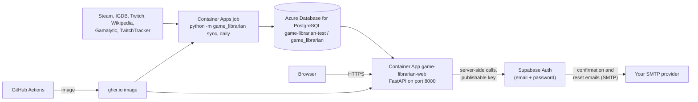

# Deploying Game Librarian to Azure

**Status.** Version 0.20 runs in Azure (you deployed it; GitHub sign-in through Container Apps' built-in
authentication). Version **0.21 is prepared, not deployed**: email-and-password accounts through Supabase Auth replace
GitHub sign-in, and Gamalytic's and TwitchTracker's figures are shown on the hosted site and refreshed by the daily
job. Nothing in Azure or Supabase was created, changed or deployed by this work. Every step below is for you to do,
in this order. Values in angle brackets, such as `<app-fqdn>` (your container app's address, without `https://`) or
`<project-ref>` (your Supabase project's id), are placeholders. Never paste a password or key into a file that is
committed, a chat, or a saved command line.

**Upgrading from 0.20: do [section 12](#12-upgrade-from-020-to-021-in-order), in order.** Sections 1 to 11 describe
the whole setup.

1. [Architecture](#1-architecture)
2. [Settings](#2-settings)
3. [Prepare PostgreSQL and copy the catalog](#3-prepare-postgresql-and-copy-the-catalog)
4. [Let Azure reach PostgreSQL](#4-let-azure-reach-postgresql)
5. [Build and publish the image](#5-build-and-publish-the-image)
6. [Run the website in the existing container app](#6-run-the-website-in-the-existing-container-app)
7. [Email accounts with Supabase](#7-email-accounts-with-supabase)
8. [The daily sync job](#8-the-daily-sync-job)
9. [Verify](#9-verify)
10. [Backups, costs and limits](#10-backups-costs-and-limits)
11. [Testing safely](#11-testing-safely)
12. [Upgrade from 0.20 to 0.21, in order](#12-upgrade-from-020-to-021-in-order)

## 1. Architecture



| Part | What it is | Notes |
| --- | --- | --- |
| Website | The container app `game-librarian-web`, environment `managed-canadacentral-e7t4cu8`, Consumption, 0 to 1 replicas | `serve --host 0.0.0.0 --port 8000`; target port **8000**. |
| Database | The flexible server `game-librarian-test`, database `game_librarian` | Catalog, history, Gamalytic and TwitchTracker figures, accounts and wishlists. TLS `verify-full`. |
| Daily sync | A Container Apps job, schedule trigger | The same image, arguments `sync`. |
| Accounts | Your Supabase Free project (Canada Central), **Auth only** (the Data API stays off) | The browser never talks to Supabase: the website's server calls Supabase Auth with the publishable key and keeps the session in HttpOnly cookies. No secret or service-role key is used. |
| Email | Your SMTP provider, configured in Supabase | Sends the confirmation and password-reset emails. |
| Image | `ghcr.io/scottphung/game-librarian` | Built by `.github/workflows/container.yml`. |

Not used, because nothing needs them: Azure Container Registry, Key Vault, Blob Storage, Data Factory, Data Lake,
Snowflake, a VM, Caddy, and Container Apps' built-in authentication (after step 12.9).

## 2. Settings

| Variable | Website | Job | Secret? | Purpose |
| --- | --- | --- | --- | --- |
| `GAME_LIBRARIAN_DATABASE_URL` | yes | yes | no | `postgresql://gl_app@game-librarian-test.postgres.database.azure.com:5432/game_librarian`. No password in it; `sslmode=verify-full` is the default and nothing weaker is accepted for a remote server. |
| `PGPASSWORD` | yes | yes | **yes** | The `gl_app` password. |
| `GAME_LIBRARIAN_HOSTED` | set by the image | set by the image | no | `1`: needs PostgreSQL, marks cookies `Secure` with the `__Host-` prefix, sends HSTS, and makes `sync` fail when a source lacks its credentials. |
| `GAME_LIBRARIAN_SUPABASE_URL` | yes | no | no | The Supabase **Project URL**, such as `https://<project-ref>.supabase.co` (no path, no trailing slash). |
| `GAME_LIBRARIAN_SUPABASE_PUBLISHABLE_KEY` | yes | no | optional | The project's **publishable** key (`sb_publishable_...`; the legacy `anon` key also works until Supabase retires it). Supabase calls it safe to expose; the site only uses it on the server. **Never** the secret or `service_role` key. Both Supabase variables set: accounts are offered; neither: no accounts, the wishlist stays in each browser. |
| `GAME_LIBRARIAN_ALLOWED_USERS` | optional | no | no | Email addresses that may keep an account, comma-separated, compared without case (an account's address is confirmed before it can sign in). Empty: everyone who confirms an address. 0.20's GitHub user names are refused at start. |
| `STEAM_API_KEY` | no | yes | **yes** | Steam catalog discovery. |
| `IGDB_CLIENT_ID`, `IGDB_CLIENT_SECRET` | yes ("Watch it live") | yes (Trending lists, and Most watched's categories) | **yes** (the secret) | A Twitch application's credentials. |
| `GAME_LIBRARIAN_CONTACT` | no | yes | store as a secret | Wikipedia's User-Agent contact. |

Removed in 0.21: `GAME_LIBRARIAN_SIGN_IN_PROVIDERS` (GitHub sign-in). If it is still set, the website logs a warning
and ignores it. Gamalytic and TwitchTracker need no setting or key: they are free APIs (see the README's "Data
sources and terms" for their restrictions).

## 3. Prepare PostgreSQL and copy the catalog

Done for 0.20. For reference: create the database and the `gl_app` role as the server administrator, then from your
computer, in PowerShell in the project folder, for that window only:

```powershell
$env:GAME_LIBRARIAN_DATABASE_URL = "postgresql://gladmin@game-librarian-test.postgres.database.azure.com:5432/game_librarian"
$secure = Read-Host "gladmin password" -AsSecureString
$env:PGPASSWORD = [System.Net.NetworkCredential]::new("", $secure).Password
.\.venv\Scripts\python.exe -m pip install -r requirements.txt
.\.venv\Scripts\python.exe -m game_librarian init-postgres --grant-to gl_app
.\.venv\Scripts\python.exe -m game_librarian migrate-to-postgres --check
.\.venv\Scripts\python.exe -m game_librarian migrate-to-postgres
Remove-Item Env:PGPASSWORD, Env:GAME_LIBRARIAN_DATABASE_URL
```

`init-postgres` creates or upgrades the tables and lets `gl_app` read and write rows only. `migrate-to-postgres` opens
the SQLite file read-only, checks it, copies every catalog table (since 0.21 also `sales_estimates` and
`twitchtracker_summaries`) in one transaction, compares every table's row count and checksum, and refuses a database
that already holds catalog rows. **`--replace` is destructive** (it empties the catalog tables, discarding what the
hosted sync collected since); accounts and wishlists are always kept. The 0.20 copy left the two tables out:
**`--only`** (step 12.7) adds just their missing rows and is not destructive.

## 4. Let Azure reach PostgreSQL

Done for 0.20 (your choice among "Allow public access from any Azure service", firewall rules for the environment's
outbound addresses, or a private network). Nothing changes in 0.21: Supabase never connects to your database.

## 5. Build and publish the image

Commit and push to `main` (only you do this). The workflow runs the tests on SQLite and PostgreSQL, then builds the
`Dockerfile` and pushes `ghcr.io/scottphung/game-librarian:sha-<commit>` and `:latest`. Deploy the `sha-` tag, so you
know what runs and can go back to the 0.20 tag. 0.21 adds `PyJWT` and `cryptography` to the image (they check
Supabase's signed tokens).

## 6. Run the website in the existing container app

Done for 0.20 (image from GHCR, `gl_app` URL and password, IGDB variables, probes `/healthz` and `/readyz` on port
8000, ingress target port 8000, HTTPS only, scale 0 to 1). For 0.21 you change the image tag and the variables in a
new revision (step 12.5).

## 7. Email accounts with Supabase

**How it works.** The header's person icon opens `/account`: sign in, **Create one** (`/account/sign-up`), **Forgot
your password?** (`/account/forgot-password`). Every form posts to this site; the server calls Supabase Auth (sign-up,
password sign-in, email links by `token_hash`, password reset, new password, sign-out) and keeps Supabase's session
in two cookies that page scripts cannot read (HttpOnly; on the hosted site `Secure` and `__Host-`, so another app under
`azurecontainerapps.io`, which is not on the Public Suffix List, cannot plant them). Every request is checked with
Supabase's published signing keys (JWKS); an expired access token is renewed with the refresh token. A person's
account row and wishlist in PostgreSQL are keyed by Supabase's user id, never by an email address. Forms carry a
per-browser token (CSRF) and must come from this site; the wishlist API takes JSON only. The site counts sign-ins,
sign-ups and emails per visitor and per address, because Supabase sees one address (this server's) for every visitor.
"Delete my account data" removes the account and its wishlist from PostgreSQL and signs out; the Supabase user itself
stays until you delete it in Supabase (the site holds no key that could).

**7.1 Signing keys.** In Supabase, open the project's JWT signing keys settings: the **current** key must be
asymmetric (ECC P-256 or RSA). Projects created since May 2025 get one by default. Check it: open
`https://<project-ref>.supabase.co/auth/v1/.well-known/jwks.json` in a browser; it must list at least one key. If it
lists none, the project still signs with a shared secret, which this site refuses: follow Supabase's guide to migrate
to asymmetric JWT signing keys first.

**7.2 Keys and URLs.** From the project's API keys settings, copy the **Project URL** and the **publishable** key
(for step 12.5). Under **Authentication > URL Configuration**, the **Site URL** must be exactly `https://<app-fqdn>`
(no trailing slash: the email links append `/auth/confirm`). **Redirect URLs:** none are needed; this site never sends
a `redirect_to`, because its email templates use `{{ .SiteURL }}`.

**7.3 Email templates** (Authentication > Emails; templates). Replace the link in two templates, keeping the rest of
the text as you like. **Confirm signup:**

```html
<h2>Confirm your email address</h2>
<p><a href="{{ .SiteURL }}/auth/confirm?token_hash={{ .TokenHash }}&type=email">Confirm your address for Game Librarian</a></p>
```

**Reset password:**

```html
<h2>Choose a new password</h2>
<p><a href="{{ .SiteURL }}/auth/confirm?token_hash={{ .TokenHash }}&type=recovery">Choose a new password for Game Librarian</a></p>
```

So the exact link targets are `https://<app-fqdn>/auth/confirm?token_hash=<hash>&type=email` (confirmation) and
`https://<app-fqdn>/auth/confirm?token_hash=<hash>&type=recovery` (password reset). That page shows a button and uses
the link only when it is pressed: some email services open every link in advance, which would otherwise use up the
one-time link (Supabase's "Email prefetching"). The other templates (magic link, invite, change of address) are not
used by the site.

**7.4 SMTP** (needed: without it Supabase emails only your project's team members, at about 2 messages an hour, and
everyone else gets "Email address not authorized"). In the project's SMTP settings under Authentication, turn on
custom SMTP and enter, from your email provider: host, port (usually 587 or 465), user name, password, the sender
address and the sender name (`Game Librarian`). Supabase lists, among others, Resend, AWS SES, Postmark, Twilio
SendGrid, ZeptoMail and Brevo; any SMTP service works. Choose one and check its current free allowance yourself. For
good delivery, send from a domain you control and set up SPF, DKIM and DMARC as the provider explains; turn off the
provider's link or click tracking (it rewrites links). After custom SMTP, Supabase allows 30 emails an hour by default
(**Authentication > Rate Limits**); that is plenty for a small circle. The SMTP password is entered only in Supabase.

**7.5 Optional.** Raise Supabase's minimum password length to 8 (the site already asks for 8). Keep "Confirm email"
on. To keep accounts to a small circle, set `GAME_LIBRARIAN_ALLOWED_USERS`; to close sign-ups entirely, turn off new
user sign-ups in Supabase after your circle has registered.

## 8. The daily sync job

Unchanged settings (schedule, `sync`, secrets) except the image tag. Since 0.21 a run also asks **TwitchTracker**
(each tracked Twitch category at most every 20 hours, 1.5 s apart, at most 200 requests a day; it needs the IGDB
variables, which choose the categories) and **Gamalytic** (each catalog game at most every 7 days, 100 per request,
at most 50 requests a day), after the Steam sync and the Trending lists. Estimates are added as new rows (history
kept, never overwritten); TwitchTracker's figures replace the previous ones per category, each with its time. A 429
or 403 stops that source's run at once and keeps the stored figures; a failure or partial run makes the execution
fail (exit 1 or 2), never a silent success. To leave a source out, add `--skip-most-watched` or `--skip-sales` to
the arguments. The replica timeout of 7200 seconds is ample (both together take a few minutes).

## 9. Verify

* **App:** `https://<app-fqdn>/healthz` and `/readyz` answer `{"status":"ok"}`; the pages open.
* **Email sign-in** (after step 12.5): create an account with your own address; the email arrives from your SMTP
  sender; its link opens `/auth/confirm` with a button; pressing it signs you in. Sign out, sign in, use **Forgot
  your password?**, and check that the old password no longer works.
* **Isolation:** sign in as account A in one browser and save two games; in a private window create account B: B's
  wishlist is empty and B's changes never appear for A. A forged header must sign nobody in:
  `curl.exe -H "X-MS-CLIENT-PRINCIPAL-ID: 1" -H "X-MS-CLIENT-PRINCIPAL-IDP: github" https://<app-fqdn>/api/wishlist`
  answers 401.
* **Cookies:** in the browser's developer tools, the cookies are `__Host-gl_access`, `__Host-gl_refresh` and
  `__Host-gl_csrf`, all HttpOnly and Secure; no page's source contains a token.
* **Data:** after a job run, Trending shows "Most watched among tracked Twitch categories" (TwitchTracker, with its
  retrieval time) and the dashboard's Sales & reception leads with "Estimated Steam copies sold" (Gamalytic, with its
  collection time). Until TwitchTracker has given figures, Trending shows Twitch's own order; until Gamalytic was
  asked once, the dashboard says there are no sales figures.

## 10. Backups, costs and limits

* **Backups:** PostgreSQL's automatic backups, as before; a restore creates a new server (re-add the firewall rules
  and change the host in `GAME_LIBRARIAN_DATABASE_URL`). Supabase keeps the sign-in side (users, password hashes);
  check what its Free plan backs up. If that project were lost, people would create their accounts again and you would
  copy their wishlists with `accounts copy-wishlist`.
* **Costs:** as before (PostgreSQL is the largest item; Container Apps Consumption beyond its free grant; logs). The
  Supabase Free plan has no charge within its limits; your SMTP provider may charge beyond its free allowance. Check
  current prices; set an Azure budget alert.
* **Limits:** Supabase Free projects are **paused after about a week of low activity** (Supabase emails a warning
  first) and must be restored from its dashboard; while paused, nobody can sign in and the site says the sign-in
  service is not answering (browser wishlists keep working; signed-in sessions work until their access token
  expires, then end). Supabase's rate limits count this server as one visitor: 30 sign-ups or emails and 150 sign-ins
  per 5 minutes for the whole site. Supabase retires the legacy `anon` and `service_role` keys by the end of 2026: use
  the publishable key. One website replica keeps the per-visitor counts in memory.

## 11. Testing safely

* **Locally, without Supabase:** `python -m game_librarian serve` has no accounts (browser wishlist), as before.
* **Locally, with your Supabase project:** set `GAME_LIBRARIAN_SUPABASE_URL` and `..._PUBLISHABLE_KEY` in `.env`
  (the publishable key only) and `serve`. Email links point at the Site URL (Azure); to use one locally, replace
  `https://<app-fqdn>` in the link with `http://127.0.0.1:8000` before opening it (the `token_hash` works on any host
  of the site, once). Local cookies are not `Secure`, so plain `http://127.0.0.1` works.
* **Automated tests** never reach Supabase, Gamalytic or TwitchTracker: `tests/conftest.py` has in-memory fakes, and
  the Supabase fake signs real tokens with a key made for each run.
* **In Azure:** create a new revision with the new image and settings, test it (section 9) while GitHub sign-in is
  still on, and keep the 0.20 revision to go back to. Use test addresses you own.

## 12. Upgrade from 0.20 to 0.21, in order

1. **Supabase signing keys and URLs:** steps 7.1 and 7.2.
2. **Supabase email templates:** step 7.3.
3. **SMTP:** step 7.4. The first real test is the sign-up in step 6.
4. **Publish the image:** commit and push 0.21 to `main`; wait for the workflow; note the new `sha-<commit>` tag.
5. **New website revision** (container app > Containers > Edit and deploy): the new tag; add
   `GAME_LIBRARIAN_SUPABASE_URL` and `GAME_LIBRARIAN_SUPABASE_PUBLISHABLE_KEY`; **delete**
   `GAME_LIBRARIAN_SIGN_IN_PROVIDERS`; change `GAME_LIBRARIAN_ALLOWED_USERS` to email addresses, or delete it (a GitHub
   user name there stops the revision from starting, and the log says why). Keep built-in authentication as it is,
   with **Allow unauthenticated access**, until step 9: the app no longer reads its headers.
6. **Verify** (section 9): email sign-in, isolation, cookies.
7. **Copy the two tables 0.20 left out** (optional; keeps the earlier Gamalytic collections as history and shows
   TwitchTracker's last figures before the first job run). From your computer, as `gl_app` (it only adds rows):

   ```powershell
   $env:GAME_LIBRARIAN_DATABASE_URL = "postgresql://gl_app@game-librarian-test.postgres.database.azure.com:5432/game_librarian"
   $secure = Read-Host "gl_app password" -AsSecureString
   $env:PGPASSWORD = [System.Net.NetworkCredential]::new("", $secure).Password
   .\.venv\Scripts\python.exe -m game_librarian migrate-to-postgres --only sales_estimates --only twitchtracker_summaries --check
   .\.venv\Scripts\python.exe -m game_librarian migrate-to-postgres --only sales_estimates --only twitchtracker_summaries
   Remove-Item Env:PGPASSWORD, Env:GAME_LIBRARIAN_DATABASE_URL
   ```

   It adds only rows PostgreSQL lacks (by `appid` and collection time, or by Twitch category), keeps every row it has
   (the hosted job's are newer), leaves out estimates of games the hosted catalog lacks, compares the added rows, and
   adds nothing on a second run. Skip it if you prefer to start these histories from the job.
8. **The job:** change its image to the same tag; keep the arguments `sync` (or add `--skip-most-watched` /
   `--skip-sales`). **Run now** once and read the log's "Most watched (TwitchTracker)" and "Sales estimates
   (Gamalytic)" lines.
9. **Old GitHub accounts, then GitHub sign-in.** The app no longer reaches 0.20's GitHub accounts; their rows stay
   in PostgreSQL. Nothing is matched or merged by email address. From your computer, as `gl_app`:
   `python -m game_librarian accounts list` shows every account (id, sign-in, name, games). For a GitHub account
   whose owner you know, once they have created their email account: `accounts copy-wishlist --from <github id> --to
   <email id>` (adds the missing games; both stay), then, when no longer needed, `accounts delete --id <github id>
   --yes`. Then remove GitHub sign-in: container app > **Authentication** > delete the GitHub identity provider (with
   no provider left, built-in authentication is off; the portal may also offer to remove authentication entirely);
   under **Settings > Secrets**, delete the secret that held the GitHub client secret; on GitHub, **Settings >
   Developer settings > OAuth Apps**, delete the app. Check that `https://<app-fqdn>/.auth/login/github` now answers
   404 and that email sign-in still works.
10. **Back out:** reactivate the 0.20 revision (and keep built-in authentication until you are sure).
