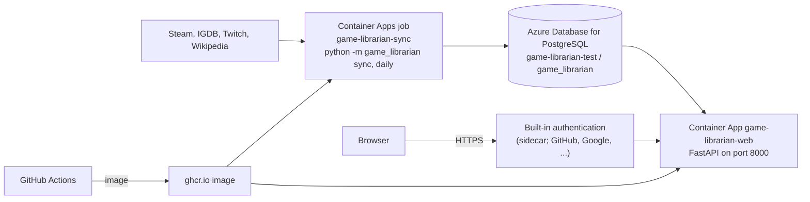

# Deploying Game Librarian to Azure

**Status: prepared, not deployed.** The code, the container image definition and the GitHub workflow are ready and
tested locally (see the README's verification log for 0.20). Nothing in Azure was created, changed or deployed by
this work. Every Azure step below is for you to do in the Azure portal, in this order. Values in angle brackets, such
as `<app-fqdn>`, are placeholders. Never paste a password into a file, a chat or a command line that is saved.

1. [Architecture](#1-architecture)
2. [Settings](#2-settings)
3. [Prepare PostgreSQL and copy the catalog](#3-prepare-postgresql-and-copy-the-catalog)
4. [Let Azure reach PostgreSQL](#4-let-azure-reach-postgresql)
5. [Build and publish the image](#5-build-and-publish-the-image)
6. [Run the website in the existing container app](#6-run-the-website-in-the-existing-container-app)
7. [Turn on sign-in](#7-turn-on-sign-in)
8. [Create the daily sync job](#8-create-the-daily-sync-job)
9. [Verify](#9-verify)
10. [Backups, costs and limits](#10-backups-costs-and-limits)
11. [What is left for you](#11-what-is-left-for-you)

## 1. Architecture



| Part | What it is | Notes |
| --- | --- | --- |
| Website | The existing container app `game-librarian-web`, environment `managed-canadacentral-e7t4cu8`, Consumption profile, 0 to 1 replicas | The image's default command: `serve --host 0.0.0.0 --port 8000`. Container (target) port **8000**. |
| Database | The existing flexible server `game-librarian-test`, database `game_librarian` | The catalog, its history, accounts and wishlists. TLS with full certificate and host-name checks. |
| Daily sync | A new Container Apps job in the same environment, schedule trigger | The same image, arguments `sync`. |
| Sign-in | Container Apps built-in authentication on the website | No password is stored by the app. |
| Image | GitHub Container Registry, `ghcr.io/scottphung/game-librarian` | Built and published by `.github/workflows/container.yml`. |

Not used, because nothing needs them: Azure Container Registry (GHCR stores the image), Key Vault (Container Apps
secrets hold the few secrets), Blob Storage (history stays in PostgreSQL tables), Data Factory, Data Lake, Snowflake,
a VM or Caddy (Container Apps gives HTTPS and scaling). You can add Key Vault references later if you want rotation
and auditing of secrets in one place.

The container keeps no data of its own: a restart or a new revision loses nothing. `curated/` (awards, labels,
reviewed decisions, stories, trivia) is part of the image; change it in Git and publish a new image.

## 2. Settings

| Variable | Website | Job | Secret? | Purpose |
| --- | --- | --- | --- | --- |
| `GAME_LIBRARIAN_DATABASE_URL` | yes | yes | no | Which database: `postgresql://gl_app@game-librarian-test.postgres.database.azure.com:5432/game_librarian`. No password in it. `sslmode=verify-full` is the default and nothing weaker is accepted for a remote server. |
| `PGPASSWORD` | yes | yes | **yes** | The password of the role in the URL (`gl_app`). |
| `GAME_LIBRARIAN_HOSTED` | set by the image | set by the image | no | `1`: a hosted process. It requires the PostgreSQL database, never treats a request as coming from "this computer" (no Gamalytic or TwitchTracker figures), and makes `sync` fail when a source lacks its credentials. |
| `GAME_LIBRARIAN_SIGN_IN_PROVIDERS` | yes, after step 7 | no | no | The providers configured in built-in authentication, such as `github` or `github,google`. Empty: no accounts; the wishlist stays in each browser. |
| `GAME_LIBRARIAN_ALLOWED_USERS` | optional | no | no | Who may keep an account: names as the provider gives them (`octocat`, `someone@example.com`) or `provider:name`. Empty: everyone who signs in. |
| `STEAM_API_KEY` | no | yes | **yes** | Steam catalog discovery. |
| `IGDB_CLIENT_ID`, `IGDB_CLIENT_SECRET` | yes ("Watch it live") | yes (Trending lists) | **yes** (the secret; the id may be plain) | A Twitch application's credentials. |
| `GAME_LIBRARIAN_CONTACT` | no | yes | store as a secret (it is your contact) | Sent only in the User-Agent to Wikipedia and Wikidata. |
| `GAME_LIBRARIAN_STEAM_COUNTRY`, `GAME_LIBRARIAN_REVIEW_LANGUAGE` | optional | optional | no | As in the README. |

In the hosted job, a missing `STEAM_API_KEY`, IGDB pair or `GAME_LIBRARIAN_CONTACT` stops `sync` before it starts
(exit 1) and names the variable, unless the job's arguments skip that source (`--skip-discovery`, `--skip-upcoming`,
`--skip-critics`). Gamalytic and TwitchTracker are never asked by a hosted process: their figures may not be shared.

## 3. Prepare PostgreSQL and copy the catalog

Do this once, from your computer (its IP address already has a firewall rule). It uses the server administrator
(`gladmin`) only for setup; the website and the job use a role that cannot change tables.

**3.1 The database and the runtime role.** Open the psql that came with PostgreSQL 18 in PowerShell:

```powershell
& "C:\Program Files\PostgreSQL\18\bin\psql.exe" "host=game-librarian-test.postgres.database.azure.com port=5432 dbname=postgres user=gladmin sslmode=verify-full sslrootcert=system"
```

psql asks for the password without showing it. `sslrootcert=system` uses the trusted roots of psql's own TLS library;
if psql reports that it cannot find them, download the two roots Microsoft lists for the server (DigiCert Global Root
G2 and Microsoft RSA Root Certificate Authority 2017), combine them into one `.pem` file and give its path instead.
Then run:

```sql
CREATE DATABASE game_librarian;
\c game_librarian
CREATE ROLE gl_app LOGIN;
\password gl_app
REVOKE ALL ON DATABASE game_librarian FROM PUBLIC;
GRANT CONNECT ON DATABASE game_librarian TO gl_app;
\q
```

`\password` asks for the new password twice and never shows it. Choose a long random one and keep it in your
password manager: you will paste it only into the Azure portal's secret fields.

**3.2 The tables.** In PowerShell, in the project folder, for this window only:

```powershell
$env:GAME_LIBRARIAN_DATABASE_URL = "postgresql://gladmin@game-librarian-test.postgres.database.azure.com:5432/game_librarian"
$secure = Read-Host "gladmin password" -AsSecureString
$env:PGPASSWORD = [System.Net.NetworkCredential]::new("", $secure).Password
.\.venv\Scripts\python.exe -m pip install -r requirements.txt
.\.venv\Scripts\python.exe -m game_librarian init-postgres --grant-to gl_app
```

(If you saved the password with `Export-Clixml`, use `[System.Net.NetworkCredential]::new("", (Import-Clixml <file>)).Password`
instead of `Read-Host`.) `init-postgres` creates the 24 tables (rows are kept if they exist), and lets `gl_app` read,
add, change and delete rows and use the id sequences, but not create, alter, truncate or drop tables. Run it again,
with the same `--grant-to`, after any upgrade of Game Librarian that adds tables or columns: the website then says so
if they are missing.

**3.3 The copy.** In the same window:

```powershell
.\.venv\Scripts\python.exe -m game_librarian migrate-to-postgres --check
.\.venv\Scripts\python.exe -m game_librarian migrate-to-postgres
Remove-Item Env:PGPASSWORD, Env:GAME_LIBRARIAN_DATABASE_URL
```

What it does (`game_librarian/migrate.py`):

* It opens `data/game_librarian.sqlite3` **read-only**, in one read transaction, so a sync running at the same time
  cannot change the copy halfway, and the file is never changed or deleted.
* It checks the file first: SQLite's integrity check, foreign keys, every table and column of this version, and that
  every value has its column's type. Any problem stops it before anything is written.
* It copies 20 catalog tables, ids included: games, tags, review excerpts, prices, player and review snapshots, the
  discovery index and bookmark, sync and source runs, candidates, IGDB records, release-date changes, PopScore
  snapshots, Steam–IGDB links, the Twitch caches, Wikipedia articles and scores. Id sequences continue after the
  highest copied id.
* It does **not** copy `sales_estimates` (Gamalytic) or `twitchtracker_summaries` (TwitchTracker): local evaluations
  that stay in your SQLite file. It never reads, empties or replaces `accounts` or `wishlist_items`.
* It compares every table with the SQLite file (row count and a checksum of every value), deletes Twitch rows older
  than 24 hours (Twitch's caching limit), and commits only if everything matched. A failure leaves the database as it
  was.
* A second run is refused while the catalog tables hold rows. `--replace` empties the catalog tables first and copies
  again: **this is destructive**: it discards everything the hosted sync collected since the last copy (snapshots,
  runs, prices). Accounts and wishlists are kept. Use it only before the hosted sync has run, or knowingly.

Validate it yourself, as `gl_app`, from your computer:

```powershell
$env:GAME_LIBRARIAN_DATABASE_URL = "postgresql://gl_app@game-librarian-test.postgres.database.azure.com:5432/game_librarian"
$secure = Read-Host "gl_app password" -AsSecureString
$env:PGPASSWORD = [System.Net.NetworkCredential]::new("", $secure).Password
.\.venv\Scripts\python.exe -m game_librarian status
Remove-Item Env:PGPASSWORD, Env:GAME_LIBRARIAN_DATABASE_URL
```

`status` should show the same games, snapshots and runs as `status` without the two variables (your SQLite file),
except the two local-evaluation lines. In psql you can also count rows (`SELECT COUNT(*) FROM games;`) or check a
relationship (`SELECT COUNT(*) FROM game_tags t LEFT JOIN games g ON g.appid = t.appid WHERE g.appid IS NULL;` must
be 0; the foreign keys make it so).

After the copy, the hosted database is the catalog of the hosted site; your SQLite file goes on as your local copy.
Do not run `sync` against both and expect them to match.

## 4. Let Azure reach PostgreSQL

The server allows only your computer today. The website and the job need access too. Options:

| Option | Portal steps | Trade-off |
| --- | --- | --- |
| **A. Allow Azure services** (simplest) | Server **Networking** > tick "Allow public access from any Azure service within Azure to this server" > **Save** | Microsoft: it "configures the firewall to allow all connections from Azure, including connections from the subscriptions of other customers". Then the strong `gl_app` password, TLS and the role's limited rights are the protection. |
| B. Firewall rules for the environment's outbound IPs | Note the outbound IP addresses of the Container Apps environment, add one firewall rule per address | Microsoft: "Outbound IPs might change over time". The site and the job then fail until you update the rules. |
| C. Private network | A VNet-integrated environment with a private endpoint or VNet access to the server, optionally a NAT gateway | Strongest, but the existing environment's network type cannot be changed after creation, and NAT gateways and private endpoints cost extra. |

Recommendation for a small private circle: A, with the restricted role, or B if you accept updating rules. Keep the
rule for your own IP for setup and `status`. Firewall changes "can take up to five minutes to take effect".

## 5. Build and publish the image

Commit and push this version to `main` on GitHub (you decide when; nothing was committed or pushed for you). The
workflow `Test and publish the container image` then:

1. runs the tests on SQLite and on a throwaway PostgreSQL 17 service;
2. builds the `Dockerfile` (Python 3.12, an unprivileged user, port 8000) and pushes
   `ghcr.io/scottphung/game-librarian:sha-<commit>` and `:latest`, with the repository's own `GITHUB_TOKEN`.

The image contains only `requirements.txt`, `game_librarian/` and `curated/` (`.dockerignore` is an allow list): no
`.env`, no `data/`, no SQLite file with Gamalytic's or TwitchTracker's figures, no saved password file.

**Public or private image.** In GitHub, open your profile > **Packages** > `game-librarian` > **Package settings**.

* **Public** (simplest): Azure pulls without credentials. Anyone can download the image, which holds the same code and
  curated files as the repository. GitHub says container storage and bandwidth are "currently free" and public
  packages are free.
* **Private**: create a GitHub personal access token with only `read:packages`, and give it to Azure as the registry
  password (step 6). Private packages count against your plan's package storage and transfer allowance; the token
  expires and must be renewed in Azure before it does.

No Azure Container Registry is needed. Deploy the `sha-` tag, not `latest`, so you know which version runs and can go
back by choosing an older tag.

## 6. Run the website in the existing container app

Portal > Container Apps > **game-librarian-web**:

1. **Settings > Secrets** > **Add**: `pg-app-password` (the `gl_app` password), `igdb-client-secret`, and
   `igdb-client-id` if you prefer it secret. Values are typed into the portal only.
2. **Application > Containers** (or **Revisions and replicas** > **Create new revision**) > select the container >
   **Edit**:
   * Image source: **Docker Hub or other registries**; image type **Public** (or **Private** with login server
     `ghcr.io`, user name your GitHub user name, password the `read:packages` token);
   * Registry login server `ghcr.io`; image and tag `scottphung/game-librarian:sha-<commit>`;
   * Command override and arguments override: **empty** (the image starts the website);
   * CPU and memory: 0.5 vCPU and 1 Gi (0.25 / 0.5 Gi may be enough; watch the metrics);
   * Environment variables: `GAME_LIBRARIAN_DATABASE_URL` (manual entry, the `gl_app` URL of step 3),
     `PGPASSWORD` (reference the secret `pg-app-password`), `IGDB_CLIENT_ID`, `IGDB_CLIENT_SECRET` (reference the
     secret). Add `GAME_LIBRARIAN_SIGN_IN_PROVIDERS` only in step 7.
   * Health probes: Liveness and Startup: HTTP GET `/healthz`, port 8000; Readiness: HTTP GET `/readyz`, port 8000.
     `/healthz` never touches the database, so a database outage does not restart the container; `/readyz` answers
     503 while the database cannot be reached.
3. **Settings > Ingress**: enabled; accepting traffic from anywhere; ingress type HTTP; **target port 8000**;
   "Insecure connections" **not** allowed (HTTP is redirected to HTTPS).
4. **Scale**: keep 0 to 1. The first request after an idle period waits for the container to start (several
   seconds); 1 to 1 avoids that but bills the replica all the time.
5. **Save / Create**, then **Revisions and replicas**: the new revision must reach "Running" with 100% traffic.
   **Monitoring > Log stream** shows the server's log; a database problem appears there, without passwords.

The Hello World image is gone from the new revision; the old revision can be reactivated if you need to go back.

## 7. Turn on sign-in

Built-in authentication works with several providers; the app code is the same for all of them.

| Provider | Setup | Who can sign in | Cost |
| --- | --- | --- | --- |
| **GitHub** | A free OAuth app in GitHub settings | Anyone with a GitHub account, so set `GAME_LIBRARIAN_ALLOWED_USERS` | Free |
| Google | A Google Cloud project with an OAuth consent screen | In "testing" mode, only the test users you list (up to 100) | Free |
| Microsoft | An app registration in a Microsoft Entra tenant | Depends on the tenant; a school tenant may not let you register apps or admit outside people | Free for this use |

The Container Apps pages do not state a price for built-in authentication; check your bill rather than assuming.

**Order matters.** Turn authentication on before setting `GAME_LIBRARIAN_SIGN_IN_PROVIDERS`. With the platform in
front of the app, "External requests aren't allowed to set these headers" (Microsoft). Without it, anyone could send
them; the app then refuses to trust them as soon as a `/.auth/` request reaches it, but do not rely on that.

GitHub example:

1. GitHub > Settings > Developer settings > OAuth Apps > **New OAuth App**: homepage URL `https://<app-fqdn>`,
   authorization callback URL `https://<app-fqdn>/.auth/login/github/callback`. Generate a client secret.
2. Portal > game-librarian-web > **Authentication** > **Add identity provider** > **GitHub**: paste the client id
   and secret (stored as a container app secret). In **Restrict access**, choose **Allow unauthenticated access**:
   the site is public; only the wishlist uses the account. Leave the token store off; the app does not use tokens.
3. Add the environment variables `GAME_LIBRARIAN_SIGN_IN_PROVIDERS=github` and, for a small circle,
   `GAME_LIBRARIAN_ALLOWED_USERS=<your GitHub user name>,<a friend's>`; save a new revision.

How it behaves: the header's person icon opens `/account` (Sign in with GitHub, or the signed-in name, Sign out and
Delete my account data). Signing in and out are the platform's `/.auth/login/github` and `/.auth/logout`. A signed-in
visitor's wishlist is kept in PostgreSQL, read and changed only through `/api/wishlist` for their own account (the
provider's id for them, never a name). Changes must be JSON requests from the site's own pages (protection against
cross-site requests); pages for a signed-in visitor are sent with `Cache-Control: no-store`. A wishlist saved in a
browser stays there: when the visitor signs in, the wishlist page offers to add its missing games to the account,
and only after that offers to remove the browser's copy. Signed-out visitors keep using the browser wishlist.

## 8. Create the daily sync job

Portal > **Container App Jobs** > **Create**:

1. Basics: name `game-librarian-sync`; resource group `reagan-test`; region Canada Central; Container Apps
   environment `managed-canadacentral-e7t4cu8`; trigger type **Schedule**; cron expression, in **UTC**, for example
   `0 9 * * *` (09:00 UTC, 03:00 in Central Standard Time).
2. Settings: replica timeout `7200` seconds (local runs took 2 to 18 minutes; a first hosted run with many due games
   takes longer); replica retry limit `1`; parallelism `1`; replica completion count `1`.
3. Container: the same image and tag as the website; **Arguments override: `sync`** (that one word; the image's
   entry point is `python -m game_librarian`); command override empty; 0.5 vCPU, 1 Gi.
4. Secrets: `pg-app-password`, `steam-api-key`, `igdb-client-secret`, `contact` (and `igdb-client-id` if secret).
   Environment variables: `GAME_LIBRARIAN_DATABASE_URL`, `PGPASSWORD` (secret), `STEAM_API_KEY` (secret),
   `IGDB_CLIENT_ID`, `IGDB_CLIENT_SECRET` (secret), `GAME_LIBRARIAN_CONTACT` (secret).
5. **Create**, then **Run now** once and watch **Monitoring > Execution history** and its logs.

What a run does: the Steam sync (discovery since the last bookmark, details due after 7 days, reviews and review
snapshots after 24 hours, prices and player-count snapshots), then the IGDB and Twitch Trending lists when 20 hours
have passed, then Wikipedia critic scores due after 30 days per game. History (player, review and PopScore
snapshots, release-date changes, runs) is added, never overwritten. Gamalytic and TwitchTracker are skipped and say
why.

How it ends: exit code 0 success; 1 failed (including missing settings and database errors); 2 partial (some
upstream requests failed; the data saved is kept and the next run retries what is due); 3 another refresh holds the
database's lock (a PostgreSQL advisory lock, released automatically if a run crashes). Any non-zero code shows as a
failed execution, so a partial or skipped run is never reported as a success. A retry is safe: each step asks only
for what is due, and the discovery bookmark moves only after a complete discovery. Logs never contain keys or
passwords.

Twitch's list may be missing from the site for a short time each day: Twitch allows keeping it 24 hours, and a daily
run renews it about 24 hours after the last one.

## 9. Verify

* **Public app:** `https://<app-fqdn>/healthz` and `/readyz` answer `{"status":"ok"}`; `/`, `/trending`,
  `/dashboard`, `/stories` and a game's details open. Trending shows "Most watched on Twitch" (Twitch's order), never
  TwitchTracker's view, and the dashboard has no "Estimated Steam copies sold" chart.
* **Database connectivity:** `/readyz` is ok; the revision's log shows no database errors; `status` from your
  computer as `gl_app` (step 3) works.
* **Sync results:** the job's execution "Succeeded"; its log ends with `Steam sync finished: success` and the
  sources' lines; `status` shows the new run and snapshot dates; the site's footer data dates move forward.
* **Wishlist isolation:** sign in with account A and save two games; open a private window, sign in with account B:
  B's wishlist is empty, and B's changes never appear for A. A forged header must not work:
  `curl.exe -H "X-MS-CLIENT-PRINCIPAL-ID: 1" -H "X-MS-CLIENT-PRINCIPAL-IDP: github" https://<app-fqdn>/api/wishlist`
  must answer 401 (the platform removed the headers), never someone's list.

## 10. Backups, costs and limits

* **Backups:** the flexible server's automatic backups (default retention 7 days, up to 35). A point-in-time restore
  "always creates a new database server"; its firewall rules "aren't copied", so add them again and change the host
  in `GAME_LIBRARIAN_DATABASE_URL` for the website and the job. Backup storage up to the size of the provisioned
  storage is included. No SQLite backup or failover is part of this setup; your local SQLite file is simply your own
  copy.
* **Costs** (check the current prices and your Azure for Students credit; set a budget alert, which warns but does
  not stop charges): the PostgreSQL server bills compute and storage all month, whatever the traffic, and is likely
  the largest item. Container Apps Consumption bills vCPU and memory seconds beyond the subscription's monthly free
  grant; scale to zero keeps the website's idle cost low and a daily job runs minutes a day. Log Analytics, if the
  environment sends logs there, bills ingested data. GHCR as described in step 5. Steam, IGDB, Twitch and Wikipedia
  calls are free within their limits.
* **Limits:** one replica; a cold start after idle; Container Apps ends a request after 240 seconds; the job's
  replica timeout; at most 4 database connections from the website (a Burstable server allows about 50); Twitch data
  kept 24 hours; Steam's terms on public display are not confirmed (README, "Data sources and terms").

## 11. What is left for you

1. Decide the open questions: who should see the site (Steam's terms speak of distribution "to end users for their
   personal use"; public display of store descriptions and review excerpts is not confirmed), which sign-in provider,
   and a public or private image.
2. Commit and push (nothing was committed for you), and check the workflow's first run: the container build itself
   could not be tested on this computer, which has no Docker.
3. Steps 3 to 8 in the portal, then step 9.
