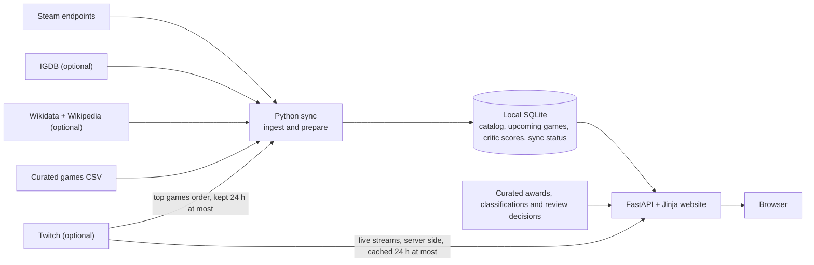
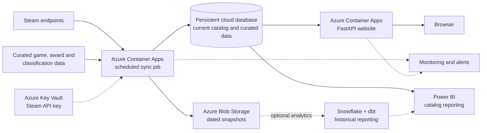

# Game Librarian

Game Librarian is a personal game-discovery website for people who like to follow noteworthy games (AAA, AA, indie
and everything in between) even when they are not ready to buy or play them yet: they may be waiting for a discount,
more free time or a computer upgrade. It helps you:

- see what people are excited about on **Trending** across **every platform**: games that are not
  out yet (**Upcoming & Anticipated**), games that just came out or are watched right now (**Trending now &
  recently released**, including console-only games without a Steam page, such as *Grand Theft Auto VI*), and,
  labeled as Steam only, the **Steam activity** of the catalog games. Each list follows one clearly named signal,
  never one combined score, and every game shows the platforms it is available on or announced for;
- browse a curated catalog of Steam games (**Discover**) and filter it by publisher, genre and tags, game modes,
  awards and Steam's review summary, sorted by recent release, player reception, popularity or the award-based
  five-year rank;
- understand player reception (Steam review counts and excerpts), critics' scores from Wikipedia's review tables, and
  verified awards;
- open a game's details (description, a short trailer clip or a still image, the current Steam price, reviews,
  **What the critics said**, **Watch it live** with current Twitch streams, awards, "More games like this"), save
  it to the Game Librarian wishlist, and visit Steam or the official website when you are ready;
- read sourced **Data Stories** about game series, Grand Theft Auto and Final Fantasy, as compact year-by-year
  timelines with each game's cover art;
- come back every day for **Daily Trivia** (the lightbulb in the header): a five-question quiz about a gaming story,
  the same for everyone that day, with sources, cover art and links to the games' details, plus earlier facts to
  browse (see [Daily Trivia](#daily-trivia)).

The **Dashboard** opens on **Trending games**: three short report pages about the Trending page's games, behind
one tab bar. **Sales & reception** compares this year's and the five-year window's strong-reception games as
scatterplots of Steam reviews against positive share; **Upcoming releases** places the tracked upcoming games on an
**Upcoming Release Radar** with a selected-game panel, and says which wishlisted games are also being watched on
Twitch; **Momentum** shows which games account for the change in Steam review count, with a game's Steam player
snapshots beside it. Each chart keeps its own source and update time. Its other pages (Player reception, Awards, About
the data) show the catalog's reception and awards; an optional Power BI project in `reporting/` shows those three
pages in Power BI Desktop (Trending games is on the website only). Prices are supporting information: there is no
price filter, and Steam is always the place to confirm the final price. Sales &
reception first charts **Estimated Steam copies sold** from Gamalytic's free API (model estimates, not reported sales; see [Estimated Steam copies sold](#estimated-steam-copies-sold), and
[Gamalytic](#gamalytic-checked-2026-11-20) for its terms).
Once TwitchTracker has given figures, Trending's Most watched list becomes **Most watched among tracked Twitch categories**: the
tracked game and series categories in **TwitchTracker's** rank order, with its average viewers, instead of Twitch's
moment-in-time order, because TwitchTracker publishes no terms that allow sharing its figures (see
[Most watched on Twitch](#most-watched-on-twitch-twitchs-order-and-twitchtracker)).

- **Backend:** FastAPI, with server-rendered Jinja templates and three small scripts (`static/app.js`,
  `static/wishlist.js`, `static/trivia.js`) that progressively enhance filters, the details dialog, the trailer clip,
  the dashboard's report pages (the radar's selected game and windows, chart tooltips, arrow keys between a
  scatterplot's dots, the waterfall's player line), the wishlist and Daily Trivia.
  Every page also works without them; the wishlist and Daily Trivia need JavaScript.
- **Storage:** one SQLite file on your computer, written by separate commands (`sync`, `candidates`); or, for the
  hosted site, Azure Database for PostgreSQL, with the same tables (see
  [Hosted architecture (Azure)](#hosted-architecture-azure) and [DEPLOYMENT.md](DEPLOYMENT.md)).
- **Accounts (hosted site):** optional, through **Continue with Google** only (Supabase Auth, which only the site's
  server calls; no password and no email code). A signed-in visitor's wishlist is kept privately in their account in
  PostgreSQL. Without an account, every page works and the wishlist stays in the browser.
- **Catalog:** hand-picked games (`curated/games.csv`) plus games promoted through a reviewed candidate workflow
  (`curated/promoted_games.csv`). Every catalog game is a verified Steam app.
- **Not included (by design):** RAG, LLMs, prediction models, machine-learned recommendations, wiki links or lore,
  download mirrors or repack sites, screenshot galleries, Steam account sign-in, age categories, price filters or
  price history, revenue figures, sales figures other than Gamalytic's estimates,
  Steam's Top Sellers chart, PriceCharting or any other resale-price data, an embedded Twitch player, and any history
  of Twitch viewers.

## Contents

1. [Setup](#setup)
2. [Credentials](#credentials)
3. [Commands](#commands)
4. [Growing the catalog](#growing-the-catalog)
5. [IGDB (optional)](#igdb-optional)
6. [Using the website](#using-the-website)
7. [Collections and sort orders](#collections-and-sort-orders)
8. [Ranking](#ranking)
9. [Prices, player counts and snapshots](#prices-player-counts-and-snapshots)
10. [Trending](#trending) (Trending now & recently released, Most watched on Twitch and TwitchTracker, Steam activity,
    refreshing it)
11. [Upcoming & Anticipated](#upcoming--anticipated)
12. [Platforms and release dates](#platforms-and-release-dates)
13. [Game identity and the wishlist](#game-identity-and-the-wishlist)
14. [Watch it live](#watch-it-live)
15. [What the critics said](#what-the-critics-said)
16. [Scores, counts, rankings and sales](#scores-counts-rankings-and-sales)
17. [Data Stories](#data-stories)
18. [Daily Trivia](#daily-trivia) (the daily quiz, scores in the browser, adding questions)
19. [Dashboard](#dashboard)
20. [Data sources and terms](#data-sources-and-terms)
21. [How the sync works](#how-the-sync-works)
22. [Curated awards and classifications](#curated-awards-and-classifications)
23. [Current architecture](#current-architecture)
24. [Hosted architecture (Azure)](#hosted-architecture-azure)
25. [Limitations](#limitations)
26. [Verification status](#verification-status)
27. [Future work](#future-work)

## Setup

You need Python 3.11 or later. The project was tested with Python 3.12.4 on Windows 11, and version 0.4 with the
project's `.venv` (Python 3.11.9). Node.js is optional: it runs the wishlist's JavaScript tests.

```powershell
cd project
python -m venv .venv
.\.venv\Scripts\python.exe -m pip install -r requirements.txt

.\.venv\Scripts\python.exe -m game_librarian sync     # first run: about 20 minutes for the 238 catalog games
.\.venv\Scripts\python.exe -m game_librarian serve    # then open http://127.0.0.1:8000
```

On macOS or Linux, use `.venv/bin/python` instead of `.\.venv\Scripts\python.exe`.

The web app starts even when the catalog is empty, and it tells you to run `sync`. The app never calls Steam while it
serves pages. It shows the data saved by the last successful sync.

## Credentials

| Variable | Required? | Purpose |
| --- | --- | --- |
| `STEAM_API_KEY` | No | Turns on catalog discovery (`IStoreService/GetAppList`). Without it, the sync still enriches the curated games and refreshes them by age. |
| `GAME_LIBRARIAN_DB` | No | Path of the SQLite catalog. Default: `data/game_librarian.sqlite3`. |
| `GAME_LIBRARIAN_CURATED_DIR` | No | Folder with the curated CSV files. Default: `curated/`. |
| `GAME_LIBRARIAN_REVIEW_LANGUAGE` | No | Steam language code for review excerpts. Default: `english`. |
| `GAME_LIBRARIAN_STEAM_COUNTRY` | No | Two-letter Steam store region whose prices the sync reads, such as `US`, `GB` or `CA`. Default: `US`; a malformed value falls back to `US`. |
| `IGDB_CLIENT_ID` | No | Client ID of your Twitch application. It turns on the cross-platform Trending lists (Upcoming & Anticipated, Trending now & recently released, including the Twitch categories that TwitchTracker is asked about), "Watch it live" and the optional IGDB candidate source. TwitchTracker itself needs no key. See [IGDB (optional)](#igdb-optional). |
| `IGDB_CLIENT_SECRET` | No | Client secret of the same Twitch application. Both IGDB variables must be set to use IGDB and Twitch; the Steam catalog, the Steam sync and every other page work without them. |
| `GAME_LIBRARIAN_DATABASE_URL` | No | The hosted site's PostgreSQL database, such as `postgresql://gl_app@<server>.postgres.database.azure.com/game_librarian`, without the password. When set, every command and the website use it instead of the SQLite file; TLS with full certificate and host-name checks (`sslmode=verify-full`) is required for any server but this computer. See [DEPLOYMENT.md](DEPLOYMENT.md). |
| `PGPASSWORD` | With the database URL | The password of the role in `GAME_LIBRARIAN_DATABASE_URL` (libpq's own variable). Set it only for the session or as a Container Apps secret, never in a file that is committed. |
| `GAME_LIBRARIAN_HOSTED` | No | `1` in the container image: a hosted process. It requires the PostgreSQL database, sets its cookies for HTTPS only (`Secure`, `__Host-`), and makes `sync` fail when a source it should refresh lacks its credentials. |
| `GAME_LIBRARIAN_SUPABASE_URL` | No | The Supabase project URL (`https://<project-ref>.supabase.co`) whose Auth keeps the accounts (Continue with Google). With the publishable key below: accounts are offered, and the Continue with Google button works while the project's Google provider is on (it is shown disabled, with the reason, otherwise); without: no accounts. |
| `GAME_LIBRARIAN_SUPABASE_PUBLISHABLE_KEY` | With the URL | The project's publishable key (`sb_publishable_...`), used only by the server. Never the secret or service-role key. |
| `GAME_LIBRARIAN_ALLOWED_USERS` | No | The email addresses that may keep an account (comma-separated, without case); empty: everyone who signs in. 0.20's GitHub user names are refused. |
| `GAME_LIBRARIAN_CONTACT` | No | An email address or website **you choose**, sent only in the User-Agent of requests to Wikipedia and Wikidata, whose policy asks automated clients for contact information. Without it, critic scores are not read. See [What the critics said](#what-the-critics-said). |

Settings are loaded automatically from the project-root `.env` file if it exists. Environment variables already set
in your shell take precedence, including empty values. For example, add this line to `.env`:

```dotenv
STEAM_API_KEY=your_key_here
```

To get a Steam Web API key:

1. Go to <https://steamcommunity.com/dev/apikey>.
2. Sign in, agree to the Steam Web API Terms of Use, and enter a domain name for the app.

The key is free, but Steam may refuse to issue one to a limited account (see Steam Support's page on limited user
accounts). Keep the key private:

- Set it as an environment variable, for example `$env:STEAM_API_KEY = "..."` in PowerShell.
- Never commit it. `.env` is git-ignored.
- The app sends the key only to `GetAppList`, the one endpoint that requires it. Candidate screening never sends it.
- Settings are printed without secrets: `Settings` hides the Steam key, both IGDB values and the contact from
  `repr()`. The Twitch token lives only in the memory of the process that asked for it; it is never stored, logged
  or sent to a browser, and no page or script contains a credential.

## Commands

All commands run from the project folder with the virtual environment's Python.

| Command | What it does |
| --- | --- |
| `python -m game_librarian sync` | Discovers changes (when a key is set); refreshes stale details, tags, covers and reviews (each review refresh also saves a dated review snapshot); reads the current Steam price of every catalog game for the store region; and saves a dated player-count snapshot of every catalog game. Then, when they are configured and due, it runs `upcoming`, `most-watched`, `critics` and `sales-estimates`. |
| `python -m game_librarian sync --force` | Refreshes every curated game, even recent ones. |
| `python -m game_librarian sync --limit 5` | Syncs only the first 5 curated games. Use it for a quick test. |
| `python -m game_librarian sync --appid 1086940` | Syncs one curated game. You can repeat `--appid`. |
| `python -m game_librarian sync --skip-reviews` / `--skip-discovery` / `--skip-prices` / `--skip-players` / `--skip-upcoming` / `--skip-most-watched` / `--skip-critics` / `--skip-sales` | Leaves out one part of the sync. |
| `python -m game_librarian upcoming [--force]` | Refreshes the cross-platform Trending lists (needs the IGDB variables): IGDB PopScore for Upcoming & Anticipated and Most wanted new releases, Twitch's top games for Most watched on Twitch (with IGDB's own record of each category), the IGDB records (platforms and release dates) of every listed and catalog game, and the catalog's IGDB links. Prints the four lists. Without `--force` it does nothing if the last refresh is less than 20 hours old. `sync` runs it too. |
| `python -m game_librarian most-watched [--force]` | Asks TwitchTracker's free API (no key) for the rank and average viewers of the tracked categories: the game and series categories in Twitch's newest top list (from `upcoming`; without a list from the last 24 hours, those chosen from the last one) and every game or series category reviewed in `curated/twitch_categories.csv`, each category at most once in 20 hours, one request every 1.5 seconds. `--force` asks about every tracked category now. Prints the list as the Trending page shows it (places 1 to 10, each with TwitchTracker's category rank) and what it leaves out. `sync` runs it after `upcoming` when the IGDB variables are set. The figures are shown only on the computer that runs the site; see [Most watched on Twitch](#most-watched-on-twitch-twitchs-order-and-twitchtracker). |
| `python -m game_librarian critics [--appid N] [--limit N] [--force]` | Reads critic scores from English Wikipedia for the games that are due (each game once in 30 days; needs `GAME_LIBRARIAN_CONTACT`). `sync` runs it too. |
| `python -m game_librarian critics --review` | Lists the article matches and scores that wait for a person, with the reason (no network). |
| `python -m game_librarian sales-estimates [--force]` | Asks Gamalytic's free API (no key) for the estimated Steam copies sold of every catalog game that is due: each game once in 7 days, 100 games per request (3 requests for 238 games). `--force` asks about every game now. `sync` runs it too. The estimates are shown only on the computer that runs the site; see [Estimated Steam copies sold](#estimated-steam-copies-sold). |
| `python -m game_librarian serve [--port 8000] [--reload]` | Runs the web app at <http://127.0.0.1:8000>. |
| `python -m game_librarian status` | Shows catalog counts, the stored prices and snapshot history, the cross-platform Trending lists, critic scores, the sales estimates, the Twitch caches (live streams, most-watched list), TwitchTracker's figures and the most recent sync runs with their outcomes. |
| `python -m game_librarian check-curated` | Validates the curated CSV files (including the reviewer decisions in `steam_matches.csv`, `critic_articles.csv` and `twitch_categories.csv`), the publisher aliases, the Data Story files and the Daily Trivia questions (`trivia.json`), and lists problems with their file and line. |
| `python -m game_librarian init-postgres [--grant-to ROLE]` | Creates or upgrades the PostgreSQL tables (`GAME_LIBRARIAN_DATABASE_URL`, with a role that may create tables), keeping existing rows, and lets each `--grant-to` role read and write rows but never change tables. |
| `python -m game_librarian migrate-to-postgres [--check] [--replace] [--only TABLE] [--from FILE]` | Copies the SQLite catalog into PostgreSQL after checking it, in one transaction, and compares every table's rows and checksum. The SQLite file is only read; accounts are never touched. `--replace` empties the hosted catalog tables first (destructive). `--only sales_estimates --only twitchtracker_summaries` adds just those tables' missing rows to a database 0.20 copied, keeping every row it has. See [DEPLOYMENT.md](DEPLOYMENT.md). |
| `python -m game_librarian accounts {list,copy-wishlist,delete}` | The hosted site's accounts: list them (sign-in, name, saved games); `copy-wishlist --from ID --to ID` adds one account's games to another (for an old GitHub account whose owner you know; nothing is matched by email); `delete --id ID --yes`. |
| `python -m game_librarian export-report [--out DIR]` | Writes the Power BI report's CSV tables (default `reporting/data/`) from the catalog and curated files, and points the report at that folder. Run it after `sync`. |
| `python -m game_librarian candidates add --source discovery\|awards\|igdb [--limit N]` | Collects candidate games (see [Growing the catalog](#growing-the-catalog)). Never changes the catalog. |
| `python -m game_librarian candidates screen [--limit N] [--min-reviews 50] [--min-positive 70] [--recheck-days D]` | Checks due candidates against Steam, 50 apps per request, and applies the inclusion rules. |
| `python -m game_librarian candidates list [--status S] [--source X]` / `show --appid N` | Shows candidates, their status and the reason for it. |
| `python -m game_librarian candidates promote --appid N [--appid M]` / `--all-eligible [--limit 20]` | Appends reviewed candidates to `curated/promoted_games.csv`. The next `sync` enriches them. |
| `python -m game_librarian candidates reject --appid N --reason "..."` / `match --id N --appid M` | Records a "no", or confirms the Steam app of a title-only candidate. |
| `python -m pytest` | Runs the test suite (Python, plus the wishlist's JavaScript tests when Node.js is installed). It needs no network access and no key. |

Exit codes for `sync`, `upcoming`, `most-watched`, `critics` and `sales-estimates` (for `sync`, the worst of its steps):

| Code | Meaning |
| --- | --- |
| 0 | success (or nothing was due) |
| 1 | failed: nothing was refreshed, the run stopped, or a needed setting is missing |
| 2 | partial: some requests failed; the last good data is kept |
| 130 | interrupted with Ctrl+C |

**Nothing refreshes automatically.** The website shows only what the last `sync` saved. To keep the data fresh, run
`sync` once a day with Windows Task Scheduler (set "Start in" to this folder) or with cron. A daily run takes about
15–20 minutes for 238 games (reviews: 3 requests per game; player counts: 1 request per game; prices: 1 request per
50 games, plus 1 for the store's currency). Details refresh after 7 days, reviews after 24 hours, prices and player
counts after 3 hours, so running `sync` again soon after skips them. Trends need snapshots saved on different days,
so a regular schedule is what makes the Trending changes appear. Run only one sync at a time. `sync` never screens or promotes candidates: growing the catalog is always a
separate, deliberate step.

The other sources refresh on their own cadence, also only when a command runs:

| Data | Refreshed by | How often | Requests |
| --- | --- | --- | --- |
| Cross-platform Trending lists, IGDB records of listed and catalog games, catalog IGDB links | `sync` or `upcoming` | At most once per 20 hours (IGDB recalculates PopScore about daily); `upcoming --force` refreshes now. Twitch's most-watched list is deleted 24 hours after Twitch answered | About 9 IGDB requests, 7 Steam requests and 2 Twitch requests (a token and Get Top Games) |
| Critic scores | `sync` or `critics` | Each game once in 30 days; a failed read is retried after a day | First run for 238 games: 3 Wikidata queries and 24 Wikipedia requests (about 1 minute); later runs read only the games that are due |
| Live streams | Opening a game's details | At most once per 5 minutes per game; after a failure, not before 2 minutes or Twitch's reset time | 2 Twitch requests per check; answers are deleted after 24 hours |
| Estimated Steam copies sold (Gamalytic) | `sync` or `sales-estimates` | Each game once in 7 days; `sales-estimates --force` asks now. Older collections are kept. At most 50 requests in any 24 hours (Gamalytic allows free users 250 a day); an HTTP 429 answer stops the run | 3 requests for 238 games (100 per request), at most one a second |
| Most watched by TwitchTracker | `sync` (after `upcoming`) or `most-watched` | Each tracked category once in 20 hours; `most-watched --force` asks now. Only the newest figures are kept. At most 200 requests in any 24 hours (TwitchTracker documents no limit); an HTTP 403 or 429 answer stops the run | One request per tracked category that is due: 79 on 2026-11-21 (about 2 minutes at one request every 1.5 seconds); after a new Twitch list, only the categories new to it (21 that day) |

## Growing the catalog

The discovery index holds about 200,000 Steam apps, but only catalog games are enriched and shown. Candidates
are how a game joins the catalog. Every step is bounded, saved as it goes, and safe to stop and rerun.

| Step | Command | What happens |
| --- | --- | --- |
| 1. Collect | `candidates add --source awards` | Every verified award row mapped to a Steam app that is not in the catalog yet. The curator's mapping is the match. |
| | `candidates add --source discovery --limit 500` | The next 500 discovery-index apps that are neither candidates nor catalog games, lowest app id first. The order says nothing about quality; it only makes runs resumable. Needs a populated index (`sync` with `STEAM_API_KEY`). |
| | `candidates add --source igdb --limit 100` | Optional: popular PC games from IGDB (see below). |
| 2. Screen | `candidates screen --limit 200` | One `IStoreBrowseService/GetItems` request per 50 candidates. Each batch is saved before the next request. |
| 3. Review | `candidates list --status eligible` / `--status needs_review`, `candidates show --appid N` | Each candidate shows its Steam facts, its sources and the reason for its status. |
| 4. Promote | `candidates promote --appid N ...` or `--all-eligible --limit 20` | Appends rows to `curated/promoted_games.csv` (`steam_appid`, `title`, `source`, `match_method`, `evidence`, `promoted_on`). |
| 5. Enrich | `sync`, or `sync --skip-discovery --appid N ...` for just the new games | Fetches details, tags, media and reviews, like for every other catalog game. |

**Inclusion rules** (`candidates.EligibilityRules`; `screen` takes `--min-reviews` and `--min-positive`):

- Steam returns store data for the app in the US store and shows it.
- Steam lists it as a game (store type 0). DLC, demos, software, videos, soundtracks and other products are
  ineligible.
- Steam sells it or offers it for free now. Delisted games (for example *MultiVersus*, the original *Death
  Stranding*) are ineligible.
- It is released: not "coming soon", and its release date is not after today.
- At least **50** Steam reviews and at least **70%** positive. These are modest on purpose, so lesser-known games
  qualify; raise or lower them per run.
- A game Steam marks with adult-only or frequent sexual content (content descriptors 3 and 4) passes the rules but
  waits as `needs_review`, so a person decides.
- An award or a production label is never required. Games without a verified label show no label.

**Statuses:** `pending` (not screened), `eligible`, `needs_review`, `ineligible` (the reason says which rule),
`error` (the request failed; retried by later runs, at most 3 times in a row), `promoted`, `rejected`.

**Matching.** A candidate is screened only when its Steam app id comes from a reliable identifier: the discovery
index itself, a curator's verified award mapping, or the Steam id IGDB records. A title alone is never enough: a
title-only candidate stays `needs_review` with the Steam apps to check (apps whose normalized title is identical),
until you confirm one with `candidates match --id N --appid M`. A game found by several sources is one candidate
that lists every source.

**Small pilot first.** For example:

```powershell
.\.venv\Scripts\python.exe -m game_librarian candidates add --source awards
.\.venv\Scripts\python.exe -m game_librarian candidates add --source discovery --limit 200
.\.venv\Scripts\python.exe -m game_librarian candidates screen --limit 300
.\.venv\Scripts\python.exe -m game_librarian candidates list --status eligible --limit 50
.\.venv\Scripts\python.exe -m game_librarian candidates list --status ineligible --limit 50   # check the reasons
```

Look at the reasons and a few Steam pages. If the rules look right, promote a handful, run `sync`, and check the
website before larger batches (`--limit 2000` and so on; a run of 2,000 candidates is 40 requests).

**Recovery.** Ctrl+C or a crash loses at most the batch in flight; run the same command again. After three failed
requests in a row the run stops and records `failed` or `partial` in `candidate_runs` (`candidates list` shows the
last runs). `--recheck-days 30` screens eligible and ineligible candidates again, for example after a game collects
more reviews. A promoted game is removed by deleting its row from `curated/promoted_games.csv`; the next `sync`
hides it, like any game removed from a curated list. Promotion never changes `curated/games.csv`.

**Limits.** Screening uses `IStoreBrowseService/GetItems`, which Valve does not document; if it changes, screening
fails safely (candidates stay `error` and are retried). Candidate state lives in the SQLite file (`data/`, git-ignored);
promotions are durable because they are written to `curated/promoted_games.csv`. Rejections live only in the
database. The discovery index is not complete: some visible Steam games, such as *Fall Guys* and *HITMAN 2*, were
missing from it on 2026-11-15.

## IGDB (optional)

IGDB powers four optional features: the cross-platform [Trending](#trending) lists (together with Twitch's top
games, read with the same Twitch application credentials), the platforms and release dates shown for every game on
Trending, the IGDB links that [Watch it live](#watch-it-live) needs to find a game's Twitch category, and an extra
source of catalog candidates. Without credentials the Steam catalog, `sync`, the Steam activity part of Trending and
the other pages work as before, and each feature explains how to enable it.

1. Sign in to Twitch (two-factor authentication must be on) and register an application in the Twitch Developer
   Console. Use `http://localhost` as the OAuth redirect URL and the **Confidential** client type, then create a
   client secret.
2. Add both values to the project `.env` (never commit it):
   ```dotenv
   IGDB_CLIENT_ID=your_client_id
   IGDB_CLIENT_SECRET=your_client_secret
   ```
3. Run `python -m game_librarian upcoming` (or the next `sync`) for the Trending lists and the IGDB links.
   Restart `serve` so the website can check Twitch. For catalog candidates, run
   `python -m game_librarian candidates add --source igdb --limit 100`, then `candidates screen`.

How it works (`game_librarian/igdb.py`, from the IGDB API documentation read on 2026-11-15):

- Server-side client-credentials authentication: a POST to `https://id.twitch.tv/oauth2/token` with the client
  ID and secret in the form body (never in a URL). The token stays in memory for the run and is renewed before it
  expires or once if IGDB rejects it. It is never stored, logged, exported or shown, and error messages are
  scrubbed of the ID, secret and token.
- Requests: `POST https://api.igdb.com/v4/games` with an Apicalypse query for PC games of the main, standalone
  expansion, remake, remaster, expanded and port types, with at least 20 ratings, most rated first. IGDB allows 4
  requests per second and 500 results per query; the client sends one request at a time, at least 0.3 s apart,
  in pages of up to 500, and retries 429 and 5xx answers (2, 4 and 8 s).
- Steam matching uses `external_games` with `external_game_source = 1` (Steam; this replaced the deprecated
  `category` field, with the same values). One Steam id: the candidate gets that app. No Steam id, or several:
  a title-only candidate that waits for review.
- Stored per candidate: the IGDB id and a source note (name and year) for provenance. Candidate data from IGDB is
  not shown on the website, copied over Steam or curated data, or exported to the report.
- The Trending refresh (`upcoming`) reads two PopScore popularity types, the IGDB game of each catalog app
  (`external_games` with the app id), and the game records (release dates with their format, region and status,
  platforms, companies and their official websites, websites, cover, summary and Steam ids) of the upcoming and
  recently released games it keeps, of the games in Twitch's top list, and of every catalog game. These are shown on
  the website, credited to IGDB.com, and are not exported to the report.

**Terms.** IGDB is free for non-commercial use under the Twitch Developer Services Agreement. IGDB's FAQ (read
2026-11-19) allows storing data locally ("we prefer if you store and serve the data to your end users") and asks
for fair, visible attribution in a static place; the agreement asks that displays of its data have a clear path to
the source. Game Librarian credits IGDB.com under each Trending list, in each IGDB game's details (with a link to
the game's IGDB page) and in the page footer on every page, and credits the cover art. Covers are loaded from IGDB's
image CDN, never copied. If the agreement ends, delete the stored IGDB and Twitch data (`igdb_games`,
`popularity_snapshots`, `release_changes`, `steam_igdb_links`, `twitch_top_games`, `twitch_live` and the candidates'
`igdb_id` column).

**Checked live on 2026-11-15** with real credentials: Twitch issued a token, and one IGDB query returned 100 games
with the fields and filters above. 30 were already in the catalog, 66 became new candidates, and 4 merged with
existing candidates. 47 of the new candidates had exactly one Steam id in IGDB, and screening found 39 eligible and
8 ineligible. Most ineligible ones are no longer sold, such as the original *Grand Theft Auto III* and *Rocket
League*; one is not a game (Steam store type 14). The other 19 wait for review because IGDB lists several Steam
apps or none for them (for example *Portal*, *Dark Souls* and *Diablo II*). See
[Verification status](#verification-status) for what was promoted.

## Using the website

Every page has a black header with **GAME LIBRARIAN**, the tabs **Discover**, **Trending**, **Data Stories** and
**Dashboard**, then two icon buttons: an outline star for the **Wishlist** page and, last, an outline lightbulb for
[Daily Trivia](#daily-trivia) (since 0.17; the star replaced the "Wishlist" tab). The icons are black squares with
a thin gold border; their names ("Wishlist", "Daily Trivia") are their accessible names and show as a tip on hover
and keyboard focus (Escape hides the tip). The current tab is marked. On a phone the tabs fill two rows with touch
targets about 40 px tall, and the icons are 40 px squares. **Discover** is the home page `/` (the wordmark links there too), and Trending is at
`/trending`. Versions 0.7 to 0.9 put Trending first; since 0.10, Discover is the first tab.

Discover has a "Discover." headline, a filter sidebar and the catalog.

- **Catalog cards.** Two per row on wide screens, one on phones. Each card shows the five-year rank (or "Unranked" / "Not in the five-year ranking"),
  and under a rank the award group and counts behind it ("The Game Awards GOTY · 2 wins", "Nominated, no win · 3
  nominations", "No award recorded · ranked by Steam reception"; see [Ranking](#ranking)),
  the portrait cover from Steam's CDN, the title, a production label (AAA, AA or Indie) only when verified evidence
  supports it (a game without one shows no label at all), three Steam tags, one short description, the release date,
  the positive review count with the positive share and total reviews, the first three verified awards in the
  editorial [award display order](#award-display-order) ("and 2 more award results in the details" when there are
  more), and a **View on Steam** button (new tab). Awards to an earlier version than the edition Steam sells say "for
  the original release".
- **Sale badge.** A card shows a compact badge such as "−30% on Steam" only when the stored Steam price has a
  discount, was checked within the last 36 hours, Steam allows showing the percentage, and the discount's end date
  (when Steam gives one) has not passed. A missing price never shows as a sale or as free.
- **Short description.** The first sentence of Steam's short description. A first sentence under 60 characters
  takes the next one; anything over 160 characters is cut at a word boundary with "…". The text is shortened, never
  rewritten.
- **Search and filters.** Name search (case-, accent- and punctuation-insensitive); production label (any of
  AAA / AA / Indie / No verified label); awards (organization, category, award year, winners only); game modes;
  genres and Steam tags (a game must have every selected tag). Every option shows how many games it would leave.
  Menus and the label, Steam review, mode and winners boxes apply at once; genre and tag boxes wait for **Apply
  filters** (next item). Without JavaScript, every change waits for **Apply filters**. On phones the filters fold
  behind a "Search & filters" button.
- **Genres and tags.** Tick as many tags as you like: nothing reloads, and a note above **Apply filters** says how
  many tag changes are not applied yet (screen readers hear it as a status message). While changes are pending,
  the Apply filters bar stays at the bottom of the filters, in view. Select **Apply filters** (or press Enter on it)
  to apply them all at once. A game must have **every** selected tag, as before; at most 10 tags are used. After
  applying, the page opens at the same scroll position (the filter column's too), the filters stay open on a phone,
  and focus returns to the control you used. This is kept for the current tab only (`sessionStorage`) and only
  for 30 seconds after the submit. The applied tags are listed first in the tag list, ticked, and shown as removable
  chips above the results; numbers count games in the current results and update when you apply. The selected tags
  stay in every search, sort, view, collection, page and details link, like every other filter.
- **Publisher.** One publisher at a time, in any spelling (`?publisher=SQUARE ENIX` finds Square Enix). Steam's
  publisher names are free text, so names are grouped when they differ only in case, accents, punctuation, a
  company type ("Inc.", "Co., Ltd.") or a trailing note in parentheses ("(Mac)", "(Japan)"). Renamed publishers are
  joined only through `curated/publisher_aliases.csv`, each row with a source (today: *WB Games* and *Warner Bros.
  Interactive Entertainment* → *Warner Bros. Games*). A parent company and its labels stay separate. The details
  still show Steam's own spelling, and each publisher name there links to all of its catalog games.
- **Steam reviews.** Steam's own review summary (Overwhelmingly Positive, Very Positive, Mostly Positive, Mixed, …)
  as returned with the review totals; a game needs any selected summary. Only summaries the catalog has are offered.
- **Award filters.** Several organizations use a category called "Game of the Year", so the **Organization** menu
  tells them apart: choose an organization, a category, both, or an award year (the ceremony or edition year, not
  the release year). The results keep only games with a matching verified result.
- **Game modes.** Steam's game-mode categories (Single-player, Online Co-op, …), kept separate from community tags.
  Selecting several modes keeps only games with all of them. A game whose Steam page lists no mode data is left out
  when a mode is selected, and its details say "Not listed on Steam": missing data is not shown as "unsupported".
  Selected modes stay in every search, sort, view, collection, page and details link.
- **Wishlist.** **Add to wishlist** / **Remove from wishlist** in the details (also for upcoming games and games
  that are not on Steam), and the star in the header. This is Game Librarian's own list, not your Steam wishlist.
  Without sign-in it is saved in browser local storage: only in this browser on this device, never synced across browsers or devices, never sent to the server, and erased when the site's
  browser data is cleared (or by some private windows). It needs JavaScript; if the browser blocks storage, the
  details and the wishlist page say so instead of showing a button that cannot work. Damaged stored data is read as
  an empty list.
- **Views and collections.** **Top-ranked · since 2021** (the default; the year moves with the window) lists only
  games released in the five-year window. **All games** lists the whole catalog, A–Z by default. The **Collections** row offers six
  more lists (see [Collections and sort orders](#collections-and-sort-orders)). All share the search, filters,
  sort orders and pagination; a search that matches only older games links to All games.
- **Sort.** Five-year rank (awards, then reception: the [ranking](#ranking) order); most positive Steam reviews; best
  player reception; most players on Steam; newest release; name A–Z. Each view has its own default; a sort you
  choose stays when you switch views. Production labels are a filter, not a sort.
- **Pagination.** 12 games per page with numbered pages, Previous and Next. Every link keeps the search, filters and
  sort. There is no infinite scrolling and no "Load more" button.
- **Details.** Click a card (or its Details button, or press Enter on it) to open the details dialog. The URL gains
  `game=<key>` (a Steam app id, or `igdb-<id>` for a game known only from IGDB), so the browser's Back button closes the dialog and the link can be shared. Escape, the close button
  and a click outside also close it; focus and the scroll position return to the card. Without JavaScript the
  Details link opens a full page with a "Back to results" link that keeps the filters and returns to the card.
- **Details content.** Rank with its full award group, award counts and any "for the original release" or
  "no usable Steam review summary" note, title, verified labels (each links to its evidence; a game without one shows none),
  tags (each filters the catalog), developer, publisher, release date, genres, modes and platforms, Steam's short
  description, every verified award in the [award display order](#award-display-order) with its source and any "for
  the original release" note, a large **View on Steam** button, the review summary, up
  to three positive and three negative review excerpts (shortened to about 280 characters, marked "shortened",
  attributed to Steam users), a link to all reviews on Steam, **What the critics said**, **Watch it live**, the full
  store description (collapsed), and **More games like this**. Opening the details never waits for an outside
  service: both new sections show stored data, and "Watch it live" fetches a newer Twitch answer afterwards.
- **Upcoming, console-only and other non-Steam games.** A game from a cross-platform Trending list that is not a
  catalog game opens its own details: where it is available and where it is only announced, per platform and as
  precisely as IGDB dates it (see [Platforms and release dates](#platforms-and-release-dates)), type, publisher,
  developer, IGDB's description and cover (credited to IGDB.com), a **View on Steam** button only for a verified
  Steam match, otherwise a verified **Official website** or store page as the main button, then the other verified
  links and, labeled "Also listed by IGDB, not verified", the rest. What the critics said ("not released yet" for
  upcoming games), Watch it live and the wishlist button follow. Steam reviews, prices, awards, player counts and
  "More games like this" are not shown there, because they exist only for catalog games on Steam.
- **Platforms in a catalog game's details.** "Steam platforms" lists the operating systems of the Steam version;
  "All platforms" adds every platform from the game's IGDB record (with the date it was checked), when there is one.
- **Price on Steam.** Above **View on Steam**: the stored price for the store region with its currency (for example
  "$7.49 −85% $49.99 · Steam US store, USD"), the discount's end date when Steam gives one, and when the price was
  checked. Older than 36 hours: "may be out of date". A discount whose end date has passed is reported as ended,
  with no current price. Steam's free flag: "Free". No purchase option in the region: "No price", with the reason.
  Never checked: "Not checked yet". Prices differ by region and change at any time, so the page always defers to
  Steam for the final price.
- **More games like this.** Up to four other catalog games that share at least three of the game's ten most-voted
  Steam tags, each with its reason ("Shares Roguelike, Deckbuilding and Strategy tags"). Tags on more than half of
  the catalog's games (today only "Singleplayer") and content tags (Sexual Content, Nudity, Gore, Violent, Mature,
  NSFW) are not counted. More shared tags come first, then more positive Steam reviews, then the title. A game with
  no qualifying match says so instead of showing weak suggestions. In the dialog, a suggestion opens in place (Back
  still returns to the list, and focus returns to the original card on close); on the full page it is a normal
  link that keeps the list's search, filters and page.
- **Preview clip.** On the right, a muted looping clip that Steam cuts from one of the game's store trailers
  ("microtrailer"). Trailers titled with "gameplay" are preferred, and only trailers Steam marks as suitable for all
  ages are used. The caption names the trailer and says that trailers are made by the publisher and may not show
  actual gameplay. A Pause / Play button (keyboard accessible) controls it; with "reduce motion" turned on, the clip
  does not start by itself. Games without a clip show the first all-ages store screenshot, or the header image.
- **Error states** are spelled out: an empty catalog, no matches, store details Steam no longer returns, failed
  refreshes (older data stays visible), reviews not fetched, failed or nonexistent, a failed last sync, and curated
  rows with problems.
- **Short text, details on demand (0.10).** Pages lead with a line or two; the longer explanations sit in native
  expandable sections (`<details>`): **How the ranking works** beside the Top-ranked heading (under it, only
  "Games released in the last five full years and this year so far: <dates>. Ranked by awards and player
  reception."), **About this list** and
  **About this section** on Trending, **Sources and methodology** on the Dashboard, **Show all sources** and **What this
  story includes and leaves out** on a Data Story, and **How this wishlist is stored**. They open with a click, or
  with Enter or Space, and work without JavaScript. Nothing was deleted to shorten a page, and the context a number
  needs to be read correctly stays in view: Steam only, not a sales figure, the date window, the source and the update
  time.
- **Footer.** Small type (12 px) across the page width, with the page's own side margins: five short blocks (Steam,
  As provided, IGDB and Twitch, Curated, Trademarks) side by side on wide screens and one under another on a phone.
  Every source credit, the "as is" notice and the Valve trademark notice are kept word for word.

## Collections and sort orders

Collections are rules over stored, verified data (`game_librarian/catalog.py`). A game without the data a rule
needs is left out, never guessed. Review counts are Steam's (all languages, Steam purchasers): a rough measure of
how many people found a game, not of its sales.

| Collection | Rule | Default sort |
| --- | --- | --- |
| Game of the Year winners | A verified **win** in an organization's top category: Game of the Year (The Game Awards, Game Developers Choice Awards, The Steam Awards) or Best Game (BAFTA). Cards name the organization and year. | Newest release |
| Award winners & nominees | At least one verified award result. Narrow it with the Organization, Category and Award year filters. | Newest release |
| Highly rated indies | A verified **Indie** label, at least **500** Steam reviews and at least **90%** positive. | Best player reception |
| Big-budget games | A verified **AAA** or **AA** label. Few games have one yet, so this list is short. | Most positive reviews |
| Hidden gems | At least **90%** positive and between **500 and 20,000** Steam reviews. | Best player reception |
| Recent releases | An exact Steam release date in the **last 365 days**, today included (rolling). Steam dates a game that left Early Access by its full release. | Newest release |

| Sort | Order | Missing data |
| --- | --- | --- |
| Five-year rank (awards, then reception) | The five-year [ranking](#ranking): award group, then more verified wins, then more verified nominations, then Steam reception (as Best player reception). Production labels play no part. | Ranked games without usable review data keep their award-based place. Games outside the window or Unranked follow A–Z. |
| Most positive Steam reviews | The count of positive reviews, highest first. | Games without a usable review summary come last. |
| Best player reception | Games with at least **500** reviews first, highest positive share first (ties: more reviews), so a handful of reviews cannot lead. Games with fewer reviews follow in the same order. | Then games without review data. |
| Most players on Steam (latest snapshot) | Players in game at each game's newest player-count snapshot, most first. One moment per game, which varies with the time of day. | Games without a count (not collected yet, or Steam reported none) follow A–Z. |
| Newest release | Exact Steam release dates up to today, newest first. | Unreleased games and games without an exact date follow A–Z. |
| Name (A–Z) | Library order: case, accents, punctuation and a leading "The", "A" or "An" are ignored. | — |

Every order breaks ties by title, then by Steam app id, so it is repeatable. The sort values used before this
version (`reviews`, `positive`) still work as `most-positive` and `reception`.

**Ranks are global.** The number on a card is always the game's place in the five-year ranking of the whole catalog.
No collection, filter, sort or page recalculates it; outside the Top-ranked view it is labeled "in the five-year
ranking", and a game without one says "Unranked" (in the window, with no award recorded and no usable review
count) or "Not in the five-year ranking".

## Ranking

The default **Top-ranked games** view ranks only games released in the five full calendar years before this year and
in this year so far: the **five-year ranking**. This is **Game Librarian's
editorial discovery ranking**, not an objective measure of game quality or prestige: games with notable verified
awards come first, and Steam player reception orders the rest. Production labels (AAA, AA, Indie) play no part in
it. Until version 0.8 the order was AAA, then AA, then all other games, each by its number of positive Steam reviews,
and awards did not count; version 0.9 replaced that rule.

1. **Window.** A game is eligible when its exact Steam release date falls between 1 January five years before this
   year and today, both included (on 20 Nov 2026: 1 Jan 2021 – 20 Nov 2026, that is 2021 to 2025 in full plus 2026
   so far). "Today" is the date of the computer that runs the site, read on every request, so the window moves
   forward on 1 January (on 1 Jan 2027 it becomes 1 Jan 2022 – 1 Jan 2027); no year is hard-coded. Until 0.10 the
   window was the four years up to today, which the Power BI export still uses (see below). Games released
   earlier, games Steam lists as coming soon or dates after today, and games without an exact release date
   ("Q4 2026", "2026", "Coming soon") are not ranked. Dates are never guessed: only Steam's exact English forms, such
   as "Aug 3, 2023" and "3 Aug, 2023", are read.
2. **Award group.** A game's highest-priority verified award result puts it in one of eight groups:
   1. The Game Awards — Game of the Year winner
   2. BAFTA Games Awards — Best Game winner
   3. D.I.C.E. Awards — Game of the Year winner (no verified D.I.C.E. rows exist today, so this group is empty)
   4. Game Developers Choice Awards — Game of the Year winner
   5. The Steam Awards — Game of the Year winner
   6. Other verified award winners
   7. Games with verified nominations but no verified win
   8. No award recorded

   Every game in a group ranks above every game in a later group, whatever its reviews or production label. So The
   Game Awards' Game of the Year winner ranks above The Steam Awards' Game of the Year winner, and an Indie game with
   a verified win ranks above an AAA game with no award recorded. The groups follow the editorial
   [award display order](#award-display-order), so a card's first listed award is the one that sets its group.
3. **Number of awards.** Within a group, more distinct verified wins rank higher; with equal wins, more distinct
   verified nominations (in group 7 that is simply the number of nominations).
   - Only `verified` rows mapped to the game's Steam app count (`steam_mapping` `same` or `edition`).
   - One result is an organization, year and category (names compared without case or extra spaces) with its
     result. A row that repeats a verified result for the same game is reported by `check-curated` and counted once,
     and a nomination for an award the game also won is not counted again.
   - A nomination never counts as a win: a Game of the Year nomination puts a game in group 7, not group 1.
   - An award to the original release of a remaster or edition (`steam_mapping = edition`) counts for the edition
     Steam sells, as everywhere else on the site, and the distinction stays visible: "for the original release" on
     the card (its group line and award line), in the details' rank line and award list, and in the export
     (`ranking_tier_original_release`). Example: *The Last of Us Part II Remastered* is in group 1 through the 2020
     Game of the Year won by the PlayStation 4 game.
4. **Steam reception** breaks the remaining ties with the rule of the **Best player reception** sort
   (`ranking.reception_key`, shared by both): games with at least **500** Steam reviews first, highest positive share
   first (positive ÷ total, not rounded), then more reviews; then games with 1–499 reviews in the same order; then
   games without a usable review summary. The share counts, not the number of positive reviews, and a handful of
   reviews cannot lead.
5. **Ties** (same group, counts, share and review total) go to the title A–Z (library order: case, accents,
   punctuation and a leading "The", "A" or "An" are ignored), then to the lower Steam app ID, so every rank is
   distinct and repeatable.

- **Missing review data is never zero.** A review summary that was never saved, shows zero reviews (the sync stores
  a missing Steam answer as zeros, so a zero is not trusted) or has inconsistent counts (more positive reviews than
  reviews, or negative numbers) is *unavailable*, never "0 reviews" or "0% positive":
  - a game **with** a verified award result keeps its award-based place, after the games of the same group and
    counts that have review data. Its card says "Steam review data unavailable" (or "No Steam reviews yet"), and its
    details say "no usable Steam review summary (ranked on its awards)";
  - a game with **no award recorded and no usable review data** is **Unranked**: it gets no number, is listed after
    the ranked games, and its details give the reason.
- **Award coverage is incomplete.** `curated/awards.csv` covers selected organizations, categories and years (see
  [Curated awards and classifications](#curated-awards-and-classifications)). "No award recorded" means only that no
  verified result is recorded for the game, not that it never received an award.
- **Ranks are calculated only among games in the window**, over the whole curated catalog, so search, filters,
  collections, sort orders and pages never change a game's rank. They are recalculated on every page load and every
  export.
- **All games** lists every catalog game. Only games in the five-year ranking carry a number, labeled "in the
  five-year ranking"; other games say "Not in the five-year ranking", and their details say why.
- **Explained on the page.** The ⓘ button next to "Top-ranked games" lists the groups (marking groups without
  verified results yet), the award counts, the reception rule, missing data, the coverage caveat and that this is an
  editorial order. Each ranked card names its group and counts under its number ("The Game Awards GOTY · 2 wins";
  the short names are `web.CARD_GROUP_LABELS`), and the details give the full group name.
- **Limits:** awards come first, so the order favors games old enough to have been through an awards season and the
  organizations, categories and years the curated data covers; a game released this autumn has had no chance at
  most awards yet. Steam dates a game that left Early Access by its full release (Valheim and Palworld show 2026), so
  reviews from its Early Access years count too.
- The website's Dashboard ranks exactly as Discover. The Power BI export keeps its own window, the four years up to
  the export day (`RankingWindow.ending_on`), so a game released between the two windows' first days (on
  2026-11-20: 1 Jan 2021 – 19 Nov 2022) is ranked on the website but "Not in the four-year ranking" in the export.
  Award groups (`ranking_tier`), award counts and tie-breaks are the same in both.

**The real catalog on 2026-11-20** (window 1 Jan 2021 – 20 Nov 2026): 96 games in the window, all ranked. The Game
Awards' Game of the Year winners come first: #1 *Baldur's Gate 3* (5 wins), #2 *Clair Obscur: Expedition 33* and #3
*Elden Ring* (4 wins and 1 nomination each, so Steam reception decides), #4 *God of War* (3 wins), #5 *It Takes Two*
(2 wins) and #6 *The Last of Us Part II Remastered* (1 win, for the original release). Then BAFTA's Best Game (#7
*Vampire Survivors*, #8 *Returnal*), the Game Developers Choice Game of the Year (#9 *Balatro*, #10 *Inscryption*)
and The Steam Awards' Game of the Year (#11 *Black Myth: Wukong* and #12 *Hollow Knight: Silksong*, 1 win and 3
nominations each; #13 *Resident Evil Village*), then 7 other winners, 66 nominated games and 10 games with no award
recorded. *Marvel Snap* (one nomination; Steam returned zero reviews) is ranked #86 instead of Unranked. The
export's four-year window (20 Nov 2022 – 20 Nov 2026) held 63 of these games on the same day.

## Prices, player counts and snapshots

Each `sync` (unless `--skip-prices` / `--skip-players`) collects three kinds of data for every catalog game:

| Data | Source | Kept as | Refreshed |
| --- | --- | --- | --- |
| Price, discount, the discount's end date, free flag | `IStoreBrowseService/GetItems` for the store region in `GAME_LIBRARIAN_STEAM_COUNTRY` (default US), 50 games per request; the region's currency code from one `appdetails?filters=price_overview` request | The **latest** price per game (`prices` table). No price history is kept. | When older than 3 hours, or read for another region |
| Players in game | `ISteamUserStats/GetNumberOfCurrentPlayers` (documented by Valve, no key), 1 request per game | A new dated row per game and run (`player_snapshots`) | When the game's newest snapshot is older than 3 hours |
| Review totals | The review refresh that already existed (`IUserReviewsService/GetAppReviews`) | A new dated row per game and refresh (`review_snapshots`) | With the reviews, after 24 hours |

**Prices are supporting information.** They answer "is it on sale where I shop?", never "which games should I see":
there is no price filter and no "discounted" filter. Rules (`game_librarian/pricing.py`):

- A price belongs to one Steam store region and its currency; the details always say which ("Steam US store, USD").
- **Free** only when Steam's own free flag says so. A game Steam shows without a purchase option (for example *Grand
  Theft Auto V Legacy* in the US store on 2026-11-19) is "No price", never free; a game Steam returns no store data
  for in the region is "unavailable".
- **Discounts that ended:** Steam gives most discounts an end date. Once it passes, the stored discount is reported
  as ended and the current price as unknown until the next sync.
- **Stale values:** a price older than 36 hours shows "may be out of date" and loses its sale badge. A failed price
  request keeps the last good values, which then age and go stale like any other.
- When Steam asks stores not to present a price as a discount (`hide_discount_pct_for_compliance`,
  `price_cannot_be_displayed_as_discount`), no percentage or badge is shown.
- Steam can change a price at any moment, and prices differ by region: Steam shows the final price.

**Snapshots, trends, Top Sellers and sales are different things:**

- A **snapshot** is one value saved at one moment: the players in game when the sync asked, or the review totals at
  a review refresh. "Popular right now" is a snapshot, not a trend; player counts also rise and fall with the hour.
- A **trend** (a change over time) exists only between snapshots this project actually saved on different days.
  Nothing before the first snapshot can be reconstructed or estimated. Review snapshots start with the totals saved
  by the last sync before this version (16 Nov 2026, seeded once from the catalog); player and price data start on
  19 Nov 2026. A change needs two snapshots of the same game 7 to 14 days apart, so with a daily `sync` the first
  review changes can appear from 23 Nov 2026 and the first player changes from 26 Nov 2026.
- **Steam's Top Sellers chart** is a ranking Valve publishes from an undocumented endpoint. It is not collected, and a
  rank would not be a number of copies sold.
- **Sales and revenue** are not published by Valve per game. Game Librarian shows neither, and review or player
  counts are not sales.

No third-party source (such as player-count history sites) is used, so no other terms or attribution apply.

## Trending

**Trending** (`/trending`, the second tab) shows the games people are looking forward to, playing and watching on
**every platform**, in three labeled parts. Each list follows one named signal and states what it measures, its
source, its update time and its limits; each explains itself when its data does not exist yet instead of drawing
anything. No game is picked by hand (nothing on the page is curated), and there is no combined score. Every game
shows where it is available and where it is only announced ([Platforms and release dates](#platforms-and-release-dates)).
A badge beside each part and list says its reach: **All platforms** or **Steam only**.

Since 0.10 each list opens with one short line on what it measures and one line with its source and update time
("Source: IGDB.com · updated 19 Nov 2026, 19:14 UTC"); its full definition (Signal, Coverage, Source, Updated, and
Rule, Order or Limits where they apply) is under **About this list**, and each part's longer introduction under
**About this section**. Essential context stays in view, such as "Steam alone … nothing here is a sales figure".

| Part | List | What it measures | Reach | Source and refresh |
| --- | --- | --- | --- | --- |
| [Upcoming & Anticipated](#upcoming--anticipated) | Most wanted on IGDB | IGDB PopScore "Want to Play" order, games not out on any platform | All platforms | IGDB, `upcoming` refresh (at most every 20 hours) |
| | Most wishlisted on Steam | IGDB PopScore "Most Wishlisted Upcoming": positions in Steam's most-wishlisted list | Steam only | IGDB (source Steam), same refresh |
| [Trending now & recently released](#trending-now--recently-released) | Most wanted new releases | The same "Want to Play" order, games first released in the last 90 days | All platforms | IGDB, same refresh |
| | Most watched on Twitch | Twitch's own order of categories by current viewers until TwitchTracker has given figures; then "Most watched among tracked Twitch categories": the tracked game and series categories in TwitchTracker's rank order, with its rank and average viewers | All platforms | Twitch, same refresh, deleted after 24 hours; TwitchTracker, `most-watched` or `sync` |
| [Steam activity](#steam-activity) | Popular on Steam right now; released this year or since 2021 with strong Steam reception; recent changes on Steam | Steam players in game, Steam review labels, changes between dated Steam snapshots | Steam only, catalog games | Steam, `sync` |

The page never calls IGDB, Twitch, TwitchTracker or Steam while it is served: it shows what the last refresh and sync
saved. In this project "trending" means **attention as measured at the last refresh** (at one moment, or, for
TwitchTracker's averages, over a period before it that TwitchTracker does not confirm); no list claims a change over a
week, and none is a count of players across platforms or a sales figure.

### Trending now & recently released

Games that are out on at least one platform, including console-only games and games without a Steam page, by two
separate signals. Both lists come from the same refresh as Upcoming & Anticipated (`game_librarian/upcoming.py`,
`game_librarian/twitch.py`).

**Most wanted new releases.** Games whose **first full release, on any platform and in any region, was in the last
90 days** (today included), in IGDB's "Want to Play" order: the same signal as Most wanted on IGDB, read from the
same 1,000 highest values. A game therefore keeps its signal, its key and its position history when it comes out:
it leaves Upcoming & Anticipated and enters this list at the next page load, even before the next refresh. On
19 Nov 2026, the day it came out, *Grand Theft Auto VI* (IGDB 52189: PlayStation 5 and Xbox Series X|S, no PC
version and no Steam app listed) was first in this list, by the live data and the rule, not by any special case.

- A date counts from the first day it allows: an exact day from that day; a month, quarter or year only once the
  whole period is over **and** only if it began within the 90 days, so a game dated only "2026" is never called
  recent (it may have come out in January). No day is guessed.
- Platforms whose own release is still ahead stay listed as **announced**, so a game can be out on one platform and
  upcoming on another (for example *Enshrouded* on 19 Nov 2026: out on PC and PlayStation 5, Xbox Series X|S TBA).
- Only the first release counts. A later port, a compatibility release or a next-gen patch of an older game does
  not make it recent; such a game can still appear in Most watched on Twitch.
- Cancelled or rumored games, DLC, bundles and other kinds that Upcoming & Anticipated leaves out are left out here.

**Investigated and not used** (all checked live on 2026-11-19): IGDB PopScore "Playing" (type 3; only 9 of its top
1,000 games were first released in the last 90 days, and *Grand Theft Auto VI*'s value still predated its launch),
"Visits" (type 1; its top 25 included adult and novelty titles), "Played" (type 4; classics) and IGDB's "Twitch Hours
Watched" (type 34; IGDB calculated it the evening before, so *Grand Theft Auto VI* had 0.0 on its launch day).

### Most watched on Twitch (Twitch's order and TwitchTracker)

The second list of Trending now & recently released has two views of the same Twitch categories. Every visitor sees
**Most watched on Twitch**, in **Twitch's own order**; a browser on the computer that runs the site sees **Most
watched among tracked Twitch categories**, in **TwitchTracker's rank order** with its average viewers, because
TwitchTracker publishes no terms that allow sharing its figures (see
[TwitchTracker](#twitchtracker-checked-2026-11-21)). In both, each game opens its details, and every entry has a
**Watch on Twitch** link to its Twitch category (a clear path to the source).

**What a category stands for.** The `upcoming` refresh reads Twitch's first 100 categories (Get Top Games; 100 is the
most that one request returns) and, in one more IGDB query, IGDB's own record of each one (IGDB lists a game's Twitch
category among its external ids, source 14). A category is listed only by these identifiers, never by its name
(`twitch.resolve_category`):

1. A reviewer's row in `curated/twitch_categories.csv` decides first: `match` names the one IGDB game the category
   stands for; `series` marks a category for a whole game series, listed under the series name and never as one of
   its games; `no_match` keeps the category out (not a game, or no game can be told).
2. Otherwise the IGDB id Twitch gives the category and IGDB's own record of the category must name one and the same
   game. Either one alone is enough; when they name different games, the category is left out.

Checked live on 2026-11-21 against that day's 100 categories: for 80, Twitch's IGDB id and IGDB's record named the
same game; IGDB alone named *Dota 2* (Twitch gives it no IGDB id, so before 0.18 it was left out) and
*Counter-Strike*; for *Call of Duty: Warzone* Twitch named IGDB game 131800 and IGDB's record named 119177, so it is
left out; the other 17 had no game on either side (Just Chatting, IRL, Slots and the like, but also *StarCraft II*).
Just Chatting and the other categories that are not games are never listed. The shipped
`curated/twitch_categories.csv` has two rows, each with its evidence in `note`:

- **Dota 2** (category 29595) is a `match` to IGDB game 2963. Twitch's Get Games names the category "Dota 2" and
  gives it no IGDB id; IGDB's own record of the category names game 2963, *Dota 2*, whose Steam record is app 570.
  The row keeps Dota 2 listed even without IGDB's record of the category, as in a Twitch list saved before 0.18.
- **Counter-Strike** (category 32399) is a `series`. Twitch renamed its Counter-Strike: Global Offensive category to
  "Counter-Strike" on 25 Sep 2023, and today both Counter-Strike 2 (IGDB 242408, Steam app 730) and Counter-Strike:
  Global Offensive (IGDB 1372, Steam app 4465480, free) are on Steam, so its streams can be either game, while IGDB's
  record names CS:GO alone. It was `no_match`, so left out, in 0.18.

A series entry shows the series name with a **Series category** label, its Twitch category name, the list's figures
and the Watch on Twitch link. It has no cover (an empty frame), no platforms and no details link, and no other list or
dashboard chart counts it as a game. Each list counts what it leaves out, and why ("Left out at this check" /
"Not listed").

To settle a category yourself, add a row, run `check-curated`, and reload the page (the website applies it at once;
the next `upcoming` and `most-watched` use it too). `title` is Twitch's category name, exactly as Twitch shows it: a
`match` or `series` row needs it, because a series is listed under it and, for a category outside Twitch's list, it
also makes the Watch on Twitch link. `igdb_id` is for `match` only. The first row below is only a format example,
not shipped:

```csv
twitch_category_id,title,decision,igdb_id,checked_on,checked_by,note
490422,StarCraft II,match,239,2026-12-01,Your Name,One game with its expansions; IGDB's base game is Wings of Liberty
32399,Counter-Strike,series,,2026-11-21,Your Name,Covers Counter-Strike 2 and Counter-Strike: Global Offensive
```

**Twitch's order (every visitor).** Twitch's own list of "the categories and games that have the most viewers on
Twitch", "sorted by the number of viewers, with the most popular first" (Get Top Games, Twitch API reference, read
2026-11-19). Twitch gives the **order only, with no viewer numbers**, so only the order is shown, as checked at the
refresh (the time is on the page); it is one moment, not a trend, and it changes through the day. Each row shows its
place in Twitch's list and Twitch's category name when it differs from IGDB's; a reviewed series category appears at
its place as a series, and another broad category can still point to its series' first game. Twitch's terms allow
keeping its data for at most 24 hours: the list is replaced at each refresh and deleted 24 hours after Twitch
answered (by the next refresh, the Trending page and `status`), with no history.

**TwitchTracker's view.** `python -m game_librarian most-watched`, which `sync` runs after
`upcoming`, asks TwitchTracker's free category summary (`twitchtracker.com/api/games/summary/<category id>`, no key)
about each **tracked category**. The list then shows:

- **The tracked categories only.** Every game and series category among Twitch's first 100 categories at the last
  refresh (the whole answer, not just its top 10: 79 at 18:55 UTC on 2026-11-21), and every `match` or `series` row of
  `curated/twitch_categories.csv`, whether Twitch's list includes it or not. Each category is asked about once, even
  when it is both in Twitch's list and reviewed. **This can miss a game:** Twitch's list is one moment, while
  TwitchTracker's figures cover a longer period, so a game that TwitchTracker ranks high but that was outside
  Twitch's top 100 when `upcoming` ran (after an event earlier in the week, or at a quiet hour) is missing unless a
  reviewed row tracks it. No documented TwitchTracker endpoint returns its complete ranking, so the site cannot tell
  what it misses. "Coverage" gives the number tracked.
- **Places 1 to 10, with TwitchTracker's own rank beside them.** The tracked entries with figures are sorted by
  TwitchTracker's rank (equal ranks by more average viewers), and the first 10 are numbered 1 to 10 without gaps, as
  places in this list. Each line gives TwitchTracker's rank as returned, such as "TwitchTracker category rank #8".
  That rank counts every Twitch category, so it skips numbers (on 2026-11-21, #2 was Just Chatting). A place is never
  called a TwitchTracker rank, and the list is titled "Most watched among tracked Twitch categories", not
  TwitchTracker's top 10 games. A game reached by two categories is listed once, at its better rank.
- **Average viewers and average channels** beside it. TwitchTracker does not say how it ranks, and its rank does not
  always follow these averages: on 2026-11-21, 20 of 76 neighbouring ranks were out of viewer order (Fortnite #6 with
  53,317 average viewers, ROB RUN #7 with 60,497). The page says so and keeps TwitchTracker's order.
- **The source and the retrieval time** ("Source: TwitchTracker · retrieved 21 Nov 2026, 17:03 UTC to 21 Nov 2026,
  18:55 UTC · period not confirmed": the oldest and newest figures shown, as a run asks only the categories that
  are due), with the age in days once the newest are a day old, and a "Stale" note once they are 20 hours old or
  more. A category whose last check failed, or that a run did not reach (figures 20 hours or more older than the
  newest), keeps its previous figures and says when they were retrieved; a failed or partial refresh is named
  above the list.
- **Missing figures left out, never shown as zero.** "Not listed" counts them by reason: TwitchTracker has no summary
  of the category (it answered `{}`), not asked yet, or a failed check with no earlier figures.
- **"Period not confirmed".** TwitchTracker's API page says "Category summary for 30 days", but in every answer
  checked on 2026-11-21, hours watched divided by average viewers was at most 168.2 hours (1,009 ten-minute samples,
  7 days): exactly that for categories streamed all week, less for a game streamed only part of it and for tiny,
  rounded averages. The answer carries no dates or period, and the rank does not follow the averages, so the site
  claims no period and stores none.

The dashboard uses the same figures: Upcoming releases' selected-game panel gives a game's
TwitchTracker category rank and average viewers when the list names the same IGDB game (most upcoming games are not
streamed enough), and Sales & reception counts this list as "Most watched among tracked Twitch categories". A series
category stands for no single game, so neither one matches it to a game. No TwitchTracker figure is combined with
IGDB's or Steam's ranks into a score.

**Caching and failures.** A category is asked again only 20 hours after its last answer (`--force` asks now); at most
one request every 1.5 seconds and 200 in any 24 hours, counted from this site's own runs (TwitchTracker documents no
limit). Timeouts and server errors are tried 3 times; HTTP 403 or 429, or an answer that is not JSON (such as a
challenge page), stops the run at once and is never worked around; an answer without a valid rank or average viewers
skips that category only. An answer of `{}` (TwitchTracker has no summary of the category) clears its figures, so an
old rank is never shown as current. Only the newest figures are kept, with no history, so no change between two
answers is ever shown. Without a Twitch list from the last 24 hours, `most-watched` asks about the categories chosen
from the last one (except one a reviewer has since marked `no_match`) and the reviewed ones; a category that leaves
Twitch's list is dropped with its figures at the next refresh, unless a reviewed row tracks it.

### Steam activity

The third part keeps the existing Steam signals, labeled **Steam only**, for the catalog games (not all of Steam).
Steam counts the players and reviews of its own version only: people playing on consoles, in other PC stores or
offline are not counted, so no number here is all of a game's players, and each figure says "on Steam". The platform
line of each game still shows every platform IGDB lists, or, without an IGDB record, "Steam version for Windows, …"
with "Other platforms: not known yet". `game_librarian/trending.py` calculates these lists.

| Section | Rule | Time window | Order |
| --- | --- | --- | --- |
| Popular on Steam right now | Players in game on Steam at each game's newest player snapshot | One moment per game (the snapshot times are shown) | Most players first |
| Released this year with strong Steam reception | Exact Steam release date and Steam's review summary *Overwhelmingly Positive* or *Very Positive* | 1 January of the current year to today | Best player reception |
| Released since 2021 with strong Steam reception (the year moves with the window) | The same, links to the same set in Discover | The five-year ranking window | Best player reception |
| Recent changes on Steam: most new Steam reviews, most added players on Steam | The newest snapshot minus the newest snapshot taken 7 to 14 days earlier; increases only | Shown per row (both dates and, for players, both times) | Largest increase first |

"Strong Steam reception" means Steam's own summary label, so the site never invents a threshold for it. Steam dates
a game that left Early Access by its full release (Valheim and Palworld appear as 2026 releases).

### Refreshing Trending and running the site

```powershell
cd project
.\.venv\Scripts\python.exe -m game_librarian upcoming --force   # the cross-platform lists, now (IGDB and Twitch)
.\.venv\Scripts\python.exe -m game_librarian most-watched       # TwitchTracker's figures for those categories
.\.venv\Scripts\python.exe -m game_librarian sync               # Steam data, then the lists when they are due
.\.venv\Scripts\python.exe -m game_librarian serve              # then open http://127.0.0.1:8000/trending
```

`most-watched` asks only about categories not answered in the last 20 hours (`--force` asks again now); run it after
`upcoming`, as `sync` does, so it uses Twitch's newest list.

`upcoming` without `--force` does nothing when the last refresh is less than 20 hours old, so a daily `sync`
refreshes everything once a day. Twitch's list is then missing for the few hours between its deletion (24 hours after
Twitch answered) and the next refresh; run `upcoming --force` to fill it. When IGDB fails, the run is recorded as
failed and every saved list stays; when only Twitch fails (or rate-limits), the run is partial and the previous
Twitch list stays until it is 24 hours old. The page shows the failure and each list's own update time. An empty
PopScore answer saves nothing, so the previous list stays with its own date.

## Upcoming & Anticipated

The first part of the Trending page lists games that are **not out yet on any platform**, including console-only
games and games without a Steam page (`game_librarian/upcoming.py`). It has two lists side by side, one per signal,
and never combines them. Each list states its signal, coverage, source and update time; the Steam list is labeled
**Steam only**.

| List | Signal (IGDB PopScore) | What the value is | Coverage |
| --- | --- | --- | --- |
| Most wanted on IGDB | "Want to Play" (popularity type 2): additions to IGDB.com users' Want to Play lists | A relative share calculated by IGDB (the top game had 0.00295 on 2026-11-19), **not a count**. IGDB does not document its time window. Only the order is used and shown. | All platforms. 86,825 games had a value, most of them released; the 1,000 highest values are scanned for upcoming games (111 of them were upcoming on 2026-11-19). |
| Most wishlisted on Steam | "Most Wishlisted Upcoming" (type 10, source Steam) | The values step down by the same amount (6.85 × 10⁻⁸, or a multiple of it where a position is skipped) from one game to the next, so they encode **positions in Steam's most-wishlisted list, not wishlist counts**. Valve publishes no wishlist counts. | PC games with a Steam store page only (4,863 games); the first 200 positions are scanned. |

**Investigated and not used as a ranking** (checked live on 2026-11-19 through `popularity_types` and
`popularity_primitives`): Visits (type 1: page visits, a share), Playing and Played (3, 4: list additions), Steam
24-hour peak players, positive, negative and total reviews (5–8: 2,873 games each), Global Top Sellers (9: a value
derived from a sales chart, which is not a sales figure) and 24hr Hours Watched (34, source Twitch; see
[Trending now & recently released](#trending-now--recently-released) for why). The `hypes` field ("number of follows a game gets before
release") is not used: it belongs to IGDB's follow feature, whose `follows` field IGDB marks as deprecated, and it
has no documented time window. IGDB recalculates the PopScore values about once a day.

**Which games count as upcoming.** An IGDB main game, standalone expansion, remake, remaster or expanded game that
IGDB does not mark released, offline, cancelled, rumored or delisted, and that has no full release that has happened
on any platform. A full release has happened when its exact day is today or earlier, or, for a month, quarter or
year, when that whole period is over (a game dated "November 2026" stays upcoming until the month ends). Alpha, beta,
early access and advanced access do not end "upcoming"; they are shown as lines such as "Early access on PC since
6 Dec 2024". A game that comes out leaves these lists at the next page load, even before the next refresh, and
enters [Most wanted new releases](#trending-now--recently-released) under the same key.

**Release dates** are shown per platform, as precisely as IGDB gives them (see
[Platforms and release dates](#platforms-and-release-dates)). Each refresh compares every platform's first-release
date with the previous refresh; a change is listed under the game for 30 days with what happened: *moved later*,
*moved earlier*, *made more precise*, *date announced*, *date withdrawn*, *platform added* or *platform no longer
listed*. A change can be a delay or a correction of IGDB's data.

**Steam links.** An upcoming game shows a Steam link only when the match is verified: IGDB lists exactly one Steam
app for it, Steam lists that app as a game, and Steam's name for it equals IGDB's (ignoring case, accents and
punctuation). A similar title alone never attaches an app. Anything else waits for review with the reason (several
Steam apps, a different name on Steam, no store data) and shows no Steam link. A reviewer can settle it in
`curated/steam_matches.csv` (none is shipped; the rows below are a format example):

```csv
igdb_id,steam_appid,decision,checked_on,checked_by,note
100001,2000001,match,2026-12-01,Your Name,Same game; the Steam name adds an edition subtitle
100002,,no_match,2026-12-01,Your Name,The Steam app IGDB lists is a demo
```

**Position changes.** Each refresh saves a dated snapshot of each list (the games' positions in IGDB's order and the
values). A row shows "Up 3 places since 12 Nov" only when the game has a snapshot 7 to 14 days older than the newest
one, the same rule as the other Trending changes; until then the list says when the first change can appear.

**Refresh:** `python -m game_librarian upcoming` or `sync`, at most once per 20 hours (see
[Refreshing Trending and running the site](#refreshing-trending-and-running-the-site)). When IGDB fails, the saved
lists stay and the run is recorded as failed. IGDB records are never deleted: a game that leaves the lists, gets
released or is cancelled keeps its page and its wishlist entries working, and its record is refreshed by every run.

## Platforms and release dates

Every game on Trending shows the platforms it is out on and the platforms it is only announced for, from IGDB's
per-platform release dates (`upcoming.availability`, shown by `templates/_platforms.html`). The lines are computed
on the day the page is served, so a platform moves from "announced" to "available" on its date without a refresh.

| Line | Meaning |
| --- | --- |
| **Available on** *PlayStation 5, Xbox Series X\|S* since *19 Nov 2026* | The platform's first full release has happened (its earliest date in any region; "other regions have other dates" when regions differ). |
| **Available on** … since … *(next-gen patch)* or *(digital compatibility release)* | IGDB lists the game on a newer platform through one of these two release kinds (for example *Grand Theft Auto V* on PlayStation 5 and Xbox Series X\|S). The game plays there, but such a date is never treated as a first release. |
| **Early access on** *PC* since … (also alpha, beta, advanced access) | That pre-release has started and no full release has. |
| **Announced for** *Xbox Series X\|S* · *TBA* | The platform's full release has not happened: a later day, a month, quarter or year that is not over yet, or "TBA". After early access it reads "Full release announced for". |
| **Listed without a release date:** *Mac* | IGDB lists the platform for the game but gives it no date at all. |
| **Platforms: not known** (IGDB lists none for this game) | IGDB has no platform data for the game. |

- **Precision is kept.** A date is shown as IGDB gives it: a day ("23 Feb 2027"), a month ("Mar 2027"), a quarter
  ("Q3 2027"), a year ("2027") or "TBA". The day of an exact date comes from IGDB's timestamp; for a month, quarter
  or year IGDB stores a placeholder timestamp (31 December for a bare year), which is never shown. A month, quarter or
  year counts as "available" only once the whole period is over, so no day is invented.
- **Nothing is guessed.** Platforms appear only as IGDB lists them: no PC or Steam version is assumed for a console
  game, and a Steam link appears only for a verified match. Cancelled and offline release entries are ignored.
- **Compact lists** show two date groups of each kind and say how many more there are; the details show all.
- **Steam activity items** use the game's IGDB record when it has one; otherwise they show the Steam version's
  operating systems ("Steam version for Windows, Linux") and say that other platforms are not known yet.
- **Source and check date.** Each list says when IGDB's data was saved; each game's details say "checked" with the
  date of the refresh that last read its record.

## Game identity and the wishlist

**Where the wishlist is kept.** By default in the browser (`static/wishlist.js`, local storage), as before. With
accounts (`GAME_LIBRARIAN_SUPABASE_URL`; DEPLOYMENT.md, "Accounts with Supabase"), a signed-in visitor's
wishlist is kept in their account in PostgreSQL (`accounts`, `wishlist_items`), private to them: every request
reaches only the account of the person whose Supabase session it carries (Supabase's id for them, from an access
token checked with Supabase's published keys), and changes must be JSON requests from the site's own pages. The same key and alias rules apply. A browser list is never sent or deleted by itself: once
signed in, the wishlist page offers to add the browser's missing games to the account and, only when the account
has all of them, to remove the browser's copy. `/account` has Sign out and Delete my account data. An account keeps
at most 500 games.

Every page link, cache entry and wishlist entry uses a **game key** (`game_librarian/identity.py`):

- a catalog game keeps its Steam app id ("271590"), exactly as before;
- a game without a Steam app in the catalog uses "igdb-" and its IGDB id ("igdb-81249").

`/games/igdb-<id>` opens the IGDB game's details. It opens the **catalog game** instead, so one game never has two
pages or two wishlist entries, when either:

1. the IGDB game has a **verified** Steam app (see "Steam links" above) that is in the catalog; or
2. it is the **only IGDB game that IGDB's own Steam record names for a catalog app** (`steam_igdb_links`), and no
   other catalog app is linked to it. This covers games whose Steam name differs from IGDB's or that IGDB lists
   with several Steam editions, such as *Grand Theft Auto V* (IGDB 1020), which opens the catalog's *Grand Theft
   Auto V Legacy*.

The Trending lists, the details and the critic-score lookups all use this same rule (`upcoming.game_key_for`), and
the catalog game's wishlist button lists the IGDB key as an alias. A Steam app id that is not a catalog game but is
the verified Steam app of an IGDB game opens that IGDB game, and that IGDB page lists the app id as an alias.

**Release day and later.** A game keeps one key through its whole life: *Grand Theft Auto VI* is `igdb-52189` while
upcoming, on its release day (when it moves from Upcoming & Anticipated to Most wanted new releases) and after. Its
IGDB record is one row, updated in place, and its Want to Play snapshots continue under the same signal, so its
position history continues too. If it later gets a verified Steam app that joins the catalog, `igdb-52189` opens the
catalog game, whose wishlist button recognizes the old entry. Nothing is merged by a similar title: remakes and
remasters are separate IGDB games with their own keys, and an IGDB game linked to two catalog apps (two Steam
editions) opens neither of them.

**Links.** A Steam link needs a verified match. IGDB marks the websites its community enters as not trusted (its
`trusted` flag was false for every official site checked on 2026-11-19), so Game Librarian verifies them itself: a
store link (PlayStation Store, Xbox store, Nintendo eShop, Epic Games Store, GOG) only when it points to that store's
own domain, and an official website only when its domain is also the official website IGDB lists for the game's
publisher or developer (*Grand Theft Auto VI*: rockstargames.com/VI, Rockstar Games: rockstargames.com). Verified
links come first; any other link IGDB lists is shown as "Also listed by IGDB, not verified".

**The wishlist** stays Game Librarian's own list, never synced with Steam. Without sign-in it is browser-local, never
sent to the server, in one browser on one device; a signed-in visitor's list is kept in their account (see the start
of this section). Its storage key (`game-librarian-wishlist-v1`) and format (a list of
`{id, name}`) are unchanged; ids may now also be IGDB keys. Wishlists saved by earlier versions are therefore read
exactly as they are, without a migration step, and reading never rewrites them (tested in
`tests/js/wishlist.test.mjs`). A catalog game's wishlist button lists its other keys as aliases: a game saved as
"igdb-125642" while it was only upcoming shows as saved in its catalog details, removing it removes every entry for
it, and saving it again uses the current key. The page scripts are versioned in their URLs, so a new version is not
mixed with old cached scripts.

## Watch it live

Each game's details show up to five live streams from the game's Twitch category: the streamer's name (linked to the
channel on twitch.tv), the stream title, the number of viewers, when Twitch was checked, and a link to all of the
category's streams (`game_librarian/twitch.py`). No video player is embedded; links open Twitch directly.

- **Category match.** Only by identifier: Twitch's Get Games endpoint with the game's IGDB id, keeping the category
  whose `igdb_id` equals it. A catalog game's IGDB id comes from IGDB's own Steam record of the app (exactly one IGDB
  game must list the app). A name is never used: on 2026-11-19 a lookup for "hades 2" returned a different category
  (IGDB id 134619), while the IGDB id of *Hades II* returned the right one. No category, or more than one, is said
  plainly and nothing is chosen.
- **Server side only.** The details render the stored answer; the page then asks `/games/<key>/live`, and the server
  calls Twitch with an app access token (client-credentials flow, the same Twitch application as IGDB). The secret
  and the token never reach the browser. Without JavaScript the stored answer is shown.
- **Caching.** A game is checked at most once per 5 minutes. After a failure the server waits 2 minutes, or until the
  reset time Twitch sends with a rate-limit answer, and shows the previous streams (marked "may have ended") if they
  are less than an hour old. Streams older than 15 minutes are marked "may have ended". Twitch's Developer Services
  Agreement allows caching its data for at most 24 hours, so older answers are deleted and never shown; no viewer
  history is kept.
- **Unreleased games.** Their streams can be trailers, news or discussion rather than gameplay, and the section says
  so. Streams are listed in the category the broadcasters chose; a title may mention other games.
- **States:** not configured, no IGDB link yet, checking, nobody live, no category, several categories, rate limited,
  Twitch unreachable.

## What the critics said

Each game's details show the critics' scores listed in the review table of the game's English Wikipedia article
(`game_librarian/critics.py`, `game_librarian/wikipedia.py`), kept apart from Steam player reviews.

**Finding the article (by identifier):**

1. The Wikidata Query Service finds the items that list the game's Steam app id (property P1733), or for a released
   IGDB-only game its IGDB slug (P5794), with each item's English article. Up to 100 games per query.
2. The match is **verified** only when exactly one item is found, it has an English article, the article is not a
   redirect to a section of another article, it has a video game infobox, and its title (without a qualifier such
   as "(video game)") is the game's name, ignoring case, accents and punctuation.
3. Anything else waits for review with the reason, and no score is shown: several items list the app (*Grand Theft
   Auto V Legacy* is listed by both *Grand Theft Auto V* and *Grand Theft Auto Online*), the article is a section
   (*Final Fantasy VII Remake Intergrade* redirects to a section of *Final Fantasy VII Remake*), or the names differ
   (*The Witcher 3: Wild Hunt — Remastered* on Steam, *The Witcher 3: Wild Hunt* on Wikipedia). A reviewer settles
   these in `curated/critic_articles.csv` (none is shipped; the rows below are a format example), and
   `python -m game_librarian critics --review` lists them:

   ```csv
   game,article,decision,checked_on,checked_by,note
   2000001,Example Game,use,2026-12-01,Your Name,The article covers this edition; its table names the platforms
   igdb-100003,,reject,2026-12-01,Your Name,The article is about the series, not this game
   ```

**Reading the scores.** The article's `{{Video game reviews}}` templates (and the template's redirect names) are read
from the wikitext through the Action API. Publication codes and names come from `Module:Video game reviews/data`
(revision 1381666060). A score is kept exactly as written when it is a fraction (9/10, 9.5/10, 87/100, 4/5, 39/40,
18/20), a percentage (PC Gamer's 91%), OpenCritic's "95% recommend", a letter grade (A, B+), a star rating template
(shown as 4.5/5) or one of the verdicts Recommended, Essential or Avoid. Nothing is converted to another scale or
averaged. A platform or edition label is kept only where the table writes one ("PC: 86/100", "(PS5) 92/100", a
platform column such as `IGN_PS4`). These are left **for review and not shown**: several scores in one cell when any
of them lacks a label, several scores on one line (Famitsu's four reviewers), a bare OpenCritic percentage (it does
not say whether it is the average or the share recommending), values filled in from Wikidata at render time, unknown
templates and any other format. Commented-out rows are ignored. Aggregates (Metacritic, OpenCritic, GameRankings)
are listed apart from individual reviews. Each score links to the source Wikipedia cites for it when the citation has
a URL.

**Display and attribution.** Only scores from a verified (or reviewer-chosen) article are shown, with the article's
title linked to the exact revision that was read, the revision date, the date checked, the CC BY-SA 4.0 license and
a count of the table's scores that wait for review. No Wikipedia text is reproduced, only the outlet names and
scores. Unreleased games say "Not released yet". Other states: not looked up yet, no article found, match waiting
for review, rejected by a reviewer, no review table, table in an unsupported format.

**Requests and refresh.** Wikimedia's User-Agent policy asks automated clients for contact information, and on
2026-11-19 the Action API answered this project's Python client with HTTP 403 until a contact was included. Set
`GAME_LIBRARIAN_CONTACT` to an email address or website you are willing to share with Wikimedia; it is sent only in
that header. The client sends one request at a time at least a second apart, asks for 10 articles per request with
`maxlag=5` and gzip, and waits `Retry-After` (at most 60 s) on 429, 503 and maxlag answers. Each game is read again
after 30 days; when a request fails, the stored result stays and the game is tried again later.

## Scores, counts, rankings and sales

These measure different things, and the site never presents one as another:

| Figure | Example on this site | What it is | What it is not |
| --- | --- | --- | --- |
| A critic's review score | A 9/10 or a 4/5 in What the critics said | One publication's judgment, in its own scale, as listed on Wikipedia | Comparable across scales, a player rating, or sales |
| An aggregate score | A Metacritic x/100 per platform, OpenCritic's "% recommend" | Calculated by the aggregator from published reviews | Steam player reception |
| Steam user reviews | The positive count and share in the Steam reviews section | Recommendations by Steam purchasers | Critic scores or a count of buyers |
| Players or viewers now | Popular right now; a stream's viewers in Watch it live | One moment on Steam (players) or Twitch (viewers) | Owners, sales or a trend |
| PopScore values | Most wanted on IGDB, Most wanted new releases | IGDB's relative shares or list positions | Counts of people or wishlists |
| Chart positions | Steam's most-wishlisted list; Twitch's most-watched order | A rank among other games or Twitch categories, at one moment | Unit sales, revenue, or a count of players or viewers |
| TwitchTracker's figures | Most watched among tracked Twitch categories | TwitchTracker's rank among all Twitch categories (beside a place 1 to 10 in this list) and its average viewers and channels of a category, over a period it does not confirm | Twitch's own figures, a count of players, a trend, TwitchTracker's top 10 games, or a complete ranking of games |
| Physical resale prices | Not shown | Marketplace prices of physical copies (for example PriceCharting) | Steam's digital prices |
| Estimated Steam copies sold | The Estimated Steam copies sold chart (Dashboard > Trending games > Sales & reception) | Gamalytic's model estimate of copies bought directly on Steam, all time up to the collection | Sales reported by publishers, sales on other platforms or stores, key activations, sales in a period, or revenue |
| Unit sales reported by publishers, revenue | Not shown | Not published per game by Valve; Gamalytic's free answers leave revenue out | Anything this site calculates: copies are never multiplied by a price |

**PriceCharting is not integrated.** Its API is paid, and making its price data available to others requires a
commercial license and written permission (as stated when this version was planned; not re-checked for this
release). Its values are physical resale prices, which differ from Steam's digital prices.

## Data Stories

**Data Stories** (`/stories`) are series journeys built from sourced facts, with an original design: summary tiles, a
release chart (one dot per game, main games highlighted, upcoming games hollow), the waits between main games, where
the main games first appeared, a compact timeline (all games or main games only), and, collapsed, what the story
includes and leaves out, the notes on the story, the method, every source and the image credits. Stories may include
games that are not sold on Steam; an entry links to Game Librarian only when the same game is in the catalog.

- **Timeline.** Grouped by decade, then by year: the year sits in a left column and each game of that year is one
  compact row with its cover, the day and month (the full date is read to screen readers), the title, its role badge
  (Main game, Expansion, Remake, ...; main games also have a blue edge), "of" the game it belongs to, the region and
  platforms of its first release (or "Announced for" an upcoming game), the note, a **Wikipedia** link to the exact
  revision, an **IGDB** link to the game's IGDB record (the source of its cover), and the catalog link when there is
  one. The chronology, roles, dates, platforms and calculations are unchanged from 0.6. On a phone the same rows use
  a narrower year column and smaller covers, with no sideways scrolling.
- **What the page says, and does not (0.10).** The header says when the facts were checked and against which
  revisions, not who checked them. The yellow notes box is gone: its notes (Final Fantasy XIV's two versions, the
  upcoming *Final Fantasy VII Revelation*, *Grand Theft Auto VI*'s article being edited on its release day) are
  under **Show all sources** as "Notes on this story", and each of those games' own rows keeps its short note. The
  charts keep the short notes needed to read them ("Upcoming games are not counted", the color key).
- **Images.** Each game shows the **cover art** of its record on IGDB.com. Since 0.10 no caption sits under each
  image: the game's row links its IGDB record right after the Wikipedia link, the timeline's key says the images are
  cover art from IGDB.com, the visible sources note links IGDB.com, and **Show all sources** lists every image credit
  ("Grand Theft Auto: Cover art · IGDB.com", with any note). Every one of the 53 entries has one. Each record was chosen on
  2026-11-19 by searching IGDB live for the entry's title and comparing IGDB's first release date and platforms with
  the story's facts. Ports, editions and collector's editions were rejected in favor of the game itself (for
  example Grand Theft Auto 2 is IGDB's main record 819, not its PlayStation port record), and all 53 covers were
  looked at on one contact sheet. Where IGDB's date differs from Wikipedia's (Grand Theft Auto, the London
  expansions, Grand Theft Auto Online), the story keeps Wikipedia's date and the cover is still the same game's.
  *Final Fantasy VI*'s cover is the North American box, where the game was titled *Final Fantasy III*, and its row
  says so. The covers load from IGDB's image server (`t_cover_small`, about 90 × 128 px, with a 2× version for sharp
  screens) and are not copied, stored or edited.
- **Why cover art and no gameplay screenshots.** The aim was a gameplay screenshot where its rights and content are
  verified, and no source offers one. IGDB's screenshots are uploaded by its contributors without a stated origin.
  Steam's store screenshots exist only for the four story games in the catalog, show today's Steam edition, and can
  show other modes: the first one for *Grand Theft Auto V Legacy* is a 3840 × 2160 picture of a *Grand Theft Auto
  Online* hangar. Wikipedia's covers and screenshots are non-free files used under fair use for Wikipedia's own
  articles, and that does not extend to other sites. So no image is called a screenshot.
- **Rights.** No image here is licensed for unrestricted reuse. The covers are their publishers' artwork. IGDB's API
  is free for non-commercial use under the Twitch Developer Services Agreement. Its FAQ (re-read on 2026-11-20 at
  api-docs.igdb.com) expects "attribution that is visible to your users and located in a static location (e.g. not
  in a change log)", allows storing data locally, and grants no license for the artwork. The site credits IGDB.com in
  the footer of every page (a static location), on each story's visible sources note and timeline key, beside each
  game, and in the full image credits; the covers identify the games. Review this before any public or commercial use.
- **Fallback.** A game without a checked image record shows a plain gray box (screen readers hear "No suitable
  image"). If IGDB stops serving a cover (IGDB keeps a replaced image for 30 days), `app.js` replaces the broken
  image with the same gray box; the IGDB link beside the game stays. Without JavaScript, the browser shows the alt
  text ("Cover art of ...") in the same small box.
- **Sources and method, collapsed.** Under the timeline, a short note stays visible: how many Wikipedia revisions
  the facts come from, when they were read, the CC BY-SA 4.0 license, and how many games have cover art from
  IGDB.com. Below it, **Show all sources** (exactly that label, without a count) opens a standard `<details>`
  section, which works with a keyboard and without JavaScript. It holds the notes on the story, the full method,
  every source with its exact revision link and what it was used for, the image rights and the full list of image
  credits, and the attribution and license text. The header's "Sources" link opens it (`#all-sources`). **What
  this story includes and leaves out** is a second collapsed card above it.

| Story | Coverage | Selection |
| --- | --- | --- |
| Grand Theft Auto (`/stories/grand-theft-auto`) | 18 games, 1997–2026: 8 main games, 4 expansions, 4 other games first released on handhelds, Grand Theft Auto Online and The Trilogy – The Definitive Edition | Wikipedia's Grand Theft Auto navigation template, plus the free London 1961 expansion |
| Final Fantasy (`/stories/final-fantasy`) | 35 games, 1987–2027: all 16 main games, 5 direct sequels, 5 remakes (the third Final Fantasy VII remake game, *Revelation*, is **upcoming**: announced for 8 April 2027), the 2013 relaunch of XIV, the Pixel Remaster collection, Stranger of Paradise and a hand-picked sample of six spin-offs | The main games and the games listed under them in Wikipedia's Final Fantasy navigation template; the six spin-offs are a sample, and the page says what it leaves out (most spin-offs, mobile games, ports and remasters of single games, XIV expansions, films) |

- **Sources.** Wikipedia was the research source. Every fact links to the exact article revision that was read
  (`oldid` permanent links), on 19 Nov 2026, through the MediaWiki API. Grand Theft Auto VI was released on that day
  and its article was being edited; its date and platforms match the linked revision.
- **Method.** First release: the earliest date in the article's infobox, in any region, with the precision the
  article gives (Mystic Quest: October 1992). Platforms: those of the first release only, not later ports. Waits
  between main games: whole calendar years, months and days, counted only when both dates name an exact day; an
  upcoming game is never counted. Platform families group platforms by maker.
- **Not included:** sales, revenue, critic scores and player counts. No future details beyond Wikipedia's announced
  date and platforms, which are marked as plans that can change.
- **License.** The pages copy no Wikipedia text or images: they list dates and platforms read from the articles,
  with notes and charts made for Game Librarian, and credit Wikipedia (text under CC BY-SA 4.0).
- **Editing.** Each story is one JSON file in `curated/stories/`. Run `python -m game_librarian check-curated`
  after an edit: invalid entries are reported and left out, never guessed. An upcoming game whose date has passed is
  reported until someone checks it again. An entry's optional `image` is one line, for example
  `{"source": "IGDB", "kind": "cover", "igdb_id": 980, "image_id": "co2lb0", "igdb_url":
  "https://www.igdb.com/games/grand-theft-auto", "checked_on": "2026-11-19"}`, with an optional `note`. Only IGDB
  cover art is accepted. An invalid image record is reported and dropped, and its entry stays with the gray box.
- **Manual review needed:** the facts were checked by Claude (an AI assistant) against the linked revisions;
  spot-check them, and set `checked_by` when you re-verify a story.

## Daily Trivia

The lightbulb at the end of the header opens **Daily Trivia** in a popup over the current page, which keeps its
place. It gives visitors a short gaming story each day and links every game that is in the catalog to its details,
where it can be added to the wishlist. It needs JavaScript, like the wishlist; without it the lightbulb is not shown.

- **Today's Quiz** (the mode it opens in): five multiple-choice questions, one at a time, with the game's cover art,
  a progress bar, the question number and the score. After an answer it says whether it was right, names the right
  answer (marked by text, not only by color), explains it in two or three sentences and links the source it was
  checked against and the cover's IGDB record. One point per correct answer; there is no timer. At the end: today's
  score, the personal best and the quiz's five games, each with **Details** (the existing details popup) when it is
  in the catalog and "Not in the catalog" otherwise.
- **Browse Facts:** one fact at a time (cover art, the fact, its source and **Details**) between previous and next
  arrows; the ← and → keys work too, and the ends wrap around. It holds the facts of the quizzes shown before today,
  newest first, plus today's five once today's quiz is finished. Facts of quizzes not shown yet are never sent to the
  browser, so browsing never gives away a future quiz. When there is nothing to browse yet (the first day, before
  the quiz is finished), it says so and links to the quiz.
- **Keyboard and focus:** Enter or Space on the lightbulb opens the popup and focus moves to the question; after an
  answer, to the verdict; then to the next question or the score. The two modes are tabs (← and → between them).
  Escape, the close button or a click outside closes the popup, and focus returns to the lightbulb. **Details** opens
  the game details popup on top; closing it returns to the same trivia card with focus on its Details link.
- **Finished badge:** after today's quiz is finished, a small gold check sits on the lightbulb (screen readers hear
  "Today's quiz is finished" as its description). It follows the server's quiz day, so it is gone after the reset.

### How the daily quiz is chosen

- **Reset at 00:00 UTC.** A quiz day is a calendar day in UTC, the same for everyone; the popup also shows the reset
  in the visitor's local time (6:00 PM in US Central time). The server decides the day, so a wrong clock on the
  visitor's computer does not change the quiz. A popup left open past the reset loads the new quiz when it is opened
  again.
- **Order.** `curated/trivia.json` holds quizzes of exactly five questions. From its `start_day` (21 Nov 2026) on,
  each day shows one quiz: a quiz never shown before comes first, in file order, once its `available_from` day has
  come; when every available quiz has been shown, the quiz shown longest ago comes back. The schedule is calculated
  from the file and the date alone (`game_librarian/trivia.py`), so everyone sees the same quiz on the same day.
- **After the first seven days.** The seven initial quizzes (35 questions) run from 21 to 27 Nov 2026 and then repeat
  in the same order: quiz 1 again on 28 Nov, and so on, so there is a quiz every day without an end date. A repeated
  quiz says so ("Repeat, first shown 21 Nov 2026"), "How Daily Trivia works" explains the rotation, and a visitor
  who played it before sees when and with what score.
- **New quizzes come first.** A quiz added with `available_from` set to a later day is that day's quiz (one a day, in
  file order, when several are added) and then joins the rotation. Adding a quiz never changes an earlier day.

### Scores and progress

- Kept only in this browser on this device (`localStorage` key `game-librarian-trivia-v1`, written by
  `static/trivia.js`), never sent to the server, like the wishlist; the popup says "Saved on this device".
- The current attempt (the answers so far and the card shown) is saved after every step, so closing and reopening
  the popup or reloading the page resumes it.
- The **first finished score of each day** is saved and never replaced. **Play again for practice** shows a practice
  score only. The **personal best** is the best first score, dated by the earliest day it was reached. A repeated quiz
  is a new day, so its first score counts.
- A new day starts a new attempt; an unfinished attempt from an earlier day is dropped. If the questions of the day
  change while a visitor plays, a new attempt starts, as practice when the day already has a first score.
- When the browser blocks site storage (some private windows) or storage is full, the quiz still works until the page
  is closed and the popup says it is not saved. Damaged or foreign stored data counts as nothing saved, clearing the
  site's data starts over, and a first score saved in another tab is never overwritten.

### Adding questions

1. Append a quiz of exactly five questions to the end of `quizzes` in `curated/trivia.json`, with a new `id` and
   `available_from` set to tomorrow or later (so today's quiz does not change for visitors who have started it):
   `{"id": "quiz-08", "available_from": "2026-12-05", "questions": [ ... five questions ... ]}`.
2. Write each question like the existing ones:

   ```json
   {"id": "half-life-no-cutscenes", "category": "mechanics",
    "question": "…?", "choices": ["…", "…", "…", "…"], "answer": "…",
    "explanation": "Two or three sentences, also shown as the fact in Browse Facts.",
    "source": {"title": "Wikipedia: Half-Life (video game)", "url": "https://en.wikipedia.org/w/index.php?title=…&oldid=…"},
    "checked_on": "2026-12-01",
    "game": {"title": "Half-Life", "steam_appid": 70},
    "image": {"source": "IGDB", "kind": "cover", "igdb_id": …, "image_id": "…", "igdb_url": "https://www.igdb.com/games/…", "checked_on": "2026-12-01"}}
   ```

   - `id`: unique in the file, lowercase words joined by hyphens. Browsers save it, so never change it once shown.
   - `category`: one of `famous`, `indie`, `development`, `music`, `mechanics`, `awards`.
   - `question` up to 160 characters; two to four different `choices` up to 80 characters each; `answer` is one of
     the choices, written the same way. Vary the answer's position.
   - `explanation` up to 420 characters; `source` is the page the fact was checked against (an `https://` link; for
     Wikipedia, a permanent `oldid` link); `checked_on` is the day it was checked.
   - `game.steam_appid` only when that Steam app is the same game (not a remaster or a collection); **Details**
     appears while the app is in the catalog. Otherwise `null`.
   - `image` (optional): the game's IGDB cover record, chosen and checked as for Data Stories. Without one, the card
     shows a plain box.
3. Check facts against reliable sources and leave out what sources disagree on, or say that they disagree.
4. Never remove, reorder or rename shown quizzes; correct a question's text in place.
5. Run `python -m game_librarian check-curated`. Invalid questions are reported; a quiz with an invalid question is
   left out whole, so every quiz keeps five questions.

### The initial questions and their sources

- **35 questions in 7 quizzes:** famous games, indie games, development stories, music and mechanics (6 each) and
  awards (5); every quiz mixes five categories. 21 are about catalog games (with Details); 14 are about games
  outside the catalog, such as Final Fantasy, Tetris and Pac-Man. Portal and Civilization IV name their Steam apps,
  so their Details appear if they join the catalog.
- **Checked on 21 Nov 2026** against the linked source: 31 exact Wikipedia revisions, the official FINAL FANTASY
  YouTube channel's 35th-anniversary interview (2023), Microsoft's Minecraft press release (2014), the Hugo Awards'
  2021 results and BAFTA's Best Game list. The award facts agree with the verified rows in `awards.csv`.
- **Final Fantasy's name** follows Hironobu Sakaguchi's explanation in that interview: the team wanted a title that
  shortens to "FF", like Dragon Quest's nickname, and considered "Fighting Fantasy", which trademark issues ruled out.
  Three reports of the interview (Inverse, GamesRadar+, Den of Geek) agree. The "last game" story is not presented as
  the reason, and not declared false either.
- **Disputed details left out:** the year of Tetris's first version (sources say 1984 or 1985) and the length of
  Stardew Valley's development (sources differ). Uncertain wording is kept as the source gives it ("Tajiri has said").
- **Cover art:** each game's IGDB record, matched through IGDB's own Steam record (catalog games) or by title, first
  release date and platforms (the others), and all 36 candidate covers looked at on one contact sheet. Three covers
  say what they show: Metroid's Japanese Famicom Disk System box, Pokémon's North American Red Version box and
  Minecraft's Java Edition cover. Covers load from IGDB's image server and are credited beside each fact, as in Data
  Stories; a cover IGDB no longer serves becomes a plain box.
- **Manual review needed:** the facts were checked by Claude (an AI assistant); the file's `checked_by` says so for
  maintainers (the site does not). Spot-check them, and update `checked_by` when you re-verify.

## Dashboard

The header's **Dashboard** link opens **Trending games**, the first tab and default page since 0.10: since 0.15,
three short report pages about the Trending page's games, on the website only. The other tabs are an HTML version
of the Power BI report (Player reception, Awards, About the data). It needs no account, no Power BI and no export:
each page load calculates it from the stored data, with the website's five-year ranking window (the Power BI report
keeps its four-year window, so its ranks can differ). Run `sync` (and `upcoming` for the cross-platform lists), then
reload the page.

| Page | URL | Shows | Filters |
| --- | --- | --- | --- |
| Trending games (first tab) | `/dashboard`, `?report=upcoming`, `?report=momentum` | Three report pages behind one tab bar: **Sales & reception** (the default), **Upcoming releases** and **Momentum**. See [Trending games](#trending-games) | Sales & reception: this year's releases only (`?view=year`); Upcoming releases: a release window (`?window=`) and the open group (`?group=`); Momentum: the game whose players are shown |
| Player reception | `/dashboard/reception` | Games with review data, total Steam reviews, the review-weighted and the average game positive rate; review volume against positive share (one dot per game, reviews on a log scale); both rates by production label; the five-year ranking; games per positive-share band | Tag or genre, production label, award status |
| Awards | `/dashboard/awards` | Award entries, winners, nominees, catalog games with awards and the share of entries in the catalog; entries per ceremony year (winners and nominees); how each award's entries match Steam; every verified entry with its source link | Year, award (organization · category), result, match to Steam |
| About the data | `/dashboard/about` | What the dashboard is, then the definitions (Player reception, Five-year ranking, Refreshing, Snapshots) as expandable topics; the loaded data and the award coverage, calculated from the curated files | — |

- **Old addresses keep working (0.10).** `/dashboard/trending` redirects to `/dashboard`. Before 0.10, `/dashboard`
  was Player reception: a `/dashboard` link with one of its filters (`tag`, `label`, `award_status`, such as a
  bookmarked `/dashboard?tag=Indie` or the pre-0.8 `/dashboard?label=Unclassified`) redirects to
  `/dashboard/reception` with the same query, so the filter still applies. A bare `/dashboard` bookmark now opens
  Trending games. The redirects are temporary (307), so nothing is cached for good if the order changes again.
- **Same numbers as Power BI.** The dashboard (`game_librarian/dashboard.py`) aggregates the same tables that
  `export-report` writes (`report_export.collect_tables`), using the measure definitions in
  [`reporting/README.md`](reporting/README.md). A test checks that its cards equal the measures calculated from an
  export of the same data. A game counts once, however many tags or awards it has.
- **Filters** apply to every chart and table on their page. They are kept in the address, so a filtered view can be
  bookmarked. A value that does not exist, such as an unknown tag, is ignored. Filters hide games but never
  renumber the five-year ranking.
- **Charts** are plain HTML and CSS (the release radar's grid and the player line are inline SVG), with no chart
  library. JavaScript only adds conveniences, each with a link or a table behind it: a menu applies its filter at
  once (without it, select **Apply**), and on Trending games the radar's selected game and windows, chart tooltips,
  arrow keys between a scatterplot's dots and the waterfall's player line. A chart that shows values only as
  positions has a **Show the numbers** (or **Show as a table**) table. Colors come from a palette that was checked
  for contrast and color blindness against the page background with the dataviz palette validator.
- **Trending games** reads the stored Trending data directly (below); none of it is in the Power BI export, so
  this page has no Power BI twin. The Power BI report, semantic model, export and `reporting/README.md` were not
  changed for it.
- **Removed in version 0.4:** the `GAME_LIBRARIAN_DASHBOARD_URL` setting and the embedded Power BI frame. The
  Dashboard page no longer shows a Power BI report, and the setting is ignored if it is still in `.env`.

### Trending games

`/dashboard` (the first tab) answers three questions about the games of the [Trending](#trending) page, one report
page each, chosen in a tab bar that stays at the top of the window (also on a phone). The Trending page lists the
games; these pages analyze them. They are built from the same stored lists and rules (`web._trending_lists`,
`web._steam_activity`; `web._sales_report`, `_upcoming_report` and `_momentum_report`; the templates
`dashboard_trending.html` and `_trending_*.html`) and make no network request. Each page has one main chart and at
most two supporting ones, each with its metric, platform scope and date in view; exact values are in a **Show as a
table** view or the game's details dialog, which every game name and point opens. Definitions and sources fold under
one **Sources and methodology** per page. IGDB's attention signals, Twitch's viewing order, Steam players and Steam
reviews stay **separate measures**: none is added to another, there is no combined score, and Steam counts never
stand for players on other platforms.

| Page and chart | Form | Real data | What a value means |
| --- | --- | --- | --- |
| Sales & reception: Estimated Steam copies sold (first, full width) | A doughnut: the 5 largest estimates each a slice with the game's cover art cropped into it and a numbered badge, the rest one "Other tracked games" slice whose games fold open; the cohort's total and size in the middle; a numbered list beside it; a table | Gamalytic's free list endpoint, saved by `sales-estimates` | Gamalytic's **cumulative estimate** of copies bought directly on Steam, as shares of the cohort's total. See [below](#estimated-steam-copies-sold) |
| Sales & reception: Strong Steam reception since the five-year window's start (full width; first on the public site) | One scatterplot, each game once: x = total Steam reviews (log scale when the counts span ten times or more), y = positive share to one decimal; this year's releases in the accent color, with a **this year only** view on the same axes; a selected game rings its peers, draws their median as a line and fills a detail strip; a table | Steam review summaries, genres and release dates of the catalog games | Does a game stand out among similar releases: its positive share against the median of its peers. See [Compared with similar releases](#compared-with-similar-releases) |
| Upcoming releases: Upcoming Release Radar (left, three fifths) | A circular radar (rings: time to release; sections: platform families), windows **Next month**, **Next 3 months**, **All tracked**, a panel with the selected game's cover, dates by platform, list ranks and Twitch place, and **Date TBA or approximate** folded under one counted control | The upcoming games of the newest saved Most wanted on IGDB and Most wishlisted on Steam lists (up to 25 each) | When a game is due **on each platform**, exact days only. See [below](#upcoming-release-radar) |
| Upcoming releases: IGDB's Want to Play and Steam's most wishlisted, compared (beside the radar; below it on a phone) | One finding, each capture's date and depth, three blocks sized by their number of games (seen on both lists, only on IGDB, only on Steam) under brackets for each capture, the open group's games, a table | The same two captures | What a player would miss by browsing only Steam's list. See [below](#what-a-player-would-miss-on-steams-list-alone) |
| Momentum: Change in Steam review count | A waterfall: the earlier total, the 8 largest changes either way, "Other tracked games", the later total of exactly the same games | Review snapshots saved by `sync` | See [Momentum](#momentum) |
| Momentum: Players in game on Steam (beside the waterfall) | A small line of one game's player snapshots at their actual times, breaking at gaps; a waterfall bar picks the game | Player snapshots saved by `sync` | Concurrent players on Steam at each snapshot; never summed |

- **Public and local layouts.** Only a browser on the computer that runs the site gets the Gamalytic chart; any
  other browser gets Sales & reception led by the reception charts, with one line saying that no sales figures are
  shown, and no Gamalytic figure or wording anywhere.
- **Removed or merged in 0.15** (the Trending page still lists every list): the Want to Play bars of Most wanted on
  IGDB and Most wanted new releases (the radar panel gives each game's rank instead), Twitch beside Steam reviews,
  the Steam player bars and the positive / negative review splits (replaced by the scatterplots), the player
  sparklines, the rises in players and reviews and the position-change and release-date-change tables of "Changes
  over time" (the waterfall and the player line replace them), the Steam data table of the cross-platform games,
  the platform and date-precision counts and Twitch's category split in the methodology (now one sentence of
  coverage), and the jump links.
- **Removed or merged in 0.16:** the two strong-reception scatterplots (now one chart, each game once), the
  copies-sold bars (now the doughnut) and "Which wishlisted games are also being watched?" (Steam against Twitch;
  Twitch's place now shows in the selected game's panel, and `list_history.py` went with that card).
- **Refresh.** `python -m game_librarian sync` refreshes the Steam data (reviews, genres, release dates, players)
  and then, when due, the IGDB lists, Twitch's order and the sales estimates; `python -m game_librarian upcoming`
  refreshes the IGDB lists and Twitch's order alone (at most once every 20 hours unless `--force`), and
  `python -m game_librarian sales-estimates` the Gamalytic estimates alone. Reload the page afterwards.

#### Upcoming Release Radar

Since 0.14 the **Upcoming Release Radar** places the tracked upcoming games; since 0.15 it is the main chart of
Upcoming releases (`dashboard.release_radar`, `templates/_trending_upcoming.html`, its script in `static/app.js`).

- **Which games.** "Upcoming games in our tracked lists": the upcoming games of the newest saved Most wanted on IGDB
  and Most wishlisted on Steam lists. Each refresh saves the first 25 upcoming games of each (the Trending page shows
  10), and a game in both lists counts once. It is not every announced game.
- **Rings.** The center is today. The rings end 1 week, 1 month, 3 months, 6 months and 1 year later (calendar
  months: 20 Nov + 1 month = 20 Dec), and an outer **Later** band holds what is due after a year. Every band has
  the same width, so the scale is not linear; inside a band a later day sits further out.
- **Sections.** One per platform family the games are announced for, clockwise from the top: PC (on any store),
  Xbox, PlayStation, Switch and Other (any other platform, such as Mac). The angle inside a section only keeps games
  apart.
- **Several platforms.** A game gets a point in every section where it has an exact release day, at that family's
  earliest day, so a game due on PC and consoles on different days sits at a different distance in each section.
- **Exact days only.** A section whose date is a month, quarter, year or TBA gets no point. A game without any exact
  day is under **Date TBA or approximate**, one control that says how many games it holds (each counted once), by
  the earliest date IGDB states.
- **Windows (0.15).** **Next month** and **Next 3 months** end on the 1-month and 3-month rings: they keep only the
  points due by then (counted in each button), dim the bands beyond, and update the address (`?window=month` or
  `quarter`, which also works without JavaScript). They never add an approximate date.
- **Selected game (0.15).** The panel beside the radar (below it when the radar's card is under 700 px wide, as it is
  beside the comparison since 0.16) shows one game: the soonest when the page opens, then whatever the visitor points
  at with a mouse or pen, focuses with Tab, or taps, on the radar or in the comparison's open group. It gives the
  cover, the name, the soonest release, every platform's date (with the days to go for an exact day) and the game's
  rank in each tracked list, as the Trending page numbers it. A second click or tap on the selected game, Enter, or
  the name in the panel opens the details dialog. TBA and approximate games select the same way.
- **Keyboard and screen readers.** Only a game's soonest point is a tab stop, so Tab moves from game to game, soonest
  first, and a window never hides that point while another of the game's points shows. Its text gives every date
  and platform; the repeated points are hidden from screen readers. **Show as a table** lists every game with its
  soonest release, its sections, every platform's date and its ranks.
- **Real data, 2026-11-20** (a copy of the database): 44 upcoming games (6 in both lists); 9 have an exact day, giving
  30 points; Next month 2 games, Next 3 months 7; 35 TBA or approximate. The first selected game is *Warhammer
  40,000: Dawn of War IV* (PC, 3 Dec 2026).
- **Empty states.** Not refreshed yet; no tracked game still upcoming; tracked games but no exact day (no points, the
  list open instead).

#### What a player would miss on Steam's list alone

Since 0.16 the main analysis of Upcoming releases compares IGDB's Want to Play capture with Steam's most-wishlisted
capture (`game_librarian/list_comparison.py`; the radar reads the same distinct games).

- **Population.** The newest saved snapshot of each list, both from one refresh: the first 25 upcoming games of IGDB
  PopScore type 2 ("Want to Play", every platform, read from its first 1,000 places) and of type 10 (Steam's
  most-wishlisted upcoming games, read from its first 200 places), with the release radar's upcoming rule applied
  again on the day the page is served. The card shows each capture's save time, IGDB's calculation time and its real
  depth: on 2026-11-20 IGDB's 25 reached place #447 (most of its highest places are games already out), Steam's #26.
- **Matching.** One game when entries share a verified identifier: the IGDB id, the game key (a catalog Steam app) or
  a verified Steam app (one Steam app listed by IGDB with the same name on Steam, or a reviewer's decision). Names
  are never compared. A game listed twice in one capture counts once, at its best rank.
- **Unresolved identities.** When IGDB links one Steam app to two games without a verified match for each, they may
  be one game: both are listed apart as unresolved and left out of the groups, so they can never count once as
  "only on IGDB" and again as "only on Steam". A saved entry without an IGDB record is counted apart too.
- **Groups and denominator.** Every distinct resolved game is in exactly one group: **Seen on both lists**, **Seen
  only on IGDB** or **Seen only on Steam**. Their counts add up to the distinct games of both captures, the one
  denominator, and the card prints the reconciliation (IGDB's distinct games + Steam's − both = the total). Each
  block is as wide as its count (a 2 rem minimum keeps a tiny group readable and tappable); an empty group shows its
  zero beside the bar without a width. A block opens its group: names (each opens the details dialog), platforms,
  ranks in each capture and a started early access; a listed game is selected for the radar's panel and lit up on
  the radar (a window that hides it gives way to **All tracked**).
- **Steam listing.** Games seen only on IGDB split into **Verified Steam listing** and **Steam availability
  unknown**. Absence from Steam's capture means only that the game was not among the places that capture holds; no
  game is called console-only, because IGDB's platforms are announcements, not exclusivity.
- **The finding** is generated from the counts: "Of N distinct upcoming games in these captures, X appeared only on
  IGDB. Of those, Y had a verified Steam listing", plus how many of those Y were already in early access. With a
  capture missing, from two refreshes, or without an upcoming game, the card shows the coverage it has and no groups.
- **Twitch** is context only: where Twitch's newest list names the same IGDB game, the selected game's panel gives
  its place with a link to Twitch. It is not in the comparison, and no Twitch history is kept (24-hour cache). On the
  computer that runs the site, the panel gives its TwitchTracker category rank (among all Twitch categories) and
  its average viewers instead ("period not confirmed"), on a line of their own, never combined with the list
  ranks. A series category, such as Counter-Strike, is never any game's entry.
- **Real data, captures of 2026-11-20 16:55 UTC** (a copy of the database, checked 2026-11-21): 44 distinct upcoming
  games = 25 + 25 − 6; 19 seen only on IGDB, 6 on both, 19 only on Steam, 0 unresolved. Of the 19, 14 had a verified
  Steam listing and 9 of those 14 were already in early access, while none of the 25 games of Steam's capture was.

#### Estimated Steam copies sold

Since 0.11 the dashboard has an **Estimated Steam copies sold** chart; since 0.15 it is the first chart of Sales &
reception. Since 0.21 every visitor sees it, by the site owner's decision; Gamalytic's published terms restrict sharing
its data (see [Gamalytic](#gamalytic-checked-2026-11-20)).

- **Collect the estimates:** `python -m game_librarian sales-estimates` (also run by `sync`, unless
  `--skip-sales`). No account, key or setting is needed.
- **What a value is:** Gamalytic's `copiesSold`, an estimate of owners who bought the game directly on Steam, all
  time up to the collection ("Steam · cumulative estimates" above the chart). Not sales reported by a publisher,
  sales in a period, other platforms or revenue.
- **Which games:** the catalog games on the Trending page, released, sold on Steam for a price, with an estimate in
  their newest collection. Since 0.16 a **doughnut**: the 5 largest each a slice (angle = share of the cohort's
  total, the same ring thickness for all, the Steam cover cropped into it, a plain blue slice without one), the
  rest one "Other tracked games" slice; the middle gives the cohort's total and size, the table shows the slices
  adding up to it, and shares are rounded so they add up to 100.0%. Selecting a slice or a listed game selects its
  dot on the reception chart when it has one (8 bars in 0.15). Free-to-play
  games are left out. The line under the chart counts what is left out and why; **Sources and methodology** names
  those games and holds the notes 0.11-0.14 had under "About these estimates" (method and accuracy, times, history,
  no revenue, the terms).
- **Real data (2026-11-20):** 16 Trending games qualified, ≈ 176.9M in all (176,898,948), led by Rust (≈ 31.6M,
  17.9%), Cyberpunk 2077 (≈ 26.6M) and Euro Truck Simulator 2 (≈ 26.1M); 11 games share "Other tracked games".

#### Compared with similar releases

New in 0.16 on Sales & reception (`dashboard.peer_benchmark`, `dashboard.reception_chart`): does a game stand out
among similar releases?

- **Comparable games:** every catalog game with a usable Steam review summary and an exact Steam release date in the
  five-year window, strong reception or not. A game without usable reviews is never a peer.
- **Peers:** the other comparable games sharing the selected game's peer genre, one of Steam's gameplay genres
  (Action, Adventure, Racing, RPG, Simulation, Sports, Strategy; Casual, Indie, Free To Play, Early Access and
  Massively Multiplayer never make games comparable). With several, the most specific: the genre the fewest other
  comparable games share among those at least 5 share (ties A–Z); when none reaches 5, the genre most share.
- **Peer median:** the median positive share of the peers, each game once whatever its number of reviews, drawn as a
  line; the strip gives the game's reviews and share, the median, the **gap in percentage points** and the peers'
  genre, count and window. Shares round half up to one decimal from the exact counts, and the gap is the difference
  of the two numbers shown. With fewer than 5 peers: the count and "Too few comparable games".
- **Real data (2026-11-21):** 82 games drawn, 94 comparable; Elden Ring 93.2% against the RPG median 91.5% (35
  peers), +1.7 points; Forza Horizon 5 is compared within Simulation (6 peers).


#### Momentum

New in 0.15: **Which games account for the change in review activity across our tracked games?**
(`dashboard.review_waterfall`, `dashboard.player_line`, `templates/_trending_momentum.html`).

- **Two comparable snapshots.** Each catalog game is compared by the Trending page's rule: its newest Steam review
  count against its newest count 7 to 14 days earlier. The cohort is every game with a count at both ends, and the
  earlier and later totals cover exactly those games, so a game that joined the catalog in between never shows up as
  a rise. The page states both dates and the number of matched games.
- **The waterfall.** From the earlier total, the 8 largest changes either way, each starting where the one above
  ended, then "Other tracked games", then the later total. A fall (Steam removed or corrected reviews) is kept at its
  size. Zero is the earlier total and each bar's length is its change; the totals are written as numbers, because
  drawn from zero they would dwarf every change. The steps add up exactly to the later total minus the earlier one,
  and the table shows that sum. The measure is "Change in Steam review count": not copies sold or players.
- **The player line.** Beside it, one game's Steam player snapshots over the last 30 days, each at its actual time,
  on an axis from zero; snapshots more than 2 days apart are not joined, so a gap shows as a break, and a game needs
  snapshots at least 7 days apart for a line. A game's bar in the waterfall switches the line to it (`?player=`
  without JavaScript); bars of games without enough history are not links.
- **Not enough history.** Until both rules can be met, the page is one coverage note from the database (0.16): the
  games and days with review and player counts, that no game has a comparable pair yet, and when the first can
  appear. **Real data, 2026-11-21:** review counts of 234 games on 16, 19 and 20 Nov (3 each), player counts of 238
  games on 19 and 20 Nov; the first comparison can appear from 23 Nov 2026. The waterfall and the line were checked
  with test data only (see [Verification status](#verification-status)).
- **First four weeks after launch (planned, not shown).** A game will qualify with a reliable Steam release date (the
  exact day Steam gives) and a review count saved at every weekly boundary: on the release day and 7, 14, 21 and 28
  days later, each on that day or the next (`dashboard.launch_weeks_coverage`). Missing counts stay missing, nothing
  is filled in between snapshots, and today's lifetime review totals never stand for launch weeks. Review counts
  began on 16 Nov 2026 and no catalog game has been released since, so no game qualifies yet.

### Power BI version (optional)

`reporting/` holds a Power BI Project with the same three pages: **Player Reception**, **Awards Explorer** and
**About the data**. Its tables, relationships, measures and publishing steps are documented in
[`reporting/README.md`](reporting/README.md).

**Works locally (no account needed):**

1. `python -m game_librarian sync`
2. `python -m game_librarian export-report`
3. Open `reporting\GameLibrarian.pbip` in Power BI Desktop (free, Windows) and select **Refresh**.

**Needs an account or more setup:** publishing to the Power BI service, refreshing there (an on-premises data
gateway for the `reporting\data` folder, or republishing from Desktop) and sharing (usually a Pro or Premium Per
User license). Re-running `sync` or `export-report` never updates a published report by itself, and nothing in
this project refreshes a published report automatically.

**Version 0.9 changes (the award-based four-year ranking):**

- `games.csv` keeps every column. `ranking_tier` and `ranking_tier_name` now hold the **award group** (1–8, such as
  "The Game Awards — Game of the Year winner" or "No award recorded") instead of the production tier, and two columns
  are new: `award_nominations` (distinct nominations without a win) and `ranking_tier_original_release` (true when
  the group comes only from awards to the original release). `award_entries`, `award_wins` and `top_award_wins` now
  count distinct results, so a repeated row is never counted twice (today's curated data gives the same values as
  before). `four_year_rank`, `rank_status` and `rank_note` follow the new rule, exactly as on the website.
- The model reads the two new columns (`Games[Award Nominations]`, `Games[Ranking Tier From Original Release]`); no
  column, measure, table or relationship was removed or renamed. The Player Reception rank table now shows Rank,
  Game, Award group, Wins, Nominations, % positive and Total reviews (it showed the tier and positive reviews), and
  the About the data page and the column descriptions explain the new rule.
- **Manual steps (needed once):** run `python -m game_librarian export-report`, then close Power BI Desktop if the
  project is open (Desktop does not reload edited report files), open `reporting\GameLibrarian.pbip` and select
  **Home → Refresh**. Export first: an export made before 0.9 lacks the two new columns, so a refresh fails with a
  "column not found" error until `export-report` has run. A copy published to the Power BI service changes only
  after you refresh or republish it there.
- **Checked offline only:** TOM (Power BI Desktop 2.159's `TmdlSerializer`) read the edited model with 0
  `Validate()` errors and no clashing names, all 70 field references in the report's visuals exist in the model, and
  a test checks that the model reads exactly the exported columns. The project was **not** opened or refreshed in
  Power BI Desktop for 0.9, so the rank table's new column widths and the About page's text length are unchecked.

**Version 0.8 changes, and what is not in Power BI:**

- The production-label value for a game without a verified label is now **"No verified label"** (it was
  "Unclassified"), and the third ranking tier is named **"Indie or no verified label"**. The website's Dashboard
  shows the new names, and an old `/dashboard?label=Unclassified` link still selects them. In the Power BI model the
  measure `Games with a verified label` leaves out both values, so it stays correct with an export made before 0.8.
  The column descriptions and the About page text were reworded.
- **Manual step:** run `python -m game_librarian export-report`, open `reporting\GameLibrarian.pbip` and select
  **Refresh**. The label slicer then shows "No verified label", and on 2026-11-19 the card `Games with a verified
  label` should show 59 of 238 games.
- **Not verified in Power BI Desktop for 0.8.** TOM read the edited model offline with 0 validation errors, and an
  export to a test folder wrote the new values (179 games with "No verified label"). Desktop was not opened, so the
  edited DAX measure and the refreshed visuals still need a check there.
- **Gap: no Trending page in Power BI.** The export holds the catalog, tags and awards only, not the Trending lists or
  the snapshots, so Power BI has no Trending games page. Building one would take new export tables (the IGDB lists,
  release dates and Steam snapshots), new model tables and a report page, all checked in Desktop. Twitch's top list
  cannot be part of it: Twitch's terms allow keeping its data only 24 hours, and an exported file would outlive that.
  Use the website's Trending games page instead.

**Version 0.4 changes to the report data:** `games.csv` adds `catalog_source` ("Hand-picked" or "Promoted
candidate") and `top_award_wins`; `awards.csv` adds `award_name` (organization · category) and `is_top_award`.
The model gained the columns `Games[Catalog Source]`, `Games[Top Award Wins]`, `Awards[Award]` and
`Awards[Is Top Award]` and the measure `Promoted games`; the Awards Explorer's category slicer, bar chart and table
now use `Award`, so the Game of the Year categories of different organizations stay apart. Review counts still
live only in `Games`, so a game with many awards or tags is counted once (a test checks this). Power BI Desktop
opened and refreshed this version on 2026-11-15 (see `reporting/README.md`).

## Data sources and terms

### Which Steam endpoint provides each field

The catalog endpoint does **not** provide descriptions, images, tags, reviews, awards or classifications, so each
field has its own source:

| Field | Endpoint | Documented by Valve? | Notes |
| --- | --- | --- | --- |
| Discovery: new and changed apps | `api.steampowered.com/IStoreService/GetAppList/v1` | Yes ([Steamworks Web API reference](https://partner.steamgames.com/doc/webapi/IStoreService)) | Needs a key. Paginated (`last_appid`, up to 50,000 per page), incremental (`if_modified_since`). Returns appid, name, `last_modified`, `price_change_number`. The older `ISteamApps/GetAppList/v2` now returns 404. |
| Review summary and helpful reviews | `api.steampowered.com/IUserReviewsService/GetAppReviews/v1` | Yes ([reference](https://partner.steamgames.com/doc/webapi/IUserReviewsService)) | No key needed. Replaces the deprecated `store.steampowered.com/appreviews/<appid>?json=1`, which now redirects to the store front page. Score fields come only with `review_type` All, so totals take a separate request. |
| Description, header image, developer, publisher, genres, game modes, platforms, release date | `store.steampowered.com/api/appdetails` | **No** (public, long used, undocumented) | One app per request. About 200 requests per 5 minutes is the commonly observed limit; Valve publishes none. |
| Community tags (by vote weight), portrait cover, trailer clips ("microtrailers"), screenshots | `api.steampowered.com/IStoreBrowseService/GetItems/v1` | **No** | Up to 50 apps per request. Clip files are served from `video.akamai.steamstatic.com/store_trailers/`, the folder appdetails uses for its trailer streams (checked 2026-11-09; 15 sampled games all resolved). |
| Tag id → tag name | `api.steampowered.com/IStoreService/GetTagList/v1` | **No** (not on the IStoreService page) | One request per sync. |
| Candidate screening: app type, visibility, purchase option, release, review summary, content descriptors | `api.steampowered.com/IStoreBrowseService/GetItems/v1` | **No** | 50 apps per request, no key. Fields checked live on 2026-11-15 (type 0 game, 1 demo, 4 DLC; `best_purchase_option` or `is_free` for sale; `reviews.summary_filtered`). |
| Candidate suggestions and Steam ids (optional) | `api.igdb.com/v4/games` | Yes ([IGDB API docs](https://api-docs.igdb.com/)) | Needs Twitch app credentials. Used only server side; candidate data is not displayed. See [IGDB (optional)](#igdb-optional). |
| Trending lists: PopScore values, records (platforms, release dates, companies, websites) of listed and catalog games, catalog apps' IGDB ids (optional) | `api.igdb.com/v4/popularity_primitives`, `/games`, `/external_games` | Yes | Needs Twitch app credentials. Displayed with credit to IGDB.com. Checked live on 2026-11-19. See [Trending](#trending). |
| Most watched on Twitch (optional) | `api.twitch.tv/helix/games/top?first=100` (Get Top Games) | Yes ([Twitch API reference](https://dev.twitch.tv/docs/api/reference/#get-top-games)) | Same Twitch application, app access token, server side only. The order of categories by current viewers, with each category's IGDB id; no viewer numbers. Kept at most 24 hours, no history. Checked live on 2026-11-19. |
| Most watched on Twitch, TwitchTracker's view | `twitchtracker.com/api/games/summary/<Twitch category id>` | In two lines, by TwitchTracker ([API page](https://twitchtracker.com/api)) | No key. JSON `avg_viewers`, `avg_channels`, `rank`, `hours_watched`; HTTP 200 with `{}` for an unknown or untracked category; no dates, period field or rate-limit headers. One category per request, at most one every 1.5 s and 200 in 24 hours. Checked live on 2026-11-21. See [TwitchTracker](#twitchtracker-checked-2026-11-21). |
| Live streams (optional) | `api.twitch.tv/helix/games?igdb_id=` and `/helix/streams` | Yes ([Twitch API reference](https://dev.twitch.tv/docs/api/reference/)) | Same Twitch application, app access token, server side only, cached at most 24 hours. Checked live on 2026-11-19. See [Watch it live](#watch-it-live). |
| Critic scores (optional) | Wikidata Query Service (`query.wikidata.org/sparql`) and the English Wikipedia Action API (`action=query&prop=revisions`) | Yes ([Action API](https://www.mediawiki.org/wiki/API:Main_page)) | Needs `GAME_LIBRARIAN_CONTACT` for the User-Agent. Scores shown with the article revision and CC BY-SA 4.0. See [What the critics said](#what-the-critics-said). |
| Players in game (player-count snapshots) | `api.steampowered.com/ISteamUserStats/GetNumberOfCurrentPlayers/v1` | Yes ([reference](https://partner.steamgames.com/doc/webapi/ISteamUserStats)) | No key. One app per request. HTTP 404 means Steam has no count for the app; it is saved as "no count", not as a failure. Players not connected to Steam are not counted. Checked live on 2026-11-19. |
| Prices: free flag, best purchase option, discount and its end date | `api.steampowered.com/IStoreBrowseService/GetItems/v1` with an empty data request | **No** | 50 apps per request, for the configured store region. Prices in cents arrive as strings; no currency code is given. Checked live on 2026-11-19. |
| The store region's currency | `store.steampowered.com/api/appdetails?filters=price_overview` | **No** | One request per price refresh, for one priced game. |
| Estimated Steam copies sold | `api.gamalytic.com/steam-games/list?appids=…&fields=steamId,copiesSold&limit=…` | Yes, by Gamalytic ([API reference](https://api.gamalytic.com/reference/)) | No key. Free users: 250 requests a day; this endpoint also allows 240 a minute when unsorted. Up to 100 app ids per request here. Checked live on 2026-11-20: `appids`, `fields` and `limit` work; a game Gamalytic has no data for is left out of the answer; `revenue` is left out of free answers; `steamId` is a number; each answer carries an undocumented `cacheTimestamp`. The single-game endpoint `/game/{id}` needs a paid plan and is not used. See [Gamalytic](#gamalytic-checked-2026-11-20). |
| Data Stories facts | Wikipedia article revisions (permanent `oldid` links) | Not applicable | Read on 2026-11-19 through the MediaWiki API. See [Data Stories](#data-stories). |
| Data Stories cover art | `api.igdb.com/v4/games` (search, records, cover ids), images from `images.igdb.com` | Yes ([IGDB API docs](https://api-docs.igdb.com/)) | Records chosen and checked once on 2026-11-19 (about 55 IGDB requests), stored as image records in `curated/stories/*.json`; the page loads each cover from IGDB's image server and makes no IGDB request. |
| Awards, AA/AAA/Indie | Curated CSV files in `curated/` | Not applicable | Steam does not provide these (its store data has no structured list of Steam Awards either). See below. |

The three undocumented endpoints can change or disappear without notice. If they fail, the sync keeps the last good
values and marks the run `partial` or `failed`. No documented Valve API was found for store descriptions, images or
tags.

### Terms checked (2026-11-09)

I read Valve's terms on 2026-11-09. This summary is not legal advice.

**[Steam Web API Terms of Use](https://steamcommunity.com/dev/apiterms)** (last updated July 2010):

| Term | How the app meets it |
| --- | --- |
| Steam Data may be distributed "to end users for their personal use". | Game Librarian is built and documented as a personal tool. |
| Steam Data must be provided "as is", with disclaimers like the terms' sections 7 and 8. | The page footer says so. |
| The app must not appear endorsed by or affiliated with Valve, and the data must not appear to come from a third party. | The footer attributes the data to Steam and says the project is not affiliated with Valve. |
| The API key must stay confidential. | The key is read from the environment and never stored or logged. |
| Calls are limited to 100,000 per day, and use must not degrade Steam. | A daily sync of 238 games makes about 960 requests (reviews 714, player counts 238, prices 6), spaced at least 1–1.5 s apart per host. |
| Links to Valve must not use `nofollow`. | "View on Steam" links use only `rel="noopener"`. |

**[Steam branding guidelines](https://partner.steamgames.com/doc/marketing/branding):** Steam trademarks may not be
primary or prominent on non-Valve material. The app uses no Steam logo, only the text "View on Steam", and shows
Valve's trademark notice in the footer.

How each kind of content is handled:

- **Descriptions** are publisher content. They are stored as plain text in the local database for display, with
  formatting stripped and no rewriting.
- **Cover images, screenshots and trailer clips** are not downloaded or stored. The browser loads them from Steam's
  CDN, and a clip loads only when you open a game's details. Trailers are publisher content; the page names each
  trailer and does not present it as gameplay footage.
- **Review excerpts** are user content. They are shortened (600 characters at most, marked "shortened") and spoilers
  are removed. They are attributed to Steam users, and the reviewers' Steam IDs and profiles are not stored.

**Not verified:** I found no Valve terms that specifically cover the undocumented store endpoints. I also could not
confirm whether public, non-personal redistribution of store descriptions or review excerpts is permitted. Treat this
as a personal tool. Review the terms, or ask Valve, before deploying it publicly.

### Other sources' terms (checked 2026-11-19)

This summary is not legal advice.

- **IGDB**: its FAQ (re-read 2026-11-19, and again on 2026-11-20 before the image credits changed, with the same
  wording) says the API is free for non-commercial and commercial projects, answers "Am I allowed to store/cache the
  data locally?" with "Yes. In fact, we prefer if you store and serve the data to your end users", and asks for
  "attribution that is visible to your users and located in a static location (e.g. not in a change log)". Game
  Librarian credits IGDB.com under each list, in each IGDB game's details, on the dashboard's charts and in every page
  footer. Its PopScore documentation says the values are "Updated every 24 hours" and cover all platforms. See
  [IGDB (optional)](#igdb-optional).
- **Twitch** ([Developer Services Agreement](https://legal.twitch.com/en/legal/developer-agreement/), last modified
  12/04/2024, re-read 2026-11-19): Schedule 1 C, "Do not store copies of Twitch Content or Program Materials,
  unless you … cache such information for only a twenty-four hour time period"; Schedule 1 B, "Research -
  educational and non-commercial projects that examine trends over specific time periods" need a separate agreement
  and approval; VII.C, "a clear path to the source from displays of Program Materials"; re-syndication and selling or
  licensing the data are prohibited. Game Librarian deletes live streams and the most-watched list 24 hours after
  Twitch answered, keeps no history of either (so it computes no Twitch trend), links every stream and category to
  twitch.tv, and shares nothing. IGDB's "24hr Hours Watched" PopScore (source Twitch) would be treated the same way;
  it is not used (see [Trending now & recently released](#trending-now--recently-released)).
- **IGDB images** (re-read 2026-11-19 and 2026-11-20): the API documentation describes the image URLs and notes that
  "Images that are removed or replaced from IGDB.com exist for 30 days before they are removed". It grants no license
  for the artwork itself, which belongs to the publishers. Game Librarian loads covers from IGDB's server, labels the
  story images as cover art, and copies none. Since 0.10 a story credits IGDB.com once per game (a link to its IGDB
  record beside the Wikipedia link) instead of under each image, plus its visible sources note, timeline key, full
  image-credit list and every page's footer (see [Data Stories](#data-stories)).
- **Wikipedia and Wikidata**: text is available under CC BY-SA 4.0, and Wikidata's data under CC0. Only outlet
  names and scores are reproduced, with the article title, a link to the exact revision and the license. The
  [Wikimedia Foundation User-Agent Policy](https://foundation.wikimedia.org/wiki/Policy:Wikimedia_Foundation_User-Agent_Policy)
  and the [robot policy](https://wikitech.wikimedia.org/wiki/Robot_policy) are followed as described under
  [What the critics said](#what-the-critics-said).
- **PriceCharting** is not used (see [Scores, counts, rankings and sales](#scores-counts-rankings-and-sales)).

### Gamalytic (checked 2026-11-20)

This summary is not legal advice. Gamalytic's own pages were read on 2026-11-20, not third-party copies, and read
again that afternoon for 0.13: the Terms of Service, About page, API reference and API specification were
identical. One more request to the free list endpoint answered as before (`revenue` left out, no rate-limit
headers); its `cacheTimestamp` had moved about 6 hours since the morning, so Gamalytic refreshes its data within
a day. The 250 free requests a day come from the API reference; the server's answers do not state a limit.

- **[API reference](https://api.gamalytic.com/reference/):** "This API has a free and paid version. Free users are
  limited to 250 requests per day and do not have access to all data and features." It says nothing about how the
  data may be used or shown.
- **[Terms of Service](https://gamalytic.com/tos)** (dated March 23, 2026), which apply to "using our services":
  - a license to access the services and download content "solely for your internal business purpose";
  - "You shall not license, sublicense, sell, resell, market, lease, loan, rent, transfer, assign, distribute,
    disclose, or make accessible to any third party, or allow any third party to analyze or access the information
    provided by the Software";
  - "Resale or redistribution of data provided by Gamalytic.com is strictly prohibited without explicit prior written
    approval";
  - "The services may not be used in connection with any commercial endeavors except those that are specifically
    endorsed or approved by us."
- **[About](https://gamalytic.com/about):** how the estimates are made and how accurate they are (see
  [Estimated Steam copies sold](#estimated-steam-copies-sold)). It grants no rights.

**Conclusion: the published terms do not allow public display.** Showing the estimates on a website that others can
open would make Gamalytic's data accessible to third parties, which the terms prohibit without written approval.
Versions up to 0.20 therefore showed the estimates only to a browser on the computer that runs the site. **Since 0.21
the site shows them to every visitor, by the site owner's decision of 2026-11-22**; the terms were read again that
day and are unchanged, so this display has no published permission. They are not in the Power BI export.
**Unresolved:** whether Gamalytic would give the written approval its terms require, and on which conditions. Calling the API at all counts as using Gamalytic's
services, so its terms apply to your use of the command.

### TwitchTracker (checked 2026-11-21)

This summary is not legal advice. TwitchTracker's own pages were read on 2026-11-21 (its API page, its `robots.txt`
and the footer every page carries); no statistics page was fetched, and the integration uses the API only.

- **[API page](https://twitchtracker.com/api):** two lines, "Channel summary for 30 days: …/api/channels/summary/
  [channel_name]" and "Category summary for 30 days: …/api/games/summary/[twitch_id or full_name]". No fields, key,
  rate limit or terms of use are given.
- **Footer:** "Scraping is prohibited. Use this basic API." and "TwitchTracker is not affiliated with Twitch or
  Amazon."
- **[robots.txt](https://twitchtracker.com/robots.txt):** `Disallow: /api/*` for every user agent (with `/search?`,
  `/u/*` and `/*/fragments`). Robots rules address crawlers, while the footer sends people to this API instead of
  scraping, so the two published statements pull in different directions.
- **No terms of service or privacy policy:** `twitchtracker.com/terms` shows the page of a Twitch channel named
  "terms", the footer links to no terms, and a web search found none.
- **The API, tested live:** 12 requests 3 seconds apart, then the 77-category refresh described under
  [Most watched on Twitch](#most-watched-on-twitch-twitchs-order-and-twitchtracker), all answered anonymously with no
  rate-limit headers (`Cache-Control: no-cache, private`, served through Cloudflare).

**Established:** the category summary is free and anonymous, and TwitchTracker asks people to use this API rather
than scrape its site. **Not established:** any permission to store its figures or to show them to other people, any
attribution rule, any rate limit, the reporting period, how the rank is calculated, and whether the `robots.txt` line
is meant for an API client like this one. **Conclusion:** public display is not established, so the figures are a
local evaluation in versions up to 0.20. **Since 0.21 the site shows them to every visitor and the hosted daily job
asks for them, by the site owner's decision of 2026-11-22** (robots.txt, re-read that day, still disallows `/api/*`);
the Power BI export leaves them out, and every view names TwitchTracker and links its API page. If you read the
`robots.txt` line as covering this use, turn the step off: `sync --skip-most-watched`.

### The hosted site (checked 2026-11-21)

This summary is not legal advice. What changes when the site is served to other people (0.20 and 0.21,
DEPLOYMENT.md):

- **Steam:** the Steam Web API Terms allow distributing Steam Data "to end users for their personal use". Whether a
  site for a small circle of people may show store descriptions, images and review excerpts publicly is **not
  confirmed** (see "Terms checked" above); decide before you share the address, or ask Valve. The footer keeps
  the attribution, the "as is" notice and Valve's trademark notice.
- **IGDB and Twitch:** IGDB asks for visible attribution and allows storing and serving its data; Twitch allows
  caching for 24 hours and asks for a path to the source. Both are kept as before on the hosted site.
- **Wikipedia and Wikidata:** scores with the article, the revision link and CC BY-SA 4.0, as before.
- **Gamalytic and TwitchTracker:** since 0.21 shown to every visitor and refreshed by the hosted job, by the site
  owner's decision. Gamalytic's terms prohibit making its data accessible to third parties without written approval;
  TwitchTracker publishes no terms and its robots.txt disallows `/api/*`. Neither restriction is resolved (see the two
  sections above). Each figure is labeled as an estimate or as TwitchTracker's, with its source, period and time.
- **Accounts:** Supabase (the sign-in service) keeps the email address and the Google sign-in, with the name and
  picture Google shares (0.21's password hashes stay there, unused). The site keeps Supabase's id for a person, the
  address and the saved games, and nothing else (`/account` says so and offers deletion of the site's data). No email
  is sent. The sign-in pages link to no terms or privacy policy: the site has none, and Google can ask for a privacy
  policy link before it lets the Google app leave Testing (DEPLOYMENT.md, step 7.2).

### Curated sources

- **Award results:** each organization's official results pages, except The Game Awards' nominees and its
  2014–2017 winners, which cite the press articles that Wikipedia's
  [The Game Award for Game of the Year](https://en.wikipedia.org/wiki/The_Game_Award_for_Game_of_the_Year) article
  cites (Polygon, GameSpot, Variety, The Hollywood Reporter, Deadline and IGN). Every row links to the page that
  confirms it; the exact coverage is under [Curated awards and classifications](#curated-awards-and-classifications).
  Award names and results are facts; no organization's logo or artwork is used.
- **AA / AAA labels:** news reports or records specific to each game. See the next section.

## How the sync works

```text
curated/games.csv ──┐
                    ├─► sync ─► discovery (key) ─► details + tags + covers ─► reviews ─► SQLite catalog
Steam endpoints ────┘            (pages)           (only games that are due)              (one transaction per game)
```

- **Stable identity.** The Steam app ID is the primary key. When Steam renames a game, the same row is updated. In
  the real data, app 292030 is now titled "The Witcher 3: Wild Hunt — Remastered". Search matches both the Steam
  name and the curated title.
- **Incremental updates.**
  - With a key, discovery requests only apps modified since the last successful discovery, page by page. It stores
    them in a discovery index (`discovered_apps`) and marks curated games whose `last_modified` changed.
  - Details are refreshed when discovery reports a change, or when they are 7 days old.
  - Reviews are refreshed when they are 24 hours old.
  - A refresh that failed is retried at the next sync, whatever its age.
  - Data that is still fresh is skipped without calling Steam.
- **Polite requests.** Every request has a timeout (20 s, 10 s to connect). Each host has a minimum gap between
  requests: 1.5 s for the store, 1 s for the API.
- **Retries.** Timeouts, 429 and 5xx responses are retried up to 4 times, waiting 2, 4 and 8 s. A `Retry-After`
  header is honored. Other 4xx responses fail at once.
- **Steam unavailable.** After 3 failed requests in a row, the sync stops calling Steam. The run is recorded as
  `failed` (or `partial` if something succeeded), and every stored value stays as it was. A run interrupted by a
  crash is marked `failed` when the next run starts.
- **Recorded outcomes.** Each run is saved in `sync_runs` with its start and end time, its status (`success`,
  `partial` or `failed`), its counts and its first errors. You can view them with `status` and in the sidebar.
- **Curated data is never written by a sync.** The sync only reads `games.csv` and `promoted_games.csv`. The web app
  reads the award and classification files directly, so no sync can overwrite them. The tests check this byte for
  byte. The only command that writes a curated file is `candidates promote`, which appends to `promoted_games.csv`.
- **Discovery vs enrichment.** Discovery can index the whole Steam catalog. Only catalog games (`games.csv` and
  `promoted_games.csv`) are enriched with details and reviews and shown in the app; an indexed app becomes a
  catalog game only through the candidate workflow. The sidebar reports the counts separately.

## Curated awards and classifications

Edit the CSV files in `curated/` with any spreadsheet tool. Then run `python -m game_librarian check-curated`. The
web app picks up changes without a restart; new games appear after the next `sync`.

**`games.csv`**: `steam_appid`, `title`, `note`. These are the 160 games to enrich:

- every Game of the Year winner and nominee from 2014 to 2025 that Steam sells (51 apps)
- most Best Independent Game nominees (47 apps)
- 62 well-known games chosen for genre coverage

This starter list is not a ranking. **`promoted_games.csv`** lists the games added through the candidate workflow
(see [Growing the catalog](#growing-the-catalog)); only `candidates promote` writes to it, and `check-curated`
validates it. A Steam app listed in both files keeps its `games.csv` row.

**`awards.csv`**: `organization`, `year`, `category`, `result` (`winner` / `nominee`), `award_title`, `steam_appid`,
`steam_mapping`, `mapping_note`, `source_url`, `review_status`, `checked_on`, `checked_by`.

- **341 rows, 304 of them mapped to a Steam app.** Coverage, exactly (the "year" is the ceremony or edition year as
  the organization names it, never the game's release year):

  | Organization | Category | Years | Rows | Source of every row |
  | --- | --- | --- | --- | --- |
  | The Game Awards | Game of the Year | 2014–2025 | 68 | Winners 2018–2025: the official rewind pages (`thegameawards.com/rewind/year-<year>`). Nominees, and winners 2014–2017: press coverage (Polygon, GameSpot, Variety, The Hollywood Reporter, Deadline, IGN), because the official rewind pages list winners only and have no pages before 2018. |
  | The Game Awards | Best Independent Game ("Best Indie Game" 2020–2022, as the sources name it) | 2014–2025 | 61 | As above. |
  | BAFTA Games Awards | Best Game | 2019–2026 | 48 | The official category page, <https://www.bafta.org/awards/games/best-game/> ("Through the years"). |
  | Game Developers Choice Awards | Game of the Year | 2019–2026 | 44 | 2019–2024: <https://gamechoiceawards.com/game-of-the-year-award/>; 2025: <https://gamechoiceawards.com/archive-gdca-2025/>; 2026: GDC's official nominations and winners articles on gdconf.com. "Honorable mentions" are not nominations and are left out. |
  | The Steam Awards | Game of the Year, Labor of Love, Better With Friends | 2018–2025 | 120 | Valve's official results page for each year, `https://store.steampowered.com/steamawards/<year>`. The page's finalists are recorded as nominees. 2016–2017 used other categories and formats and are not included. |

  This is an initial verified batch, not complete historical coverage. The Game Awards 2026 (10 December 2026) and
  The Steam Awards 2026 have not happened yet.
- **How the 2026-11-15 rows were checked.** The BAFTA, GDCA and Steam Awards rows were transcribed from the
  official pages with one-off scripts that read the pages' own results (for The Steam Awards, the finalists' and the
  winner's Steam app ids embedded in Valve's page); no scraper is part of the app. Every row has exactly one winner
  per organization, category and year (a test checks this). Every mapped app id was checked with Steam
  (`GetItems`: a visible game) and its name compared with the award title. Titles not found in a Steam store search
  on 2026-11-15 are mapped `none`.
- **Mapping rules for the new rows.** Steam Awards rows use the exact app id on Valve's page, never another
  edition. When that app now holds a different game, the row is kept but not attached: *Counter-Strike: Global
  Offensive* (app 730 now holds Counter-Strike 2) and *Call of Duty: Modern Warfare II* (app 1938090 is now the
  "Call of Duty" app for several games) are `none`, with the reason in `mapping_note`. Apps renamed since the award
  keep the awarded title (for example *PlayerUnknown's Battlegrounds*), and the note gives the current name. BAFTA
  and GDCA rows reuse the existing curated mapping of the same game (for example the remaster editions of *The Last
  of Us Part II* and *Marvel's Spider-Man*, marked "for the original release"). Valve now also offers *CS:GO* as a
  separate free app (4465480, in the catalog through IGDB); the Steam Awards rows for *CS:GO* follow the exact-app
  rule and are not attached to it.
- **One existing row was re-mapped on 2026-11-15.** The Game Awards 2015 nomination of *Ori and the Blind Forest*
  now points to the Definitive Edition (387290, `edition`), because Steam no longer sells the original app (261570).
- `steam_mapping` takes one of three values:
  - `same`: the Steam app is the awarded game, even if Steam renamed it.
  - `edition`: Steam sells a remaster, bundle or expanded edition of the awarded game.
  - `none`: the game is not on Steam, or is deliberately not mapped.
- `mapping_note` says why. Example: the 2016 *Overwatch* award is not mapped to Steam's current *Overwatch* app,
  because that app is the 2022 successor that replaced the awarded game.
- Rows with `none` are kept for completeness and never shown. Rows that are not `verified` are never shown and
  never become candidates; an uncertain match stays out of the badges until someone checks it.
- A nomination is never shown as a win: a nominee that won is listed only once, as the winner.
- A verified row that repeats an earlier verified result (same organization, year, category and result for the same
  Steam app, or for the same title when unmapped; names compared without case or extra spaces) is reported by
  `check-curated` with both line numbers and ignored, so no card, ranking, dashboard or export counts it twice.

### Award display order

When a game has several verified awards, cards and the details list them in **Game Librarian's editorial display
order**. Since 0.9 the ranking's award groups follow the same order (see [Ranking](#ranking)), so a card's
first listed award is the one that sets its group. This is an editorial choice, not an objective measure of
prestige:

1. The Game Awards: Game of the Year, won.
2. BAFTA Games Awards: Best Game, won.
3. D.I.C.E. Awards: Game of the Year, won. `curated/awards.csv` has no D.I.C.E. rows today, so this place stays empty
   until verified rows are added.
4. Game Developers Choice Awards: Game of the Year, won.
5. The Steam Awards: Game of the Year, won.
6. Every other win.
7. Nominations, including Game of the Year nominations.

Within a group, the newest award year comes first. Ties go to the organizations in the order above, then any other
organization A–Z, then the category, the awarded title and the source link A–Z, so the order never depends on the
file's row order. A card has room for three awards, so it shows the first three in this order and says how many more
are in the details. The order changes nothing in the data. Organization, category, year, winner or nominee, source
link and the "for the original release" note stay as recorded, and no award is moved to another group to fit the
order. Names are matched ignoring case and extra spaces. A row with an unknown organization or category counts as
another win or a nomination. A row with a missing or invalid year, organization or result is reported by
`check-curated` and not shown (`curated.award_display_key`). For example, *Baldur's Gate 3* now lists its 2023 Game
Awards win before its 2024 BAFTA and GDCA wins.

**`classifications.csv`**: `steam_appid`, `title`, `label` (`AAA` / `AA` / `Indie`), `review_status`,
`evidence_url`, `evidence_summary`, `checked_on`, `checked_by`. Each row holds one label, so a game can be both AA
and Indie. *Clair Obscur: Expedition 33* is an example.

- **Review status:**
  - `verified`: someone opened the source and it supports the label. Only these rows are displayed.
  - `needs_review`: proposed but not yet checked.
  - `rejected`: the evidence does not hold. The row is kept for the record.
- **Evidence rule for AA/AAA:** the source must be specific to the game, such as a reported budget, team size, or an
  explicit "AAA" or "AA" description. A big publisher alone is not enough. If a game is verified as both AAA and AA,
  it shows neither label and `check-curated` reports the conflict.
- **What is labeled now:**
  - **5 AAA:** *The Last of Us Part II* and *Horizon Forbidden West* (budgets disclosed in court documents),
    *Red Dead Redemption 2* (Guinness development-team record), *Baldur's Gate 3* (a team of about 400, per Larian)
    and *Black Myth: Wukong* (SCMP).
  - **2 AA:** *Clair Obscur: Expedition 33* (GamesRadar+) and *Hellblade: Senua's Sacrifice* (MCV).
  - **54 Indie:** each game was nominated in The Game Awards' independent-game category. This is one documented
    evidence standard, not the only possible one.
  - **1 rejected:** *Dave the Diver* was nominated as independent, but its developer is a team inside Nexon and its
    director rejects the label (VGC).
  - **No verified label:** every other game. This is deliberate, not a gap in the code. Cards and details show no
    label for these games (before 0.8 they showed "Unclassified"). The filters call the choice **No verified
    label**, and an older link with `label=Unclassified` still selects it. They keep their place in every view,
    collection and sort. Since 0.9 no label affects the ranking (before, it put these games in one tier
    with Indie games, after AAA and AA).
- **Who checked the rows:** Claude (an AI assistant) checked every row marked `checked_by = Claude (AI assistant)` on
  2026-11-09 against the linked page. Spot-check them yourself, and put your own name in `checked_by` when you
  re-verify a row.

## Current architecture

**Implemented:** the ingestion pipeline and website run on your computer (this section), or, since 0.20, on
Azure (see [Hosted architecture (Azure)](#hosted-architecture-azure)). Steam is an external online data source;
Azure, Snowflake, and Power BI are not required to run the app.



Run the sync manually or schedule it on your own machine; starting the website does not run the sync. The sync
cleans and prepares Steam data before saving the latest results in SQLite. The website reads the curated awards and
classification CSVs separately, so a sync cannot overwrite them. A Steam API key is optional for catalog discovery;
the curated games can be refreshed without it. The website's Player reception, Awards and About the data pages and
the optional Power BI report use the same report tables: the website builds them in memory on each request, and
`export-report` writes them as CSV files for Power BI. The Trending games page instead reads the same stored lists
and snapshots as the Trending page.

The implementation is organized as follows:

```text
Steam endpoints + curated/*.csv
        │
        ▼
game_librarian/sync.py      orchestration: discovery, due checks, circuit breaker, run records
game_librarian/steam.py     the only module that calls Steam: timeouts, rate limits, retries
game_librarian/prepare.py   pure functions: HTML → text blocks, BBCode cleanup, search keys, excerpts
game_librarian/curated.py   reads and validates the CSV files (read-only)
        │
        ▼
game_librarian/store.py     the storage boundary: all SQL lives here (SQLite file in data/)
        │
        ▼
game_librarian/ranking.py   pure ranking: the website's five-year and the export's four-year windows, award groups and
                            counts, Steam reception, tie-breaks, Unranked
game_librarian/catalog.py   pure: views, collections (membership rules) and sort orders
game_librarian/related.py   pure: "More games like this" from shared characteristic Steam tags
game_librarian/publishers.py  pure: groups Steam's publisher spellings for the publisher filter
game_librarian/pricing.py   pure: price freshness, sale badges and the details' price text
game_librarian/trending.py  pure: the Steam activity sections of Trending and changes between dated snapshots
game_librarian/list_comparison.py  pure: IGDB's and Steam's upcoming captures matched by verified identifiers, in
                            three groups (both, only IGDB, only Steam) with the finding
game_librarian/stories.py   Data Stories: loads and validates curated/stories/*.json; waits, platforms, chart positions
game_librarian/trivia.py    Daily Trivia: loads and validates curated/trivia.json; the UTC quiz day and the schedule
game_librarian/candidates.py  catalog expansion: candidate sources, Steam screening rules, review, promotion
game_librarian/identity.py  game keys: a Steam app id, or igdb-<id> for a game without a catalog Steam app
game_librarian/twitch.py    Twitch app token (shared with IGDB), Helix streams and top games, category matching
                            (resolve_category: game, series or none), 24-hour cache
game_librarian/igdb.py      optional IGDB client: PopScore, game records, Steam ids, pacing, retries (server side)
game_librarian/upcoming.py  cross-platform Trending: dates and precision, availability per platform, the upcoming
                            and recent rules, verified links, Steam matching, game keys, the refresh (IGDB + Twitch)
game_librarian/wikipedia.py Wikimedia client: Wikidata identifiers, article wikitext, User-Agent and pacing
game_librarian/critics.py   critic scores: article matching, review-table extraction, review states, refresh
game_librarian/gamalytic.py estimated Steam copies sold: free list endpoint, pacing, 24-hour budget, collection
game_librarian/twitchtracker.py Most watched by TwitchTracker: category summaries, the tracked categories, the
                            list (places 1-10, ranking), pacing, 24-hour budget
game_librarian/web.py       FastAPI + Jinja templates; reads stored data; calls Twitch only from /games/{key}/live;
                            sends the sales estimates only to a browser on the same computer
game_librarian/dashboard.py  pure: the Dashboard pages' measures, filters and chart positions (Trending games'
                            scatterplots, release radar, review waterfall and player line too)
templates/, static/         the dark catalog layout, app.js, wishlist.js and trivia.js (no frontend framework)
game_librarian/report_export.py  the report tables (collect_tables) and their CSV export (export-report)
reporting/                  Power BI Project: TMDL semantic model + PBIR report pages
```

A separate frontend framework was not needed: the page is a read-only list with a form and links. `app.js` adds
instant filters, the details dialog (with history support) and the clip controls; without it, the same features
work through ordinary links and forms.

## Hosted architecture (Azure)

**Running in Azure since 0.20.** Since 2026-11-22 each push to `main` also deploys the new image (the workflow's
`deploy` job). The step-by-step portal guide is [DEPLOYMENT.md](DEPLOYMENT.md). The hosted site uses only what it
needs:

- **Azure Container Apps** runs the website (`serve --host 0.0.0.0 --port 8000`, container port 8000, probes
  `/healthz` and `/readyz`) and a **scheduled job** in the same environment that runs `sync` once a day. Both use
  one image, built by GitHub Actions (`.github/workflows/container.yml`) and stored in the GitHub Container
  Registry. The container keeps no data; `curated/` is part of the image.
- **Azure Database for PostgreSQL** holds the catalog, its history, accounts and wishlists. `store.py` keeps one set
  of SQL for SQLite and PostgreSQL; `database.py` opens the connections (TLS `verify-full`, a small pool for the
  website, an advisory lock so two refreshes never overlap). The website and the job use a role that cannot
  change tables; `init-postgres` and `migrate-to-postgres` run once with the administrator.
- **Supabase Auth** keeps the accounts: Continue with Google only since 0.22 (email and password in 0.21; 0.20 used
  Container Apps' built-in authentication with GitHub). Only the website's server calls its API, with the publishable
  key; the browser visits Supabase and Google only for Google's sign-in screens, and the server finishes that sign-in
  with PKCE. The session stays in HttpOnly cookies, and nobody has a password. 0.21's accounts are reached through
  Google with the same address (Supabase links them); DEPLOYMENT.md, section 7, covers the rest.
- Gamalytic's and TwitchTracker's figures are collected by the daily job and shown like the other data (since 0.21).

**Sign-in setup in short** (you do every step; the details and their order are in DEPLOYMENT.md, sections 7 and
12):

1. **Google Cloud:** an OAuth client of type Web application whose **Authorized redirect URI** is Supabase's
   callback, `https://<project-ref>.supabase.co/auth/v1/callback` (not this site's), with `https://<app-fqdn>` as
   its JavaScript origin and only the scopes `openid`, email and profile.
2. **Supabase:** the Google provider on, with that client's ID and secret (the secret is entered there only); Site
   URL `https://<app-fqdn>` and Redirect URL `https://<app-fqdn>/auth/callback`; **Allow new users to sign up** on.
   No email templates, SMTP service or domain are needed. Turn the Email provider off only after Google sign-in works
   on the hosted site.
3. **Azure:** no new setting (`GAME_LIBRARIAN_SUPABASE_URL` and `GAME_LIBRARIAN_SUPABASE_PUBLISHABLE_KEY` as for
   0.21). A push to `main` deploys. Remove the old GitHub sign-in (Container Apps' built-in authentication) only
   after Google sign-in has been tested.

Key Vault, Blob Storage, Data Factory, Data Lake, Snowflake and a VM are not needed for this. The earlier proposal
is kept below for reference.

### Earlier proposal (before 0.20)

**Proposed, not built.** The goal is to make the website accessible from another device and keep its
catalog up to date even when your computer is off. The current SQLite store and sync are not yet cloud-ready.



| Component | Proposed purpose and work required |
| --- | --- |
| **Azure Container Apps website** | Host FastAPI so it can be used without the developer's computer running. Containerize the app and configure access, deployment, and a persistent data source. |
| **Scheduled sync job** | Run the ingestion pipeline regularly and update the same cloud catalog. Container Apps jobs support schedules; adapt the sync to prevent overlapping writes and retain the last successful data on failures. |
| **Persistent cloud database** | Share the current catalog between the job and website. Select a suitable service after checking student-account availability and cost, then replace or adapt the SQLite storage boundary and migrate its data. Container-local files alone are ephemeral. |
| **Curated data** | Import the current CSVs into the shared catalog or another durable, versioned source. Preserve evidence and make sure the Steam sync cannot overwrite manual curation. |
| **Azure Blob Storage** | Save dated source snapshots for recovery and future analysis. Define retention, access controls, and handling of source content before collecting history. Existing SQLite records only contain the latest values. |
| **Azure Key Vault and monitoring** | Securely provide credentials to the job and report sync failures. Choose managed identity and alerts during implementation; neither is configured today. |
| **Power BI** | Connect to a prepared catalog dataset for comparisons. For historical trends, build a reporting dataset from snapshots collected over time. The report and automated refresh are not built. |
| **Snowflake + dbt, optional** | If practicing cloud warehousing or historical analysis, load snapshots into Snowflake and use dbt to build and test reporting tables. The website should not depend on a Snowflake trial to serve the catalog. |

Suggested rollout: (1) choose and provision the persistent store, migrate the catalog, host the website and
schedule syncs; (2) add snapshots, recovery and monitoring; (3) prepare Power BI reporting and optionally add
Snowflake/dbt. Verify each stage before moving on. No historical trend can be reconstructed from snapshots that were
never collected.

**Accounts and costs:** Azure for Students may provide credits and selected free allowances to eligible students;
check the current offer and the selected database's availability and pricing. Hosting, storage, monitoring and
Power BI sharing can incur costs or require licenses. Snowflake's trial is time-limited and paid usage can follow an
upgrade. Set spending alerts, and do not assume an alert stops charges. Review Steam's terms and confirm rights to
display descriptions and review excerpts before making the site publicly accessible; the current project is a
personal tool and those public-use rights have not been confirmed.

## Limitations

- **Discovery is not verified against live Steam.** No API key was available during development, so
  `IStoreService/GetAppList` was implemented from Valve's documentation and tested only with simulated responses.
- **Undocumented endpoints.** Three Steam endpoints are undocumented (see the table above) and may break or be rate
  limited without notice.
- **Reviews are a sample, not an analysis.**
  - Excerpts are English only by default.
  - They are ranked by Steam's helpfulness for the past year; Steam already pushes memes and low-quality reviews
    down.
  - Reviews under 20 characters are skipped, and excerpts are cut at 600 characters.
  - The overall percentage is rounded down, like the store.
- **Search** is a case-, accent- and punctuation-insensitive substring match on names, with no typo tolerance.
- **Curated catalog.** 160 hand-picked games plus the promoted candidates, not all of Steam. Ranks are positions
  in this catalog only. Only games sold (or free) on Steam can be candidates; a game that is not on Steam never
  appears as a catalog entry, even when it won an award (its award row is kept with `steam_mapping` none).
- **Coverage.** Most AA / AAA / Indie values are unknown by design (such games show no label; the filter calls them
  "No verified label"); candidates join the catalog without a label. Awards cover the organizations, categories and years listed under
  [Curated awards and classifications](#curated-awards-and-classifications).
- **Candidate screening** relies on an undocumented Steam endpoint and on Steam's US store; a game that is
  region-locked out of the US store is screened as unavailable. Screening facts are a snapshot: `--recheck-days`
  refreshes them. Steam data cannot tell that a live-service game has shut down while its store page stays; review
  such candidates before promoting them.
- **Related games** depend on Steam's community tags, which players vote on; tags can be broad or change over time.
- **Gameplay media.** Steam offers no reliable gameplay footage: every clip is cut from a publisher trailer and is
  labeled as such. 2 of 160 games have no all-ages clip and show a still image; 3 have no all-ages screenshot.
  Clip URLs follow a CDN folder observed on 2026-11-09 that Valve could change; the poster image then remains.
- **Stale or missing reviews.** Review totals are as fresh as the last sync; their history starts on 16 Nov 2026. Older data is marked
  "(may be out of date)" in the details. A game without a usable summary keeps an award-based rank when it has a
  verified award, and is Unranked otherwise.
- **Media fingerprint.** The first sync after this version reports every game as "changed", because the stored
  fingerprint now includes trailer and screenshot data.
- **Power BI scatter.** Its horizontal axis is linear, so games with under 1M reviews sit close together.
- **Remasters and editions** show the original game's awards with "for the original release". AAA evidence for a
  remaster refers to the original game, and the evidence summary says so.
- **Image-only descriptions.** Some store pages build their description entirely from images and video. On
  2026-11-09 this applied to *Cyberpunk 2077*, *The Witcher 3* and *Kingdom Come: Deliverance II*. For these, the
  About section shows only Steam's short description and says that no longer text exists. Nothing is invented to
  fill the gap.
- **Covers** load from Steam's CDN. If it is unreachable, entries show alt text, and all text still works.
- **Estimated Steam copies sold** are Gamalytic's model estimates, shown to every visitor since 0.21 although
  Gamalytic's terms restrict that (see "Data sources and terms"). They are often off for a single game (Gamalytic
  reports 77% within 30% and 98% within 50% of actual sales), count only copies bought directly on Steam, and are
  less accurate for small and free-to-play games. Only the catalog games on the Trending page are charted, so the
  chart is not a list of Steam's best sellers. Gamalytic can change its free tier, fields or terms at any time; the
  command then fails, or saves no estimate, and keeps the stored ones.
- **Accounts (hosted site)** depend on the Supabase Free project, which Supabase pauses after about a week of low
  activity (nobody can sign in until you restore it), and on Google: only test users can sign in while the Google app
  is in Testing, and Google's screen names `<project-ref>.supabase.co` until the Google app's brand is verified. A
  person without a Google account for their address cannot sign in. See DEPLOYMENT.md, sections 7 and 10.
- **Freshness.** The catalog is only as fresh as the last `sync`. Nothing refreshes automatically unless you
  schedule it.
- **Prices.** One store region at a time, and only Steam's "best purchase option" (other editions and bundles can
  cost more or less). The currency code comes from one extra request per run; if it fails, prices show without it.
  A price can change minutes after it was checked.
- **Player counts** are one moment per game and run, read one game after another over about 4 minutes, so the
  catalog's counts are not one simultaneous snapshot. They depend on the time of day of each run.
- **Steam activity on Trending** covers the catalog's Steam games only, and Steam's own players and reviews only.
  Changes stay unavailable until snapshots 7 to 14 days apart exist; a schedule with gaps longer than 14 days
  produces no changes. Steam's Top Sellers chart is not collected (an undocumented endpoint, and a rank is not sales).
- **No cross-platform popularity count exists.** IGDB offers no documented measure of players across platforms, so
  the cross-platform lists rank by IGDB.com users' Want to Play additions (a smaller and different group than all
  players, over an undocumented time window) and by Twitch viewers at one moment. A widely played game that few
  IGDB users add and few people stream can be missing from both.
- **Most wanted new releases** counts from a game's first release only: a port of an older game to a new platform,
  a compatibility release or a next-gen patch never makes it "new", even when that platform's release is recent. A
  month-, quarter- or year-dated release enters the list only after its whole period is over, so it can appear late
  or never (a year-dated one never does). Only the 1,000 highest Want to Play values are scanned.
- **Most watched on Twitch** is Twitch's order at the moment of the refresh, not a day's total, and it changes through
  the day (and by time zone). Categories that neither Twitch nor IGDB links to a game are left out, including some
  real games (*StarCraft II* and *Magic: The Gathering* on 21 Nov 2026), as are categories they link to different
  games (*Call of Duty: Warzone*). *Counter-Strike* is listed as a series (a reviewer's `series` row), never as one
  of its games; another category-to-game link can still point a series category to its first game. The list is
  deleted 24 hours after Twitch answered, so with a daily refresh it can be missing for a few hours. Twitch's terms
  need a separate agreement for research on trends over time, so the dashboard shows no Twitch rank changes or
  repeat top places, and it never will under the current access.
- **TwitchTracker's view** covers only the tracked categories: Twitch's game and series
  categories at the last `upcoming` refresh, which is one moment, and the reviewed ones. A game that ranks high over
  TwitchTracker's longer period but was outside Twitch's top 100 at that moment, and is not reviewed, is missing,
  and the site cannot tell: no documented endpoint gives TwitchTracker's complete ranking. Places 1 to 10 are places
  in this list, not TwitchTracker ranks; TwitchTracker ranks by a rule it does not state (it does not always follow
  the average viewers shown) and over a period it does not confirm (its page says 30 days; its averages fit 7). Its
  figures are TwitchTracker's own estimates, not Twitch's or a count of players, and a series entry's viewers are
  spread over the games of its series. Public display is not established (see
  [TwitchTracker](#twitchtracker-checked-2026-11-21)). With each tracked category, the TwitchTracker table also keeps
  the category's id and Twitch's name for it (for the Watch on Twitch link) beyond Twitch's 24 hours, until the
  category leaves the list; the category-to-game link it keeps is a reviewer's row (Dota 2) or was confirmed by
  IGDB's own record (the other 77 of 79 on 2026-11-21), which IGDB allows storing. If you read Twitch's 24-hour
  limit as covering a category's name too, skip the step (`sync --skip-most-watched`).
- **The analyses of Steam's most-wishlisted list** compare only the snapshots this site saved, one per IGDB
  calculation: with a daily refresh, changes are day to day, and a gap in the refreshes makes the previous snapshot
  older (both dates are shown). A place is IGDB's position for the game in Steam's list, among the games IGDB has
  values for, so places shift when games above come out or IGDB adds or drops a game. Only the first 25 upcoming
  games are saved, so a game below them has no place there, never a guessed one. Their comparison with Twitch uses
  IGDB ids only, so it misses a game whose Twitch category names no IGDB game or another one.
- **Platforms and release dates** are IGDB's community-maintained data: a platform can be missing, a date can lag
  behind a launch or announce a platform that never ships (IGDB lists consoles with "TBA" dates for some older PC
  games). The page shows IGDB's data as it is, with its source and check date, and never fills a gap itself.
- **Official links** are verified only by comparing domains with the publisher's or developer's website on IGDB;
  a correct official site on another domain (for example a platform holder's site) is shown as "not verified".
- **Data Stories** are curated subsets read from Wikipedia, which can be wrong or change. Regions are given only
  where the infobox names one. Future dates are announced plans. Their cover art comes from IGDB records chosen on
  2026-11-19. IGDB can replace a cover (the old one then disappears after 30 days and the gray box appears) or change
  a record. A cover can show another region's title or a later edition; such a cover says so. There are no gameplay
  screenshots (see [Data Stories](#data-stories)).
- **Tag counts while choosing.** The numbers next to the tags count the games in the current results. They update
  when you apply the filters, not while you tick boxes, so a combination of tags can leave no game.
- **Trending games dashboard** analyzes only what this site stores: Steam data only for catalog games, Twitch's
  order without viewer numbers, the upcoming games of the two tracked IGDB lists, and history only from the
  snapshots this site has saved. Momentum needs review snapshots of the same game 7 to 14 days apart and player
  snapshots spanning 7 days, so until the sync has run that long it shows one message with the dates saved. A change
  in review count is not copies sold or players. Nothing in it is in the Power BI report, which was not changed.
- **Who checked the Data Stories.** The story pages say when and against which revisions the facts were checked, not
  who checked them. The story files (`checked_by`) and the Data Stories section above still record that an AI
  assistant did the checking, for maintainers; a person should spot-check the facts.
- **Upcoming lists** depend on IGDB's community-maintained data and on two PopScore signals whose formulas IGDB does
  not publish. "Want to Play" reflects IGDB users, a smaller and different group than all players; its time window is
  undocumented. The Steam list covers PC games on Steam only. Only the top 1,000 (IGDB) and 200 (Steam) values are
  scanned, and 25 upcoming games (and 25 recent releases for Want to Play) per list are tracked. A date change can be
  a correction rather than a delay.
- **Steam matches of upcoming games** are verified only by IGDB's Steam id plus the same name on Steam; renamed or
  subtitled store pages wait for review. Early-access games that IGDB lists as unreleased can appear in the upcoming
  lists while they are also catalog games; they then open the catalog game.
- **Live streams** are the five most watched in the category the broadcasters chose, at the moment of the check;
  a title may mention another game, and Twitch leaves out streams it restricts from discovery. Games without an IGDB
  link, or whose IGDB id Twitch does not know, have no streams.
- **Critic scores** come only from English Wikipedia review tables, which editors maintain by hand and which can be
  incomplete, wrong or changed. Scores in unsupported formats are not shown. The table may list scores for an
  earlier release or another platform than the one Steam sells; the label says so only when the table does.
  Without `GAME_LIBRARIAN_CONTACT`, no scores are read.
- **Test warning.** Starlette 1.x prints a deprecation warning saying its test client prefers a package named
  `httpx2`. The tests pass with `httpx` 0.28, so no extra dependency was added.

## Verification status

**Version 0.22 (sign-in with Google only, no passwords), checked on 2026-11-22.**

- **What changed:** the sign-in and sign-up pages are one compact "save file" card each
  (`templates/sign_in.html`) with one button, **Continue with Google**; the first Google sign-in creates the account.
  Google goes through Supabase with PKCE finished on the server (`/auth/google`, `/auth/callback`; the verifier waits
  in an HttpOnly cookie for 10 minutes). The button is a link only while Supabase's settings say its Google provider
  is on; when the provider is off or Supabase does not answer, it is shown disabled with the reason, and the log says
  so. The callback tells Google's cancel apart from Supabase's own refusals (sign-ups turned off, an address Google
  has not verified, a banned user, a failure at Supabase's end, for which the log points to the client secret). An
  email-code sign-in drafted for 0.22 was removed again before release, with its routes, rate limits and styles,
  because it needs a domain and an SMTP service. 0.21's password, confirmation-link and reset pages are removed;
  0.21's accounts are reached through Google with the same address (Supabase links them; the site never merges
  accounts), and `accounts copy-wishlist` serves a person who moves to another address, by the owner's decision.
  The session, CSRF, safe-redirect and isolation rules are unchanged; the attempt limit counts Google sign-ins per
  visitor. A sign-out form that fails its check shows the account page with its wishlist count. DEPLOYMENT.md is
  rewritten for 0.22 and for the automatic deployment (the workflow's `deploy` job, added on 2026-11-22). No new
  dependency or setting.
- **Automated tests:** on SQLite, 631 pass and 12 PostgreSQL-only tests are skipped; on a temporary PostgreSQL 18.6
  (TLS only, `verify-full`), all 643 pass; the 21 JavaScript tests pass. The in-memory Supabase follows Supabase
  Auth's source (read 2026-11-22): automatic linking to confirmed and never-confirmed 0.21 users, PKCE exchanges that
  fail for another browser, the refusals it sends back to the callback, late returns and outages. One test checks
  that the site calls only Supabase's settings, signing-key, token, renewal and sign-out endpoints, never its email
  sign-in. Undoing each fix in a copy of the code (a refusal reported as a cancel, no button when Google is off, no
  attempt limit, the email form back, a call to `/otp`) makes its test fail.
- **Browser check:** headless Edge against a local server with the in-memory Supabase: the sign-in and sign-up
  cards, Tab order with a visible focus outline, a full Continue with Google round trip in the browser (the request
  to Supabase answered through DevTools, so the browser's own SameSite=Lax rule brought the verifier cookie back),
  sign-out, a cancel, the disabled button with Google off and with Supabase silent, no sideways scroll at 390 px,
  and no Content-Security-Policy violation.
- **Not verified:** the real Supabase project and Google client (provider settings, redirect URLs, consent screen,
  test users), the deploy of 0.22 by the workflow, and anything in Azure.

**Version 0.21 (email accounts with Supabase Auth; Gamalytic and TwitchTracker on the hosted site), checked on
2026-11-22.**

- **What changed:** GitHub sign-in through Container Apps' built-in authentication is replaced by email-and-password
  accounts through Supabase Auth (`supabase_auth.py`, a rewritten `accounts.py`, `/account`, `/account/sign-up`,
  `/account/forgot-password`, `/auth/confirm`, `/account/password`, sign-out). The server alone calls Supabase, with
  the publishable key; sessions live in HttpOnly cookies (`Secure` and `__Host-` when hosted) and every request
  checks the access token with Supabase's published signing keys (ES256 or RS256 only), renewing it with the refresh
  token; forms carry a CSRF token and must come from this site; attempts are counted per visitor and per address.
  The wishlist API, its isolation and the browser-list import are unchanged; 0.20's GitHub account rows are kept and
  can be copied by `accounts copy-wishlist` only. Gamalytic's estimates and TwitchTracker's figures are shown to every
  visitor and refreshed by the hosted `sync` (the local-only gates and wording are gone; Trending keeps Twitch's
  order until TwitchTracker has figures, and the dashboard shows no copies-sold chart before a first collection);
  `migrate-to-postgres` copies both tables, and `--only` adds them to a database 0.20 copied. New dependencies:
  PyJWT 2.15.1 and cryptography 50.0.2.
- **Automated tests:** on SQLite, 624 pass and 12 PostgreSQL-only tests are skipped; on a temporary PostgreSQL 18.6
  (TLS only, `verify-full`), all 636 pass. The Supabase tests use an in-memory Supabase whose tokens are real JWTs
  signed with keys made for the run: sign-up, confirmation by button, sign-in, refresh, sign-out, reset, forged and
  expired tokens, key rotation, outages, CSRF, attempt limits and isolation between two accounts.
- **Not verified:** anything against the real Supabase project (email delivery, templates, signing keys), the
  container build and the workflow, the new revision and job in Azure, and live calls to Gamalytic and TwitchTracker
  from Azure's addresses.

**Version 0.20 (prepared for Azure: PostgreSQL, container, daily job, accounts), checked on 2026-11-21.**

- **What changed:** PostgreSQL support beside SQLite (`database.py`, `store.py`: one set of SQL; the few SQLite-only
  statements rewritten: `INSERT OR REPLACE`/`OR IGNORE` as `ON CONFLICT`, `lastrowid` as `RETURNING`, `GROUP_CONCAT`
  and `json_each` replaced, named parameters, `NOT IN ()`; discovery pages written in batches); `init-postgres` and
  `migrate-to-postgres`; TLS `verify-full` for any server but this computer, with certifi's roots by default;
  `GAME_LIBRARIAN_HOSTED`; a refresh lock (PostgreSQL advisory lock, exit code 3); a hosted `sync` that fails on a
  missing credential; `/healthz`, `/readyz`; security headers (Content-Security-Policy, nosniff, frame denial, HSTS
  when hosted); accounts and private wishlists through Container Apps' built-in authentication (`accounts.py`,
  `/account`, `/api/wishlist`, an explicit import of the browser's list); `Dockerfile`, `.dockerignore`, the GitHub
  workflow and [DEPLOYMENT.md](DEPLOYMENT.md).
- **Found and restored:** at 14:41-14:42 the same day, outside this work, `web.py` had been changed so that every
  visitor got Gamalytic's estimates and TwitchTracker's figures (`local = True`, and the Trending view without its
  check), and four templates had lost their local-evaluation badges and terms notes. Two tests failed. The check and
  the notes are back, now also behind `Settings.local_evaluation`; the changed files were kept for comparison.
- **Automated tests:** on SQLite, 611 pass and 11 PostgreSQL-only tests are skipped (580 before). With
  `GAME_LIBRARIAN_TEST_DATABASE_URL` set to a temporary PostgreSQL 18.6 server (TLS only, verify-full, a linguistic
  default collation like Azure's), all 622 pass; the Gamalytic and TwitchTracker tests then use SQLite by design.
  Node: the wishlist tests (9) and the trivia tests pass. New: `test_database.py`, `test_migrate.py`,
  `test_accounts.py`, `test_hosting.py`.
- **Live checks on the temporary server, with a copy of the real catalog** (the real file was only read): as a
  non-superuser owner role, `init-postgres --grant-to gl_app` and `migrate-to-postgres` copied 20 tables and 216,615
  rows in about 3 seconds, every count and checksum matching; the Gamalytic (238 rows) and TwitchTracker (81) tables
  were left out; one Twitch row older than 24 hours was deleted; a second run was refused. As `gl_app`, reading and
  writing rows worked and CREATE, DROP, TRUNCATE and ALTER were refused; `status` matched. Served in hosted mode as
  `gl_app`: the probes, security headers and nine pages answered; in headless Edge, no Content-Security-Policy
  violation on eight pages, no TwitchTracker or Gamalytic figure, and the signed-in flows (account list, import of a
  browser list, removing the browser copy only on request, the details' button, another account seeing nothing of
  the first) worked, also at 390 px. Server, browser and the temporary database were stopped afterwards.
- **Not verified:** building or running the container (no Docker on this computer), the GitHub workflow, anything
  in Azure (built-in authentication, networking, the job's schedule), and a connection to the Azure server.

**Version 0.19 (Most watched among tracked Twitch categories), checked on 2026-11-21.**

- **What changed:** [Most watched on Twitch](#most-watched-on-twitch-twitchs-order-and-twitchtracker).
  `curated/twitch_categories.csv` gains a `series` decision (a category for a whole game series, listed under its
  name and never as one of its games); a `match` or `series` row needs Twitch's category name in `title`. The shipped
  file keeps the reviewed Dota 2 row (`match`, IGDB 2963, now with its evidence in `note`) and marks Counter-Strike
  `series` (it was `no_match`). `most-watched` tracks every game and series category of Twitch's newest list and
  every reviewed game or series category, in Twitch's list or not; `upcoming` reads the IGDB record of every reviewed
  game. On the computer that runs the site, the list is titled "Most watched among tracked Twitch categories": the
  first 10 entries in TwitchTracker's rank order, numbered 1 to 10, each line giving "TwitchTracker category rank #N"
  as returned; one function (`twitchtracker.ranking`) decides the entries for the page, the dashboard and the command.
  Missing figures are told apart (no summary, not asked yet, a failed check with no earlier figures), a "Stale" note
  appears once the newest figures are 20 hours old, the meta line gives the oldest and newest retrieval times, and only
  a failed check or a gap of 20 hours marks one figure as old. Every visitor's Twitch-order list shows a reviewed
  series as a series. A series is never matched to a game by the dashboard's Upcoming panel or sales chart. A 0.18
  `twitchtracker_summaries` table is rebuilt at start with its rows, so a series (no IGDB id) and a reviewed category
  outside Twitch's list (no list time) fit. The Power BI files and export are unchanged.
- **Why Dota 2 was missing from the saved snapshot:** its `most-watched` run (17:03 UTC) chose from a Twitch list saved
  at 13:43 UTC by the code before 0.18's IGDB-record step, so nothing named Dota 2's game, and the reviewed Dota 2 row
  was added after that run. The 0.18 code already used that row (checked on a copy: Dota 2 chosen and due);
  Counter-Strike needed the new `series` decision.
- **The reviewed rows, checked live on 2026-11-21:** Twitch's Get Games names 29595 "Dota 2" and 32399
  "Counter-Strike", both without an IGDB id. IGDB's own Twitch records: 29595 to game 2963 (*Dota 2*), 32399 to 1372
  (*Counter-Strike: Global Offensive*). IGDB's Steam records: app 570 to 2963, app 730 to 242408 (*Counter-Strike 2*)
  and app 4465480 to 1372; both Counter-Strike games are in IGDB's Counter-Strike collection.
- **Automated tests:** `python -m pytest` runs 580 tests, all passing (572 before). `tests/test_twitchtracker.py` has
  30 (22 before): a Dota 2-like category with no IGDB id or record, a Counter-Strike-like series (listed, never matched
  to the game IGDB's record names on the page, the public list, the dashboard panel or the sales chart), Just Chatting
  never asked or listed, rank gaps beside places 1 to 10, the first 10 only, a category repeated by Twitch or both
  listed and reviewed (asked once), a game reached by two categories (listed once), missing summaries (never zero),
  not asked versus failed, stale figures, a category asked hours later, a reviewed category outside Twitch's list
  (with and without a Twitch list), a reviewer ruling one out, the 0.18 table rebuild, the `series` and `title` rules,
  the shipped file and the commands' output.
- **Mutation check:** 26 deliberate breaks, one at a time (places showing ranks, a series treated as `no_match` or as
  IGDB's game, series dropped, reviewed categories not chosen or miscounted, reviewed games not read, a ruled-out
  category still asked, a series opening details, later decisions ignored, categories without figures listed, not
  asked counted as failed, no stale note, a "top 10 games" title, more than 10 shown, a game listed twice, no rebuild
  or a rebuild losing figures, the two curation rules, and five 0.18 rules): all 26 caught; every file restored byte
  for byte.
- **Live checks on a copy of the database** (the real one was only read): opening it rebuilt the 0.18 table with its 79
  rows and figures. On the saved snapshot (Twitch's list of 13:43 UTC), `most-watched` tracked 81 categories and asked
  only Dota 2 and Counter-Strike (2 requests): Counter-Strike place 7, TwitchTracker category rank #8, 57,576 average
  viewers; Dota 2 place 8, rank #9, 48,252. After `upcoming --force` (100 categories, 80 with Twitch's IGDB id, 82 in
  IGDB's records), `most-watched` tracked 79 (77 by Twitch and IGDB together, Dota 2 and Counter-Strike by their
  reviewed rows) and asked the 21 new ones; places 1 to 10 showed ranks 1, 3, 4, 5, 6, 7, 8, 9, 10 and 11. Served,
  a loopback browser saw that list; a visitor with `X-Forwarded-For` got Twitch's order with Dota 2 (#3 on Twitch)
  and the Counter-Strike series (#7) and no TwitchTracker word; the other pages answered 200. Headless Edge (30
  checks, 1280 and 390 px): no horizontal scroll; the series row has its label and Twitch link and opens no dialog;
  Dota 2's row opens its details; the dashboard panel gives Star Citizen's TwitchTracker category rank (#47), and no
  panel matches Counter-Strike to a game. Server and browser were stopped afterwards.
- **Limits:** the reporting period and TwitchTracker's rank rule stay unconfirmed; public display is not established;
  a game outside Twitch's top 100 at the refresh and not reviewed is missing; on the copy no paid game of the list had
  an estimate (Dota 2 and Path of Exile are free, GTA V had none), so the sales chart's list name was checked by a test
  only; a real screen reader and browsers other than Edge were not tried.

**Version 0.18 (Most watched on Twitch by TwitchTracker), checked on 2026-11-21.**

- **What changed:** [Most watched on Twitch](#most-watched-on-twitch-twitchs-order-and-twitchtracker): on the computer
  that runs the site, the list ranks its game categories by TwitchTracker's rank (as returned, with gaps) and average
  viewers (`game_librarian/twitchtracker.py`, `web._most_watched`, a `most-watched` command, a `sync` step with
  `--skip-most-watched`, a `twitchtracker_summaries` table); every other visitor keeps Twitch's order. One rule now
  decides which game a Twitch category stands for (`twitch.resolve_category`): a reviewer's row in the new
  `curated/twitch_categories.csv` (one shipped: Counter-Strike, `no_match`), else Twitch's IGDB id and IGDB's own
  record of the category (read by `upcoming` in one more IGDB query and saved in a new `twitch_top_games.igdb_links`
  column), which must agree. So *Dota 2* is now listed, and *Call of Duty: Warzone* is left out. Dashboard: the Upcoming
  releases panel and the Sales & reception doughnut follow TwitchTracker's list on this computer. The footer says
  "Twitch's top-games order" instead of "the most-watched order". The Power BI files and export are unchanged.
- **Automated tests:** `python -m pytest` runs 572 tests, all passing (550 before). New: `tests/test_twitchtracker.py`
  (answers and missing fields, the client's pacing, retries, 403/429/non-JSON stops, identity rules including Dota 2,
  Warzone and reviewer decisions, the refresh's IGDB records, an older database, the chosen categories, the 20-hour
  cache, a new or missing Twitch list, failures keeping the last figures, the 24-hour budget, local and public pages,
  rank gaps, old and failed figures, empty states, a reviewer's later decision, the dashboard panel and doughnut, the
  command, `sync`, `status` and `check-curated`). A conftest fake stands in for TwitchTracker in every test. One
  expected text in `tests/test_trending_cross_platform.py` follows the new left-out wording.
- **Mutation check:** 20 deliberate breaks, one at a time (renumbered or viewer-ordered ranks, figures shown to every
  browser, IGDB's record or a reviewer ignored, a disagreement accepted, `{}` keeping old figures, a failure wiping
  them, the cache, the budget or a 429 retry ignored, a missing rank accepted, a 7-day label, no age, no migration,
  the dashboard and doughnut ignoring the list): all 20 caught; every file restored byte for byte.
- **Live checks on a copy of the database:** `upcoming --force` (Twitch's 100 categories; IGDB recorded 81 of them),
  then `sync --limit 2 --skip-discovery --skip-critics --skip-sales`: the new step chose 77 game categories and got 77
  answers in 1 min 55 s (76 matched by Twitch and IGDB together, *Dota 2* by IGDB alone). The served Trending page
  gave a loopback browser ranks 1, 3, 4, 5, 6, 7, 9, 10, 11, 14 with average viewers, and a visitor with
  `X-Forwarded-For` Twitch's order and no TwitchTracker word; every other page answered 200. Headless Edge (16
  checks, 1280 and 390 px): no horizontal scroll, every rank fits its column, the details dialog opens from the list,
  the dashboard panel shows TwitchTracker's entry. Server and browser were stopped afterwards.
- **Limits:** TwitchTracker's reporting period and rank rule are not confirmed (see above); public display is not
  established; StarCraft II and Magic: The Gathering stay unmatched until a reviewer adds them; a real screen reader
  and browsers other than Edge were not tried.

**Version 0.17 (Daily Trivia), checked on 2026-11-21.**

- **What changed:** [Daily Trivia](#daily-trivia): the header's star (Wishlist) and lightbulb (Daily Trivia), the
  popup (`templates/trivia_panel.html`, `/trivia/panel`), the schedule (`game_librarian/trivia.py`), browser storage
  (`static/trivia.js`) and 35 checked questions (`curated/trivia.json`). The game details dialog is now on every page
  (it was on Discover, Trending and Trending games only) so that trivia can open it anywhere; the full details page
  still has none. `check-curated` validates the trivia file. No table, command, setting, dependency or data source
  was added; the wishlist's storage, the details, the navigation, the dashboard and the Power BI files are unchanged.
- **Automated tests:** `python -m pytest` runs 550 tests, all passing (528 before). New: `tests/test_trivia.py` (the
  shipped questions and sources, the checks of the file, the UTC reset, the order, repeats, a quiz added later,
  Browse Facts, the popup's content, missing covers and catalog links, escaping, the header on every page,
  check-curated) and `tests/js/trivia.test.mjs` with Node (resuming, first score and practice, personal best, a new
  day, a repeated quiz, changed questions, damaged, blocked, full and cleared storage, another tab). Two navigation
  assertions were updated for the star.
- **Mutation check:** 12 deliberate breaks (new quizzes not first, today's facts leaking into Browse Facts, a local
  instead of a UTC day, http sources accepted, an invalid question kept, practice replacing the first score, a
  personal-best tie, another tab's score overwritten, an old attempt resumed, today's facts unmarked, Details for
  games outside the catalog, the details dialog on the full page), each file restored byte for byte. The first run
  missed the old attempt (a repeated quiz resumed last week's finished attempt); a test now covers it, and all 12
  fail the tests.
- **Browser check** (headless Edge through the DevTools protocol, 1280 and 390 px, real key and mouse events, on a
  copy of the real database with the server's clock moved between days): 62 checks passed: the header controls
  (order, gold-bordered 36 px squares, accessible names, tips on hover and focus, Escape), opening with Enter over a
  scrolled page that keeps its place, focus on the question and then the verdict, right and wrong answers, Details on
  top of the popup and back to the same card (also from Browse Facts), Escape and the close button returning focus
  to the lightbulb, resuming after closing and after a reload, the empty Browse Facts before finishing, the first
  score in storage and the badge, practice keeping the first score, the arrows and keys in Browse Facts, a cover
  that fails to load, blocked storage, the next UTC day, a popup reopened after the reset, a repeat with the
  visitor's earlier score, no sideways scrolling at 390 px, and no lightbulb without JavaScript.
- **Limits:** a real screen reader, a real phone and browsers other than Edge were not used. The facts were checked
  against the linked sources by Claude (an AI assistant) and need a person's spot-check.

**Version 0.16 (Trending games: what a player would miss, and peers), checked on 2026-11-21.**

- **What changed:** Upcoming releases leads with IGDB's Want to Play against Steam's most wishlisted, beside the radar
  ([What a player would miss](#what-a-player-would-miss-on-steams-list-alone)); Sales & reception has one reception
  chart with peer medians ([Compared with similar releases](#compared-with-similar-releases)) and the copies-sold
  doughnut (local only); Momentum shows one coverage note and documents the planned launch weeks. No table, command,
  setting, dependency or data source was added; Power BI files are unchanged.
- **Automated tests:** `python -m pytest` runs 528 tests, all passing. New: `tests/test_list_comparison.py` (groups
  reconciling to the distinct union, duplicates, a game matched by its Steam app, unresolved identities, missing and
  mismatched captures, a verified Steam listing outside Steam's capture, the page, Twitch as context); in
  `tests/test_dashboard_trending.py` the hand-calculated peer median (with a lower-rated peer, never the selected
  game), the small-group fallback, missing reviews, half-up rounding and the gap; in `tests/test_sales_estimates.py`
  slices that add up to the total and a public page without any estimate; in `tests/test_momentum.py` the coverage
  note and the launch-week rule. `tests/test_list_analysis.py` (the Twitch overlap card) was removed with the card.
- **Browser check** (headless Edge through the DevTools protocol, 1280 and 390 px, on a copy of the real database): 20
  checks passed: no sideways scrolling, the comparison beside the radar (below it on a phone), blocks sized 19 : 6 :
  19, Tab reaching a listed game and selecting it for the panel, a block opening its group in place (address kept),
  a game hidden by a window brought back, first tap selects and second opens the details, the doughnut first with
  five covers loaded, a doughnut game selecting its dot with 29 ringed peers and the RPG median line, the arrow keys
  moving between dots, the this-year view on the same axes, and no Gamalytic markup for another computer.
- **Limits:** a real screen reader and a real phone were not used. The captures are one refresh: Steam's capture
  holds only its first 26 places, so "only on IGDB" says nothing about Steam's places below them.

**Version 0.15 (Trending games as three report pages), checked on 2026-11-20.**

- **What changed:** Dashboard → Trending games is three report pages behind one sticky tab bar (`?report=`), Sales &
  reception first: [Trending games](#trending-games). Estimated Steam copies sold (8 bars, local only) leads Sales &
  reception where it may be shown; this year's and the five-year window's strong-reception games are two
  scatterplots on shared axes (`dashboard.reception_plots`). Upcoming releases: the release radar at two thirds with
  a selected-game panel, ring-aligned windows and the TBA / approximate games under one counted control; the
  wishlisted-and-watched comparison sized to its overlap. Momentum (new): the review waterfall
  (`dashboard.review_waterfall`) and the player line (`dashboard.player_line`). The long feed of 0.10-0.14 is gone
  (listed under [Trending games](#trending-games)). The templates are split into `dashboard_trending.html` and
  `_trending_*.html`. No table, command, sync step, dependency or data source was added; Trending, Discover, the
  ranking, the wishlist, Data Stories and the other dashboard pages are unchanged, and so are the Power BI report,
  semantic model, export and `reporting/README.md`.
- **Automated tests:** `python -m pytest` runs 515 tests, no network needed, all passing. New: `tests/test_momentum.py`
  (the waterfall's cohort, falls, zero changes, step order, reconciliation, axis and dates; the player line's span,
  gaps and ticks; the page, `?player=` and the sparse states); rewritten: `tests/test_dashboard_trending.py` (the
  report tabs, the removed feed, the shared axes, log or linear scale, named games, public and local layouts),
  `tests/test_release_radar.py` (soonest point as tab stop, windows, panel), `tests/test_list_analysis.py` (the
  comparison's three sizes); updated: the sales, compact-page and two older test files.
- **Waterfall arithmetic:** on a database copy with re-dated snapshots (below), an independent SQL calculation of the
  per-game rule gave the same cohort (234 games), totals (47,557,589 → 47,590,768, +33,179), eight steps and
  "Other tracked games" (+20,371, 226 games) as the page.
- **Mutation check:** 12 deliberate breaks (zero changes as steps, falls dropped, signed ranking, the oldest
  baseline, the log switch, a per-plot axis, the radar's tab stop and window ends, estimates for every browser, the
  line's gaps and span, hidden points shown), each file restored byte for byte. One was missed at first (a per-plot
  y axis): a test now has a longer-window game with a lower share, and all 12 fail the tests.
- **Browser check** (headless Edge through the DevTools protocol, 1280 and 390 px, as this computer and as another
  one behind a proxy): on a copy of the real database 98 checks passed: no sideways scrolling, every visible image
  loaded (the 35 folded covers once opened), the main chart in the first screen, the Gamalytic chart only locally,
  both scatterplots with one geometry, labels inside their cards and never overlapping, the radar round at two
  thirds with the panel beside it (below on a phone), sticky tabs (65 px tall on a phone); keyboard (Tab through the
  radar soonest first with the panel following, Enter and Escape on the dialog, one Tab stop per scatterplot and the
  arrow keys with a tooltip), pointer (hover selects, a click on the selected point opens it), touch (the first tap
  selects, the second opens) and the windows (in place and with `?window=month`). On the re-dated copy 15 Momentum
  checks passed (layout at both widths, aligned rows and meeting connectors, a bar switching the line in place and
  with Enter, the line's gap). The first runs found two faults, now fixed: a long direct label made the phone page
  scroll sideways, and narrowing the radar could leave a TBA game in the panel.
- **Test data:** real snapshots are too close together for Momentum (reviews on 16, 19 and 20 Nov, players on 19 and
  20 Nov), so the real page shows its one-line message. The waterfall and the player line were checked only on a
  copy where the 16 Nov review counts were re-dated to 12 Nov and the 19 Nov player counts to 10-11 Nov.
- **Not verified:** a real screen reader and touch on a real phone (emulation only); a real waterfall and player line
  (from about 23 Nov 2026 if the sync runs daily); a comparison of two or more games in both lists with real data
  (the tests cover it).

**Version 0.14 (the Upcoming Release Radar on the Trending games dashboard), checked on 2026-11-20.**

- **What changed:** the [Upcoming Release Radar](#upcoming-release-radar) replaces "Most wishlisted on Steam: release
  timeline" and "Most wishlisted on Steam: the top 10 over time" (`dashboard.release_radar`; `web._trending_lists`
  now also keeps every saved upcoming game of each list as `tracked`; the tooltip in `static/app.js`). Most wanted on
  IGDB spans the section below it, in two columns. With the rank chart gone, `list_history.py` keeps only what "In
  both lists" uses, and Steam's list is back in the 7–14-day position changes of Changes over time, like the other
  lists. Estimated Steam copies sold stays first; the two strong-reception cards keep their full width and order,
  with years from the calendar; "In both lists" is unchanged. No table, command, sync step, dependency or data
  source was added. Trending, Discover, the ranking, the wishlist, Data Stories, the Power BI report, semantic model,
  export and `reporting/README.md` are unchanged.
- **Automated tests:** `python -m pytest` runs 511 tests, no network needed, all passing. New in
  `tests/test_release_radar.py` (12):
  - placement: platform families by IGDB's names; ring ends in calendar months; a later day always further out, each
    day inside its ring and never on a line; points inside their section; "Later" past a year;
  - dates: only exact days placed; months, quarters, years, TBA and no date listed apart, in order; a game on several
    platforms placed once per section, at that section's earliest day; a platform listed without a date keeping its
    section; a game in both lists counted once; empty lists;
  - the page: the population sentence, rings, section numbers and label sides, one tab stop per game soonest first,
    the points' text and the tooltip templates, the list, the table and the methodology; games past the Trending
    page's 10; every point opening its details panel and page; the three empty states; the phone and 1,100 px rules
    and the tooltip script (focus, Escape, text inserted as text).

  `tests/test_list_analysis.py` lost the timeline's and the rank chart's tests with them; three older dashboard tests
  were updated.
- **Mutation check:** 19 deliberate breaks, each file restored byte for byte; all 19 made the tests fail. One was
  missed at first (a platform listed without a date losing its section), and a test was added for it.
- **Browser check** (headless Edge through the DevTools protocol, 1280 px and 390 px, a copy of the database, a
  browser on the same computer): 29 checks passed.
  - Layout: no sideways scrolling; the radar stays round (560 px, 320 px); all 35 covers of the card load; the dated
    list sits beside the radar on a desktop and below it on a phone.
  - Pointer: a point shows the tooltip with its cover and lights all of the game's points; the tooltip stays open with
    the pointer on it and closes when the pointer leaves.
  - Keyboard: Tab moves from game to game, soonest first, with a visible focus ring and the tooltip; Escape closes
    the tooltip; Enter opens the details dialog, and Escape returns focus to the point. A click on a repeated point
    opens that game.
  - High contrast (Edge's forced-colors emulation): the points stay visible in a system color, with the rings,
    section lines and labels.

  The first phone shots showed the "PlayStation" and "Switch" labels sticking out of the circle, then "PlayStation"
  crossing a point. Labels now stay inside the circle, and PlayStation, the longest name, sits at the bottom. Opening
  details during the check also ran the dialog's existing "Watch it live" request to Twitch, on the database copy.
- **Not verified:** a real screen reader (only the markup was checked: the first point's text, the hidden repeats,
  the table); touch on a real phone (Edge's phone emulation only); a real release more than a year out (none now;
  the tests cover it).

**Version 0.13 (a reordered, more visual Trending games dashboard), checked on 2026-11-20.**

- **What changed:** Estimated Steam copies sold comes first (full width; still only for a browser on the computer
  that runs the site), titled "Trending games with available Steam estimates" and called cumulative next to the
  chart. Steam's most-wishlisted list has one rank chart, "the top 10 over time" (`dashboard.rank_history`), in place
  of 0.12's "changes since the previous snapshot" and "time in the top 10" cards. The games in both lists are a
  connected-dot chart (`dashboard.list_overlap`). This year's strong-reception games span the page above those since
  the start of the five-year window; both titles still follow the calendar. No table, command or sync step was
  added: Steam's snapshots were already saved, and Twitch's terms rule out saving Twitch's (see
  [above](#most-wishlisted-on-steam-and-most-watched-on-twitch-analyzed)), so the dashboard still shows no Twitch rank
  changes. No radar or waterfall chart was added: the dashboard's measures share no scale a radar could use, and
  none of its charts adds up step by step. Trending, Discover, the ranking, the wishlist, Data Stories, the Power BI
  report, semantic model, export and `reporting/README.md` are unchanged.
- **Gamalytic, re-checked:** see [Gamalytic](#gamalytic-checked-2026-11-20). The free list endpoint, its fields and
  the published terms are unchanged, so public display is still not permitted and the chart stays local. Requests
  used on 2026-11-20: 11 of the 250 free ones (5 manual checks and two collections of 3 requests: one on a
  copy of the database, one on yours).
- **Automated tests:** `python -m pytest` runs 504 tests, no network needed, all passing. New or rewritten in
  `tests/test_list_analysis.py`: the rank chart (real places, the "Out" lane for a lower place or a game not saved,
  no line along that lane, New / up / down / same against the previous comparable snapshot only, the last 7
  snapshots, nothing from one snapshot), the connected-dot chart (IGDB ids only, one axis of places, a deeper place
  widening it), and the page order (sales first, full-width reception cards, this year first, no estimates for
  another computer). The phone-layout test also checks the rank chart's rules.
- **Mutation check:** 14 deliberate breaks, each file restored byte for byte afterwards. All 14 made the tests fail.
  Two were missed at first: a game far below the top drawn at its own place, and a line drawn along the "Out" lane.
  A test for a game that falls out of the top 10 and stays out was then added.
- **Screenshots** (headless Edge, 1280 px and 390 px, a copy of the database, a browser on the same computer): all
  94 covers loaded, no horizontal scrolling at 390 px. The first phone shot showed the rank chart's two date labels
  running together; they are now short ("19 Nov"), and a phone shows only the first and last.
- **Not verified:** the rank chart with real moves (the two real snapshots are identical, so it shows ten flat
  lines and says no game changed place); the connected-dot chart with more than one real game (only *Deadlock* is in
  both lists now).

**Version 0.12 (Most wishlisted on Steam and Most watched on Twitch analyzed on the dashboard), checked on
2026-11-20.**

- **What changed:** `game_librarian/list_history.py` (new, pure); the dashboard's analysis views in `dashboard.py`;
  `web._list_analysis`, which also reads Twitch's whole stored list (`listable`) and a new store query
  (`store.popularity_snapshot_rows`); the Upcoming & Anticipated and Trending now cards of Trending games and their
  styles. The two position-tile charts are gone from the dashboard (the Trending page still lists both lists), and
  Steam's list left the 7–14-day "position changes" of Changes over time. No table, command or sync step was added:
  the Steam snapshots were already saved, and Twitch's terms rule out saving Twitch's. Trending, Discover, the
  ranking, the wishlist, Data Stories, Gamalytic's chart, the Power BI report, semantic model, export and
  `reporting/README.md` are unchanged.
- **Automated tests:** `python -m pytest` runs 503 tests (493, plus 11 in `tests/test_list_analysis.py`, minus the
  test of the tiles' short platform lines, `dashboard.platform_brief`, removed with the tiles because nothing else
  used them; four older dashboard tests were updated), no network needed, all passing. The new tests cover:
  - comparable snapshots: one per IGDB calculation, the newest save of it, rows in any order, a snapshot without a
    calculation time, the last 30 days;
  - changes: moves only with both places, ordered by size; games entering the top 10 from a lower place or from
    outside the games saved; games leaving it for a lower place, for "released", or out of the games saved; no
    change at all from one snapshot or from two saves of one calculation; the newest snapshot against the one just
    before it, also with longer history;
  - time in the top 10: two snapshots needed, a game not saved never filled in, who stayed;
  - the release timeline: day, month, quarter and year at IGDB's precision, a year that has begun starting today,
    a date for another platform never used for PC, TBA and alpha noted, the axis positions and its labels;
  - both lists matched by IGDB id only, never by name, each place kept; Twitch places beside Steam reviews only for
    games with both, in Twitch's order, at most 10;
  - the page: the populated cards, a second save of one calculation, a missing Steam list, a missing or expired
    Twitch list, the Twitch source links, and the Trending page still listing Steam's list in its order.
- **Mutation check:** 12 deliberate breaks of the new rules, one at a time, each file restored byte for byte: all 12
  made the tests fail (two saves of one calculation compared, the oldest save kept, a move without both places,
  every top game called new, time in the top from one snapshot, a game not saved counted as in the top, lists
  matched without the IGDB id, Twitch games without Steam reviews compared, another platform's date on the PC
  timeline, the timeline starting before today, Steam's list back in the 7–14-day changes, and the first snapshot
  used as the previous one; the last one was missed at first and a test with three snapshots was added).
- **Terms re-read (2026-11-20):** the Twitch Developer Services Agreement, last modified 12/04/2024, still allows
  caching for 24 hours only and needs a separate agreement for research on trends over time (quoted
  [above](#most-wishlisted-on-steam-and-most-watched-on-twitch-analyzed)).
- **Real-data page check** (a copy of the database, in process and with `serve`): the figures under "Real data,
  2026-11-20" above. No network request was made.
- **Screenshots:** headless Edge at 1280 px and 390 px (CDP emulation): all 51 covers of the two sections loaded,
  no horizontal scrolling at 390 px. The first shots showed the timeline's "Today" label running into "2027" on a
  phone; the label now appears only when there is room, and the subtitle says the axis starts today.
- **Not verified:** a real move, entry or exit in Steam's list (the two real snapshots are identical in their first
  26 places; these cases are tested with made-up snapshots only); the cards after weeks of daily snapshots (the time
  in the top 10 shows up to 30 squares per game).

**Version 0.11 (Estimated Steam copies sold from Gamalytic, local evaluation only), checked on 2026-11-20.**

- **What changed:** `game_librarian/gamalytic.py`; a `sales_estimates` table (created in an existing database at the
  next start); the `sales-estimates` command, also a `sync` step (`--skip-sales`); a `status` line; and the
  Estimated Steam copies sold section of Trending games, which only a browser on the computer that runs the site
  gets. The other Trending games charts, Trending, Discover, the ranking, the wishlist, Data Stories, the Power BI
  report, semantic model, export and `reporting/README.md` are unchanged.
- **Automated tests:** `python -m pytest` runs 493 tests (476 plus 17 in `tests/test_sales_estimates.py`), no network
  needed, all passing. `tests/conftest.py` gives every test an in-memory Gamalytic, so no `sync` test reaches the
  real API. The new tests cover:
  - the answer: only requested games count; a missing, zero, negative or malformed estimate is "no estimate"; the
    cache timestamp; an answer without a result list, or split into pages, is refused;
  - the client: one request per batch with the documented parameters, the User-Agent and no key; timeouts and server
    errors tried 3 times; HTTP 429 and other refusals not tried again, with Gamalytic's message kept;
  - collections: 100 games per request; one row per game, "no estimate" saved as none; nothing asked again within
    7 days, never-asked and oldest games first; older collections kept; a 429 or a failure stops the run and keeps
    the stored estimates; at most 50 requests in any 24 hours;
  - the chart: released paid games only, largest first on one scale, the first 10; free-to-play games, games without
    a current price, unreleased, unestimated and unasked games left out with their names; old estimates flagged;
  - the dashboard: the section for 127.0.0.1, ::1, ::ffff:127.0.0.1 and 127.0.0.2; nothing for another computer,
    the test client or a request with `X-Forwarded-For` or `Forwarded`; the empty, old and failed-collection states;
  - the commands: `sales-estimates`, a second run that asks nothing, `sync` with and without `--skip-sales`,
    `status`, and a 429 answer.
- **Mutation check:** 11 deliberate breaks of the new rules, one at a time, each file restored byte for byte
  afterwards: 10 made the new tests fail (anyone or a proxied visitor getting the chart, free-to-play games drawn, a
  missing or zero estimate stored or shown as a number, a 429 not stopping the request, the daily budget or the
  7-day cache ignored, a run that goes on after a failed batch, a paged answer accepted). The 11th, adding 429 to the
  retried statuses, changes nothing, because a 429 answer is handled before that list is read.
- **Live API checks (2026-11-20):** 4 manual requests (the fields, an unknown app id, the default free fields, 100
  catalog app ids), then one real collection on a copy of the database: 3 requests, 235 of 238 games with an
  estimate, status success; a second run asked nothing.
- **Real-data page check** (database copy, in process): 7 of 7 checks. A local browser gets 10 bars, largest first,
  no free-to-play game, both times and no revenue; a LAN address and a proxied request get no estimate. Against
  `serve` on 127.0.0.1, curl got the section, and curl with `X-Forwarded-For` did not.
- **Screenshots:** headless Edge at 1280 px and 390 px (CDP emulation): the 10 covers loaded, values readable, no
  horizontal scrolling at 390 px, both folds open cleanly.
- **Not verified:** Gamalytic's answer when its daily limit is used up (no 429 was triggered; any HTTP 429 stops the
  run); how often `cacheTimestamp` changes; and a reverse proxy that forwards visitors without any forwarding header
  (the local-only check cannot tell them apart; see [Limitations](#limitations)).

**Version 0.10 (compact pages, Trending games first, game-focused dashboard charts, the five-year ranking), checked
on 2026-11-20.**

- **What changed:** long explanations fold into native `<details>` sections behind one or two visible lines (Trending's
  lists and sections, Discover's ranking rules, Dashboard's sources and methodology, Player reception's ranking
  rules and definitions, About the data's topics, a Data Story's scope and sources, the wishlist's storage notes);
  a compact full-width footer; Data Stories without the public fact-check credit, the yellow notes box and the caption
  under each image (credits moved beside each game and into **Show all sources**); Trending games as the first and
  default dashboard page with redirects for the old addresses; the Trending games dashboard redrawn as per-game
  bar charts and position tiles; Discover as the first site tab and Trending as the second; the website's ranking
  window changed from the four years up to today to the five full calendar years before this year plus this year
  so far (the five-year ranking; 63 → 96 ranked games on 2026-11-20). The ranking's order rules, the catalog,
  filters, pagination, details, wishlist, related games and the integrations are unchanged. The Power BI report,
  semantic model, export and `reporting/README.md` were not changed: the export keeps the four-year window.
- **Automated tests:** `python -m pytest` runs 476 tests, no network needed, all passing. New or rewritten in 0.10:
  - `tests/test_dashboard_trending.py` (21 tests): relative Want to Play bars against the list's highest (100, 75, 25),
    no bar and no number without a value, "<1" instead of a rounded-down zero; Steam's most-wishlisted order and
    Twitch's order as position tiles without bars; tile platform lines that never mix "out" and "announced"; the
    same games and order as the Trending page; each chart's own source and time; the methodology collapsed at the
    bottom with the platform and date-precision breakdowns; Steam data unavailable, never zero, for console-only
    and non-catalog games; changes only from dated snapshots, otherwise one note; Twitch gone after 24 hours; an
    empty site with no invented chart; Trending games as the first tab and default page; `/dashboard/trending` and
    old `/dashboard?tag=…` links redirected (307) with their filters; covers with a gray-box fallback.
  - `tests/test_compact_pages.py` (10 tests): the footer's five blocks and every credit on every page, its full width,
    12 px type and phone rules; every Trending list's definition folded under "About this list" while source, time
    and the "Steam only, not sales" context stay visible; the folded sections of About the data, Player reception,
    the wishlist and a Data Story; the two-line Discover intro with its labeled control; the phone CSS rules.
  - `tests/test_story_layout.py`: no "Claude" or "AI assistant" and no notes box on either story; the notes kept once
    inside **Show all sources**; no caption under the images, an IGDB link right after each Wikipedia link, the full
    image-credit list, "Show all sources" exactly; the scope lists folded with nothing dropped.
  - `tests/test_ranking.py` (5 new tests): the website's window (1 Jan 2021 – 9 Nov 2026 on 9 Nov 2026, moving only
    on 1 January), its first day and today included, its "five-year" texts, a 2022 game ranked on the website but
    not in the export, and a 1 Jan 2021 game leaving on 1 Jan 2027. The export's rolling-window tests are kept.
  - Updated: `test_web.py` (the new intro and URLs; the window's dates, first-day games and wording),
    `test_web_upcoming.py` (Trending's compact list heads), `test_web_discovery.py` (the Trending section's window),
    `test_award_ranking.py` (Player reception at `/dashboard/reception`), `test_trending_cross_platform.py` (the
    site tab order), and for the five-year wording `test_compact_pages.py`, `test_dashboard.py`,
    `test_awards_labels_filters.py` and `test_trending.py`.
  - A mutation check put each of the five website callers back on the export's window: four are caught; the fifth
    (the Trending games dashboard) passes a window that page never shows.
- **Real data (in process, a copy of the database):** 73 of 73 smoke checks passed on 2026-11-20: every page renders
  with no template residue, no "Claude" and the compact footer; both redirects; Trending games first; 10 Want to Play
  bars starting at 100 (*The Elder Scrolls VI: Sentinel* 100, *Fable* 92, *Inzoi* 77, ...), 10 wishlist tiles and
  10 Twitch tiles without bars, 10 recent-release bars, 10 Steam player bars, no summed player total; one IGDB link
  and one credit per story image (18 and 35); the two-line Discover intro; Trending's 8 folded list definitions.
  For the five-year ranking, 20 of 20 checks: Discover, Trending and the Dashboard use 1 Jan 2021 – 20 Nov 2026
  (96 games ranked), no website page says "four-year", and an export of the same copy keeps 20 Nov 2022 – 20 Nov
  2026 with 63 ranked games and its four-year texts.
- **Browser (headless Edge over the DevTools protocol, a copy of the database, the server stopped afterwards):**
  `/dashboard`, `/trending`, `/`, `/stories/grand-theft-auto` and `/wishlist` looked at in screenshots at 1,280 and
  390 px, with no sideways scrolling on any of them. 11 of 11 behavior checks passed: a broken story cover and a broken
  dashboard thumbnail turn into the gray box while the IGDB link stays; "How the ranking works" opens with Enter
  and closes with Escape, focus kept; with JavaScript turned off at 390 px, Enter opens Sources and methodology, a
  Trending section and list, Show all sources, the story scope, an About the data topic and the wishlist notes.
  This also covers 0.9's unverified phone check: the cards' award-group line wraps cleanly at 390 px.
- **Not verified:** the details dialog's live Twitch check was not opened in the browser (it calls Twitch); the
  Player reception, Awards and About pages were checked by tests, not by screenshots. The screenshots above show
  Trending as the first tab: the later swap with Discover was checked by tests only. The five-year ranking's pages
  were checked in process, not in screenshots.

**Version 0.9 (the award-based four-year ranking), checked on 2026-11-20.**

- **Automated tests:** `python -m pytest` runs 451 tests, no network needed, all passing. New or rewritten in 0.9:
  - **Ranking rules** (`tests/test_ranking.py`, 35 tests): The Game Awards' Game of the Year winner above every
    lower group whatever the reviews; all eight groups in order; the highest-priority result sets the group and a
    nomination is never a win; more distinct wins, then more nominations; nominations-only games by their count;
    repeated rows (also with other case and spacing) and a nomination for a won award counted once; unverified,
    unmapped and other games' rows ignored; awards to the original release counted for the edition and marked;
    reception with 500+ reviews first, then share, then review count, at the 499/500 edge; share over positive count;
    missing, zero and inconsistent counts unavailable, never zero; an award winner without reviews keeps its place;
    an Indie winner above an AAA game without an award; full ties by title, then app ID, in any input order; the
    window edges, the window moving forward, and older and undated games.
  - **End to end** (`tests/test_award_ranking.py`, 5 tests): one synced catalog with the same ranks on the cards,
    the card and details explanations, the Dashboard's ranking table and `export-report`'s `games.csv`; ranks
    unchanged by label, tag, search, award filters, collections, sorts and pages.
  - `tests/test_curated.py`: a repeated verified award row is reported with both line numbers and counted once.
    Updated tests in `test_web.py`, `test_report_export.py` and `test_awards_labels_filters.py` check the new
    explanation, sort label, details lines, export columns and the Power BI model's columns.
  - **Mutation check:** breaking one rule at a time in `ranking.py` (ignoring wins, nominations or the group;
    counting duplicates, a won award's nomination or unverified rows; dropping edition awards; the positive count
    instead of the share; no 500-review threshold; unranking award winners without reviews) made the tests fail in
    all 10 cases.
- **Real data (in process, no server):** 21 of 21 smoke checks passed against the real catalog on 2026-11-20: all
  63 games in the window ranked 1–63 in the same order on every Discover page, the Dashboard and an export written to
  a scratch folder; ranks unchanged under 8 filter, collection and sort combinations; details lines for a Game Awards
  winner, an original-release award, a nominee without reviews, a game without an award and an older game.
  `check-curated` reports no problems.
- **Power BI, offline only:** TOM read the edited model with 0 validation errors and no clashing names; the two new
  columns are bound to the export; all 70 field references in the visuals exist. Desktop was not opened (see
  [Power BI version](#power-bi-version-optional)).
- **Not verified:** the browser checks (headless Edge at 390 px and 1280 px) were not run for 0.9: the local server
  and the headless browser were stopped by the system for low memory. The card's new group line and the longer ⓘ
  explanation therefore have not been looked at on a phone. `reporting/data` was not re-exported (run
  `export-report` before refreshing Power BI).

**Version 0.8 (award order, labels, tag filters, Data Stories, Trending games dashboard), checked on 2026-11-19.**

- **Automated tests:** `python -m pytest` runs 436 tests (435 Python tests plus the Node.js wishlist tests), no
  network needed, all passing. New in 0.8:
  - **Awards and labels** (`tests/test_awards_labels_filters.py`, 11 tests):
    - award order: The Game Awards' Game of the Year win first even when older; the other top wins in editorial
      order; other wins; nominations last, a Game of the Year nomination included; ties by year, organization and
      category, the same for any row order; other spellings and unknown organizations; invalid rows reported;
    - cards show the first three awards and the details all of them, with sources and "for the original release";
    - no badge without a verified label, every game still listed and ranked, the big-budget collection unchanged;
    - "No verified label" in the filters, and an old `label=Unclassified` link (Discover and Dashboard) still working.
  - **Tag filters** (same file):
    - tag boxes without auto-submit while the other boxes keep it;
    - the Apply filters button and the pending note (a status) right after the tag list;
    - several tags applied with the all-tags rule, the selected tags listed first;
    - the form submitted exactly as a browser without JavaScript sends it;
    - tags kept by views, collections, details, the details page's back link and pagination.
  - **Data Stories** (`tests/test_story_layout.py`, 7 tests): every shipped entry has a checked IGDB cover; invalid
    image records are reported and dropped while the game stays; images are labeled "Cover art" and credited, never
    called gameplay; the year-by-year rows; the gray box for a game without an image; the regional-title note; the
    collapsed sources keep every revision link, the method, the image credits and the license.
  - **Trending games dashboard** (`tests/test_dashboard_trending.py`, 13 tests):
    - the same games as the Trending page's cross-platform and Steam lists, in the same order;
    - each list's own source and observation time, with player counts that are never summed;
    - platform overlap and the split by state, release status, date precision;
    - Steam data unavailable (never zero) for console-only, unmatched and non-catalog games;
    - changes only with dated snapshots (IGDB position change, date change, "Not available yet", no small chart for
      one day's snapshots);
    - Twitch order only, with its coverage and positions, gone after 24 hours;
    - an empty site explaining every gap.
  - Updated tests keep their intent: the label wording, the dashboard's Trending page, and a review-split test that
    replaces the two removed `activity_page` tests.
- **Live checks (2026-11-19, real credentials, never printed):** about 55 IGDB requests chose and checked the 53
  Data Story records (title, first release date, platforms); a contact sheet of all 53 covers was looked at.
  `check-curated` reports no problems. An export to a test folder wrote the new label values. TOM read the edited
  Power BI model with 0 validation errors.
- **Browser checks** (headless Edge 157 through the DevTools protocol, real database, 390 px phone and 1280 px
  desktop): **34 of 34 passed.**
  - Tag filters:
    - ticking two tags with the space bar loads nothing and shows "2 tag changes are not applied yet.";
    - Enter on Apply filters applies both;
    - focus and the scroll position return after the reload, and the filters stay open on a phone;
    - with JavaScript turned off, ticking loads nothing and Apply filters submits every tag;
    - every view, collection, page and details link keeps the tags.
  - Awards and labels: Baldur's Gate 3's card starts with its Game Awards win; no page shows "Unclassified".
  - Data Stories: all 18 and 35 covers load and are labeled and credited; the Sources link and Enter on the summary
    open the collapsed section; a cover that fails to load becomes the gray box.
  - Dashboard: the five sections, and the stacked tables on a phone.
  - No page scrolls sideways, and there were no console errors.
  - The earlier 25-check smoke test of the running site also passed (25 of 25).
- **Not verified:** the Power BI project was not opened in Power BI Desktop for 0.8 (see [Power BI
  version](#power-bi-version-optional)). Screen readers were not run: the accessibility checks are the markup
  (roles, labels, status message, `<details>`) and keyboard use in Edge. Small player charts on the dashboard need
  7 days of snapshots and could only be tested with made-up history.

**Version 0.7 (cross-platform Trending), checked on 2026-11-19.**

- **Automated tests:** `python -m pytest` runs 406 tests (405 Python tests plus one that runs the 7 wishlist
  JavaScript tests with Node.js 24), no network needed, all passing with Python 3.11.9 in this project's `.venv`.
  New in 0.7, all against **mocked** IGDB, Twitch and Steam answers shaped like the live ones
  (`tests/test_trending_cross_platform.py`, plus updated tests): Trending-first navigation on every page with `/`
  still Discover; availability per platform (a console-only game without a Steam id, a game out on one platform and
  announced for another, a month that is not over, early access, missing platforms, a platform without a date,
  regional dates, next-gen patches and compatibility releases shown but never counted as a first release); the
  90-day rule at its edges (day 90 and 91, month, year, future, cancelled, DLC); a full refresh across a release
  day (the game moves from Upcoming & Anticipated to Most wanted new releases at the next page load, one IGDB row,
  one snapshot history, the same key and wishlist button before and after); Twitch's top games (order kept,
  non-game categories, missing or malformed ids, repeats, empty answers), HTTP 503 and 429 from Twitch (partial
  run, previous list kept), IGDB down (failed run, saved lists kept), the 24-hour deletion (deleted, not only
  hidden); verified and lookalike links; one identity for an IGDB game linked to a catalog app (and none when two
  apps link to it), also for critic lookups; the separation of cross-platform lists and Steam activity (badges, no
  Steam player counts in the cross-platform lists, no console-only game in Steam activity); the catalog details
  keeping every Steam section; no network call from any page; the new CLI output with no secret printed.
- **Live, with your IGDB/Twitch credentials (nothing secret printed; about 50 IGDB requests and 7 Twitch requests in
  total, including the two refreshes below, always one at a time and paced):** read IGDB's API docs (PopScore section and field tables), IGDB's FAQ, Twitch's Get Top Games reference
  and the Twitch Developer Services Agreement (quoted under [Data sources and terms](#data-sources-and-terms)).
  Diagnostics: `popularity_types` listed 11 types; *Grand Theft Auto VI* is IGDB 52189, a main game released
  19 Nov 2026 on PlayStation 5 and Xbox Series X|S (exact day, worldwide), with no PC platform and no Steam id; it was
  first in IGDB's Visits and Want to Play values and first in Twitch's Get Top Games, while IGDB's Twitch Hours
  Watched still had 0.0 (calculated the evening before). Candidate rules were compared on the top 1,000 Want to Play
  and Playing values (34 versus 9 games first released in the last 90 days). IGDB's `trusted` flag was false for the
  official sites of *Grand Theft Auto VI*, *Marvel's Wolverine* and *Enshrouded*, true only for a Steam link.
  IGDB's `release_date_statuses` endpoint named statuses 35 and 36, which *Grand Theft Auto V* uses for PS5 and
  Xbox Series X|S.
- **Live refresh of your database** (after a backup to `data/backup-2026-11-19-before-cross-platform-trending.sqlite3`):
  `python -m game_librarian upcoming --force` succeeded with no errors: 1,000 and 200 PopScore values, 34 recent
  releases and 111 upcoming games found in the Want to Play scan, 100 Twitch categories (79 with an IGDB id), 358 IGDB
  records saved and all 238 catalog games linked. *Grand Theft Auto VI* was first in both Most wanted new releases
  and Most watched on Twitch, with "Available on PlayStation 5, Xbox Series X|S since 19 Nov 2026" and its verified
  official site as the main link. A second run after the next-gen-patch fix showed *Grand Theft Auto V*'s PS5 and
  Xbox Series X|S versions as available.
- **The running website** (`serve`, real catalog): 25 of 25 smoke checks passed (pages, navigation order, the lists
  above, *Grand Theft Auto V* opening the catalog game from its IGDB key, the details' links and sections, no
  secret on the page). In headless Microsoft Edge 157 driven through the DevTools protocol at 390 and 1,280 px,
  17 of 17 checks passed: no page scrolls sideways (`/trending`, `/`, an IGDB game, a catalog game, `/wishlist`), the
  phone navigation fits two rows of 40 px tabs, clicking *Grand Theft Auto VI* on Trending opens its details dialog,
  **Add to wishlist** saves it as `igdb-52189` and the wishlist page lists it, with no console errors.
- **Not verified live:** Twitch's 503 and 429 answers and IGDB outages (mocked only); position changes and date
  changes across real days (they need refreshes 7 days apart); the 24-hour deletion on real data (tested with a
  controlled clock); Wikipedia requests (unchanged in 0.7; they still need `GAME_LIBRARIAN_CONTACT`).

**Automated tests of version 0.6 (391 tests at the time, no network needed; run with Python 3.11.9 in this project's
`.venv` on 2026-11-19; 390 Python tests plus one that runs the 7 wishlist JavaScript tests with Node.js 24).** New
in 0.6, all against mocked answers: release dates at every IGDB precision (no invented day, placeholder timestamps
ignored), platform-specific and regional dates, pre-release statuses, the upcoming rule (this month, early access,
cancelled, rumored, DLC), date changes (later, earlier, narrowed, announced, withdrawn, added, removed); PopScore
parsing with missing, non-numeric, negative and duplicate values and ties; position changes only with a 7–14-day
baseline; Steam matching (verified by id and name, renamed, several apps, not a game, no data, reviewer decisions);
safe links only (no script URLs, no unverified Steam links); a full refresh against fake IGDB and Steam (records,
snapshots, catalog links, ambiguous links, a delay noticed, games kept after leaving the lists or being released,
IGDB down keeping the saved lists, Steam down keeping stored matches); Twitch category matching by IGDB id only,
stream parsing, the shared token flow, 401 renewal, 429 with reset time, server errors, the 5-minute and 2-minute
rules and deletion after 24 hours; review-table extraction (every supported format, unsupported ones, labels,
platform columns and switches, custom rows, comments, footnotes, named references, archive URLs, aggregates
apart), article matching and review states, the display rules, the Wikimedia client's User-Agent, pacing, 429,
maxlag and errors, and a full critics refresh; the Trending upcoming section, IGDB game details without Steam-only
data, game keys and aliases, 404s for unknown keys, critics and live sections in the details, the live endpoint's
caching and failures, and that no credential, token or contact reaches any page, script or output; the wishlist's
old data kept as is, IGDB keys and aliases (JavaScript); the new commands, the sync's new steps and the reviewer
decision files. New
in 0.5: publisher grouping (spellings, company types, qualifiers, aliases, related companies kept apart) and the
publisher filter with every other filter, multiple modes still requiring all of them, links and the details' publisher
links; the Steam-reviews filter; price parsing from live-shaped answers (discount, free, no purchase option,
malformed values, compliance flags, earliest discount end); sale badges for fresh, stale, ended, hidden, free, unsold
and unchecked prices; the details' price states; prices by region, currency, refresh by age and region, and failed
checks keeping old values; player snapshots, HTTP 404 as "no count", the circuit breaker, skip flags and the
configured region through the CLI; review snapshots (no zero totals) and their one-time seeding; the player sort; every
Trending section and its missing-history explanations; snapshot changes (7–14 day baselines, no counts, increases
only, consistent positive parts); the Trending games dashboard; the shipped Data Stories (valid, sourced, exact
waits including leap years and month-precision dates, the upcoming game kept out of the numbers, invalid entries
reported); the new pages without network access; the navigation. The tests from 0.4 cover:
the Dashboard pages (each card against the measures calculated from an export of the same data, filters and
unknown filter values, ranks kept under filters, award entries with sources, the log-scale scatter, stacked
columns and bars, round axis steps, number formats, an empty catalog, escaped game names);
candidate inclusion rules at their edges, duplicate merging across sources, title-only and multiple-Steam-id
matches waiting for review, bounded and resumable screening (50 apps per request, failures retried, stop after 3
failed requests, no repeat requests), promotion and its refusals, the README pilot end to end; IGDB authentication,
token reuse and renewal, pacing, retries, paging and Steam ids against mocked answers, and that no secret reaches
URLs, errors, output, the database or `repr()`; award coverage, one winner per category and year, organization
names and top-award categories; every collection rule and sort order with missing data and ties; related games
(order, explanations, missing tags, self-exclusion); multiple mode filters kept across links; the wishlist page and
storage (add, remove, reload, damaged data, blocked or full storage); the report export (sources, top-award wins,
no double counting across organizations, the model reading exactly the exported columns); and also search; tag, label and award filters and their
option counts; sorting; pagination that keeps every parameter; out-of-range pages; the four-year ranking (window
edges, future and undated games, award groups and counts, Steam reception, ties, missing and inconsistent counts,
stable ranks under filters) and the All games view; the export columns matching the Power BI model; card and details
content; edition-award notes; hidden unverified data; the trailer-clip choice (gameplay title preferred, all-ages
only) and still-image fallback; HTML escaping; no network use while serving; the sync (incremental refresh, failures, media kept
when a request fails); upgrading an existing catalog database; and the report export (one row per game, bridge
tables, award statuses, no secrets written, parameter update).

**Checked on 2026-11-19 for version 0.6 (live services and the real catalog):**

- **IGDB, live** (with your credentials; nothing secret printed): `popularity_types` listed 11 types; their coverage
  and value shapes are in [Upcoming & Anticipated](#upcoming--anticipated). After a backup to
  `data/backup-2026-11-19-before-upcoming-critics.sqlite3`, `python -m game_librarian upcoming` read 1,000 and 200
  PopScore values, saved 41 IGDB records (37 with a verified Steam match), and linked all 238 catalog games to IGDB
  ids, with no errors. *Path of Exile 2*, in early access and in the catalog, opens its catalog page from the list.
- **Twitch, live, through the website's own endpoint**: *ELDEN RING* (category found by IGDB id) listed five live
  streams in about 1 s, and a second request within 5 minutes answered from the cache in 0.03 s; *Half-Life* matched
  Twitch's "HλLF-LIFE" category; *The Elder Scrolls VI* showed its category with nobody live and the unreleased note.
  No credential, token or "Bearer" text appeared in any page.
- **Wikipedia, piloted**: the extraction was piloted on 13 articles fetched in one batched request with a
  descriptive User-Agent (`curl`): 221 scores read, 7 left for review (OpenCritic values that do not say what they
  are, Famitsu's four-reviewer cells, a cell mixing an unlabeled and an edition-labeled score), and a commented-out
  row correctly ignored. The site's whole critics pipeline (matching, reading, storage, display) then ran on those
  real Wikidata and Wikipedia answers, replayed locally: 9 of 12 catalog games verified with 148 scores shown and 6
  held for review; the 3 uncertain matches described in [What the critics said](#what-the-critics-said) wait for
  review. Those 12 games' results are in your database now.
- **Not verified live:** the app's own HTTP requests to Wikidata and Wikipedia (they need your
  `GAME_LIBRARIAN_CONTACT`; the client is tested only with mocked answers); Twitch rate limits and errors (mocked
  only); position changes and date changes on real data (they need refreshes on different days); a browser click
  through the new details and the live section's script swap (the server side was checked through the website's
  endpoints).

**Checked on 2026-11-19 against live Steam and the real catalog (version 0.5):**

- Live answers, before choosing the endpoints: `GetItems` returned *Hades* at $24.99, *Final Fantasy VII Rebirth* at
  $7.49 (−85% from $49.99, ending 2 Dec 2026, 18:00 UTC), *Counter-Strike 2* as free and *Grand Theft Auto V Legacy*
  without a purchase option; `appdetails?filters=price_overview` returned USD; `GetNumberOfCurrentPlayers` returned
  counts (Counter-Strike 2: 460,680 at that moment) and HTTP 404 for an unknown app.
- The database was backed up to `data/backup-2026-11-19-before-prices-and-snapshots.sqlite3`, then
  `sync --skip-discovery --skip-reviews` ran on the real catalog: 238 prices (US store, USD; 24 discounted), 238
  player counts, 244 requests, no failures, about 4 minutes. Review snapshots were seeded for 234 games from the
  16 Nov 2026 totals; `status` and `check-curated` report both, with no curated problems.
- The publisher filter on the real catalog: `SQUARE ENIX` finds the 4 Square Enix games, `Konami` finds *Metal Gear
  Solid V*, and *Warner Bros. Games* finds 3 games through the two aliases.
- Every new page rendered against the real catalog. In headless Microsoft Edge driven through the DevTools protocol
  at 390 and 1,280 px, no page scrolls sideways (`/`, `/trending`, `/stories`, both stories, `/dashboard/trending`,
  a details page).
- **Not verified:** a change between snapshots with real data (needs snapshots 7 days apart); prices for a region
  other than the US; the details dialog driven by clicks on the Trending page (it reuses the catalog's dialog
  script and markup unchanged).

**Checked on 2026-11-15 against live Steam and the real catalog:**

- Pilot: `candidates add --source awards` (50 new candidates; 8 more results merged into them), `candidates add
  --source discovery --limit 200`, `candidates screen --limit 300`: 250 candidates in 5 requests, no errors, 202
  eligible and 48 ineligible (for example *Elden Ring Shadow of the Erdtree* as DLC; *Fall Guys*, *MultiVersus*,
  *HITMAN 2* and the original *Death Stranding* as not sold; *Battlefield 6* at 62% positive).
- The 38 eligible **award** candidates were promoted with `candidates promote`, and `sync --skip-discovery --appid
  ...` enriched all 38 (78 operations, no failures). The 164 eligible **discovery** candidates (mostly early Valve
  and id Software games) were left for your review.
- **IGDB, live** (see [IGDB (optional)](#igdb-optional)): `candidates add --source igdb --limit 100` and `candidates
  screen`. 39 eligible IGDB candidates were promoted, among them 3 that were also discovery candidates (*Half-Life*,
  *BioShock*, *Call of Duty 4*). The sync enriched all 39 (80 operations, no failures). Three eligible IGDB
  candidates were not promoted, because a newer edition is already in the catalog: the original *Skyrim* (72850),
  *Mass Effect* (17460) and *Mass Effect 3* (1238020).
- The Game Awards 2015 nomination of *Ori and the Blind Forest* now maps to the Definitive Edition (387290, as an
  `edition` mapping), because Steam no longer sells the original app (261570). The awards source then added the
  Definitive Edition as a candidate; it was screened eligible, promoted and synced.
- The catalog now shows **238 games** (160 hand-picked + 78 promoted). Real-catalog render: Game of the Year winners
  21, award winners and nominees 161, highly rated indies 48, big-budget games 7, hidden gems 25, recent releases 3;
  Top-ranked 64 of 238. "More games like this" for *Balatro*: *Slay the Spire*, *Loop Hero*, *Inscryption*, *Into
  the Breach*; for *Detroit: Become Human*: *Heavy Rain* first.
- **Headless Microsoft Edge**, driven through the DevTools protocol (13 checks, all passed): a card opens the dialog
  and the URL keeps the filters; a related game opens inside the dialog with the list context, focus on its title
  and no extra history entry; the wishlist button saves to local storage and shows its storage note; closing returns
  to the list URL and focus to the original card; the wishlist page lists the game after a reload, and Remove empties
  it.
- `export-report` wrote 238 games and 341 award rows. **Power BI Desktop 2.159** opened the updated project
  without errors and refreshed it, and 26 measure results matched an independent calculation from the CSV files
  (see `reporting/README.md`).
- **HTML dashboard**, with the same data. Its cards show the values Power BI Desktop calculated:
  - Player reception: 234 games with review data, 47,515,291 reviews, 89.4% review-weighted and 90.8% average
    positive rate.
  - Awards: 341 entries, 64 winners, 277 nominees, 161 catalog games with awards and 86% matched to the catalog.
  - A new export after the refactoring was byte-for-byte identical to the one Power BI checked.
  - In headless Edge at 390 px and 1,280 px, no dashboard page scrolls sideways; long tables scroll inside their
    own box.

**Manual review needed:**
- The 3 critic-score article matches listed by `python -m game_librarian critics --review`, and any new ones after
  the first full `critics` run.
- Upcoming games whose Steam match waits for review (`python -m game_librarian upcoming` prints the lists; their
  details give the reason).
- The 161 eligible discovery candidates (`candidates list --status eligible --source discovery`).
- The 3 eligible IGDB candidates listed above.
- The 19 IGDB candidates waiting for review (`candidates list --status needs_review`). IGDB listed several Steam
  apps or none for them. Confirm one with `candidates match --id N --appid M`, or use `candidates reject`.
- The AI-checked award rows from 2026-11-15 (spot-check them against the linked pages).

**Checked on 2026-11-09/10 against live Steam and the real catalog:**

- A forced details sync (`sync --force --skip-reviews --skip-discovery`) refreshed 160/160 games in 165 requests
  with no failures; 158 got a trailer clip (40 from gameplay-titled trailers) and 157 a screenshot. For 15 sampled
  games, every clip (webm and mp4), poster and screenshot URL returned HTTP 200.
- **Headless Microsoft Edge 157** at 1920, 1440, 1280, 900 and 390 px: two cards per row down to 900 px, one on a
  phone, no horizontal scrolling. Driven through the DevTools protocol: a card click and Enter on Details open the
  dialog; Escape, the close button and the Back button close it; focus returns to the card and the scroll position
  is unchanged; filters survive in the URL; a `?game=` link opens the dialog; the clip plays muted and loops, the
  Pause button works from the keyboard, and with reduced motion the clip stays paused until Play; a game without a
  clip shows a screenshot; no console errors.
- **Power BI Desktop 2.159** opened and refreshed `reporting/GameLibrarian.pbip`, and 24 measure results matched an
  independent calculation (see `reporting/README.md`).

**Not verified:** publishing, refreshing and embedding the report in the Power BI service (they need an account);
discovery behavior over many days; browsers other than Edge; a formal accessibility audit (keyboard and
reduced-motion behavior were tested); macOS and Linux; whether Valve's terms allow anything beyond personal use.

## Future work

- Read critic scores for the whole catalog: set `GAME_LIBRARIAN_CONTACT` and run `python -m game_librarian critics`
  (about a minute), then review what `critics --review` lists.
- An embedded Twitch player, if Twitch's current embed requirements fit a hosted version of the site (not checked
  for this release; the first version links to Twitch instead).
- Cloud-hosted website, scheduled sync, persistent storage and optional reporting pipeline (see the architecture above).
- Snapshots in the Power BI export, for trend pages in the report.
- More award categories and years for the included organizations, and more AA / AAA / Indie evidence.
