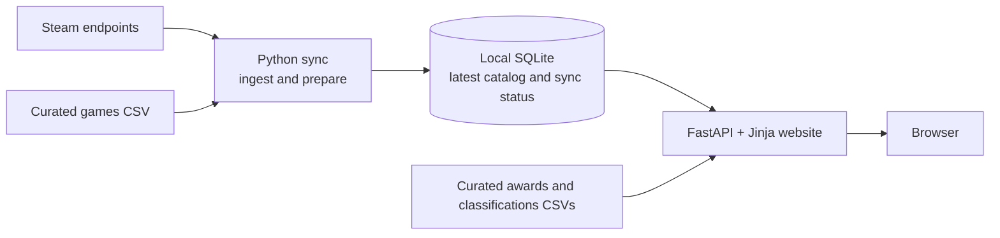
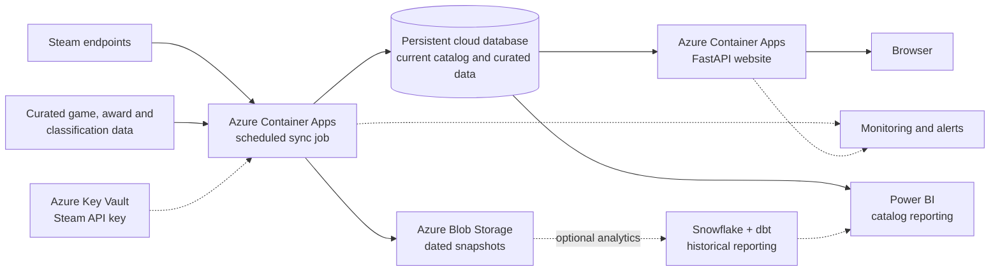

# Game Librarian

Game Librarian is a small, personal game discovery website. It ranks the curated Steam games released in the last
four years (by production tier, then positive Steam reviews) and shows, for each game, a short description, Steam's positive share, curated award results and AA / AAA /
Indie labels backed by evidence. A details view adds a balanced sample of Steam reviews and a trailer clip. A Power BI
report analyzes the same data.

- **Backend:** FastAPI, with server-rendered Jinja templates and one small script (`static/app.js`) that
  progressively enhances filters, the details dialog and the trailer clip. Every page also works without it.
- **Storage:** one SQLite file, written by a separate sync command.
- **Not included (by design):** RAG, LLMs, prediction models, recommendations, wiki links, download mirrors,
  screenshot galleries, and Steam account sign-in.

## Contents

1. [Setup](#setup)
2. [Credentials](#credentials)
3. [Commands](#commands)
4. [Using the website](#using-the-website)
5. [Ranking](#ranking)
6. [Power BI dashboard](#power-bi-dashboard)
7. [Data sources and terms](#data-sources-and-terms)
8. [How the sync works](#how-the-sync-works)
9. [Curated awards and classifications](#curated-awards-and-classifications)
10. [Current architecture](#current-architecture)
11. [Future cloud architecture](#future-cloud-architecture)
12. [Limitations](#limitations)
13. [Verification status](#verification-status)
14. [Future work](#future-work)

## Setup

You need Python 3.11 or later. The project was tested with Python 3.12.4 on Windows 11.

```powershell
cd project
python -m venv .venv
.\.venv\Scripts\python.exe -m pip install -r requirements.txt

.\.venv\Scripts\python.exe -m game_librarian sync     # first run: about 12 minutes for 160 games
.\.venv\Scripts\python.exe -m game_librarian serve    # then open http://127.0.0.1:8000
```

On macOS or Linux, use `.venv/bin/python` instead of `.\.venv\Scripts\python.exe`.

The web app starts even when the catalog is empty, and it tells you to run `sync`. The app never calls Steam while it
serves pages. It shows the data saved by the last successful sync.

## Credentials

| Variable | Required? | Purpose |
| --- | --- | --- |
| `STEAM_API_KEY` | No | Turns on catalog discovery (`IStoreService/GetAppList`). Without it, the sync still enriches the curated games and refreshes them by age. |
| `GAME_LIBRARIAN_DB` | No | Path of the SQLite catalog. Default: `data/game_librarian.sqlite3`. |
| `GAME_LIBRARIAN_CURATED_DIR` | No | Folder with the curated CSV files. Default: `curated/`. |
| `GAME_LIBRARIAN_REVIEW_LANGUAGE` | No | Steam language code for review excerpts. Default: `english`. |
| `GAME_LIBRARIAN_DASHBOARD_URL` | No | HTTPS link to the published Power BI report, ideally a secure embed link. Until set, the Dashboard page explains how to connect the report. See [Power BI dashboard](#power-bi-dashboard). |

Settings are loaded automatically from the project-root `.env` file if it exists. Environment variables already set
in your shell take precedence, including empty values. For example, add this line to `.env`:

```dotenv
STEAM_API_KEY=your_key_here
```

To get a Steam Web API key:

1. Go to <https://steamcommunity.com/dev/apikey>.
2. Sign in, agree to the Steam Web API Terms of Use, and enter a domain name for the app.

The key is free, but Steam may refuse to issue one to a limited account (see Steam Support's page on limited user
accounts). Keep the key private:

- Set it as an environment variable, for example `$env:STEAM_API_KEY = "..."` in PowerShell.
- Never commit it. `.env` is git-ignored.
- The app sends the key only to `GetAppList`, the one endpoint that requires it.

## Commands

All commands run from the project folder with the virtual environment's Python.

| Command | What it does |
| --- | --- |
| `python -m game_librarian sync` | Discovers changes (when a key is set) and refreshes stale details, tags, covers and reviews for the curated games. |
| `python -m game_librarian sync --force` | Refreshes every curated game, even recent ones. |
| `python -m game_librarian sync --limit 5` | Syncs only the first 5 curated games. Use it for a quick test. |
| `python -m game_librarian sync --appid 1086940` | Syncs one curated game. You can repeat `--appid`. |
| `python -m game_librarian sync --skip-reviews` / `--skip-discovery` | Leaves out one part of the sync. |
| `python -m game_librarian serve [--port 8000] [--reload]` | Runs the web app at <http://127.0.0.1:8000>. |
| `python -m game_librarian status` | Shows catalog counts and the most recent sync runs with their outcomes. |
| `python -m game_librarian check-curated` | Validates the curated CSV files and lists problems with their file and line. |
| `python -m game_librarian export-report [--out DIR]` | Writes the Power BI report's CSV tables (default `reporting/data/`) from the catalog and curated files, and points the report at that folder. Run it after `sync`. |
| `python -m pytest` | Runs the test suite. It needs no network access and no key. |

Exit codes for `sync`:

| Code | Meaning |
| --- | --- |
| 0 | success |
| 1 | failed: nothing was refreshed, or the run stopped |
| 2 | partial: some requests failed; the last good data is kept |
| 130 | interrupted with Ctrl+C |

To keep the data fresh, run `sync` once a day with Windows Task Scheduler (set "Start in" to this folder) or with
cron. Run only one sync at a time.

## Using the website

The page has a black header with **GAME LIBRARIAN** and a **Dashboard** link, a "Discover." headline, a filter
sidebar and the catalog.

- **Catalog cards.** Two per row on wide screens, one on phones. Each card shows the four-year rank (or "Unranked" / "Not in the four-year ranking"),
  the portrait cover from Steam's CDN, the title, the verified production label (AAA, AA, Indie, or "Unclassified"
  when no verified evidence exists), three Steam tags, one short description, the release date, the positive review count with the positive share and
  total reviews, verified award badges and a **View on Steam** button (new tab). Awards to an earlier version than the
  edition Steam sells say "for the original release".
- **Short description.** The first sentence of Steam's short description. A first sentence under 60 characters
  takes the next one; anything over 160 characters is cut at a word boundary with "…". The text is shortened, never
  rewritten.
- **Search and filters.** Name search (case-, accent- and punctuation-insensitive); production label (any of
  AAA / AA / Indie / Unclassified); awards (any listed award or one category, optionally winners only); genres and
  Steam tags (a game must have every selected tag). Each option shows how many games it would leave. Checkbox and
  menu changes apply at once; **Apply filters** does the same without JavaScript. On phones the filters fold behind
  a "Search & filters" button.
- **Views.** **Top-ranked · last four years** (the default) lists only games released in the four-year window and
  shows the window dates above the results. **All games** lists the whole catalog, A–Z by default. Both share the
  search, filters and pagination; a search that matches only older games links to All games.
- **Sort.** Rank (tier, then positive reviews; the Top-ranked default), most Steam reviews, highest positive share or
  name A–Z (the All games default).
- **Pagination.** 12 games per page with numbered pages, Previous and Next. Every link keeps the search, filters and
  sort. There is no infinite scrolling.
- **Details.** Click a card (or its Details button, or press Enter on it) to open the details dialog. The URL gains
  `game=<appid>`, so the browser's Back button closes the dialog and the link can be shared. Escape, the close button
  and a click outside also close it; focus and the scroll position return to the card. Without JavaScript the
  Details link opens a full page with a "Back to results" link that keeps the filters and returns to the card.
- **Details content.** Rank, title, verified labels (each links to its evidence), tags (each filters the catalog),
  developer, publisher, release date, genres, modes and platforms, Steam's short description, verified awards with
  their sources and any "for the original release" note, a large **View on Steam** button, the review summary, up
  to three positive and three negative review excerpts (shortened to about 280 characters, marked "shortened",
  attributed to Steam users), a link to all reviews on Steam, and the full store description (collapsed).
- **Preview clip.** On the right, a muted looping clip that Steam cuts from one of the game's store trailers
  ("microtrailer"). Trailers titled with "gameplay" are preferred, and only trailers Steam marks as suitable for all
  ages are used. The caption names the trailer and says that trailers are made by the publisher and may not show
  actual gameplay. A Pause / Play button (keyboard accessible) controls it; with "reduce motion" turned on, the clip
  does not start by itself. Games without a clip show the first all-ages store screenshot, or the header image.
- **Error states** are spelled out: an empty catalog, no matches, store details Steam no longer returns, failed
  refreshes (older data stays visible), reviews not fetched, failed or nonexistent, a failed last sync, and curated
  rows with problems.

## Ranking

The default **Top-ranked games** view ranks only games released in the last four years. The ranking is a discovery
ordering, not an objective judgment of quality.

1. **Window.** A game is eligible when its exact Steam release date falls between the same calendar day four years
   ago and today, both included (on 9 Nov 2026: 9 Nov 2022 – 9 Nov 2026). "Today" is the date of the computer that
   runs the site, read on every request, so the window moves forward every day; no year is hard-coded. Games released
   earlier, games Steam lists as coming soon or dates after today, and games without an exact release date
   ("Q4 2026", "2026", "Coming soon") are not ranked. Dates are never guessed: only Steam's exact English forms, such
   as "Aug 3, 2023" and "3 Aug, 2023", are read.
2. **Tier.** Verified AAA games first, then verified AA games, then Indie and Unclassified games together. Labels
   follow the verification rules under [Curated awards and classifications](#curated-awards-and-classifications): a
   game without a verified label is Unclassified, and a game with two verified labels (for example AA and Indie)
   ranks in its higher tier. So an AAA game ranks above an AA game, and an AA game above an Indie or Unclassified
   game, **even when it has fewer positive reviews**.
3. **Positive reviews.** Within a tier, more positive Steam reviews rank higher. This is the count itself (all
   languages, Steam purchasers), not the positive percentage. Cards show the count, the percentage and the total.
4. **Ties** (same tier, same count) go to the title A–Z (library order: case, accents, punctuation and a leading
   "The", "A" or "An" are ignored), then to the lower Steam app ID, so every rank is distinct and repeatable.

- **Unranked:** a game in the window whose review summary was never saved, shows zero reviews (the sync stores a
  missing Steam answer as zeros, so a zero is not trusted), or has inconsistent counts. It is never treated as having
  zero positive reviews: it gets no number and is listed after the ranked games.
- **Ranks are calculated only among games in the window**, over the whole curated catalog, so search and filters
  never change a game's rank. They are recalculated on every page load and every export.
- **All games** lists every catalog game. Only games in the four-year ranking carry a number, labeled "in the
  four-year ranking"; other games say "Not in the four-year ranking", and their details say why.
- **Awards are not part of the rank.** They stay visible and filterable.
- **Limits:** counting positive reviews favors popular games and games released earlier in the window, which have
  had more time to collect reviews. Steam dates a game that left Early Access by its full release (Valheim and
  Palworld show 2026), so reviews from its Early Access years count too. Labels and award coverage depend on the
  curated data: only 5 games are verified AAA and 2 AA, so most games share the third tier.
- The Power BI export calculates the same ranking, with the window ending on the export day.

The ⓘ button next to "Top-ranked games" explains this on the page.

## Power BI dashboard

`reporting/` holds a Power BI Project with three pages: **Player Reception**, **Awards Explorer** and **About the
data**. Its tables, relationships, measures and publishing steps are documented in
[`reporting/README.md`](reporting/README.md).

**Works locally (no account needed):**

1. `python -m game_librarian sync`
2. `python -m game_librarian export-report`
3. Open `reporting\GameLibrarian.pbip` in Power BI Desktop (free, Windows) and select **Refresh**.

**Needs an account or more setup:** publishing to the Power BI service, refreshing there (an on-premises data
gateway for the `reporting\data` folder, or republishing from Desktop) and sharing (usually a Pro or Premium Per
User license). Re-running `sync` or `export-report` never updates a published report by itself.

**The website's Dashboard link** always opens `/dashboard`:

- With no `GAME_LIBRARIAN_DASHBOARD_URL`, it says the report is not connected and lists the setup steps.
- With a secure embed link (`https://app.powerbi.com/reportEmbed?...`, from **File → Embed report → Website or
  portal**), it shows the report in a frame. Each viewer signs in to Power BI, which shows the report only to
  accounts with access. The website stores no credentials.
- With a **Publish to web** link (`https://app.powerbi.com/view?r=...`), it also embeds the report but warns that
  anyone with the link can see the report and its data without signing in. Publish to web is public: use it only
  if that is acceptable. Nothing in this project publishes a report.
- Any other HTTPS link (for example the report's own `app.powerbi.com` page) opens in a new tab, where Power BI asks
  the viewer to sign in.

## Data sources and terms

### Which Steam endpoint provides each field

The catalog endpoint does **not** provide descriptions, images, tags, reviews, awards or classifications, so each
field has its own source:

| Field | Endpoint | Documented by Valve? | Notes |
| --- | --- | --- | --- |
| Discovery: new and changed apps | `api.steampowered.com/IStoreService/GetAppList/v1` | Yes ([Steamworks Web API reference](https://partner.steamgames.com/doc/webapi/IStoreService)) | Needs a key. Paginated (`last_appid`, up to 50,000 per page), incremental (`if_modified_since`). Returns appid, name, `last_modified`, `price_change_number`. The older `ISteamApps/GetAppList/v2` now returns 404. |
| Review summary and helpful reviews | `api.steampowered.com/IUserReviewsService/GetAppReviews/v1` | Yes ([reference](https://partner.steamgames.com/doc/webapi/IUserReviewsService)) | No key needed. Replaces the deprecated `store.steampowered.com/appreviews/<appid>?json=1`, which now redirects to the store front page. Score fields come only with `review_type` All, so totals take a separate request. |
| Description, header image, developer, publisher, genres, game modes, platforms, release date | `store.steampowered.com/api/appdetails` | **No** (public, long used, undocumented) | One app per request. About 200 requests per 5 minutes is the commonly observed limit; Valve publishes none. |
| Community tags (by vote weight), portrait cover, trailer clips ("microtrailers"), screenshots | `api.steampowered.com/IStoreBrowseService/GetItems/v1` | **No** | Up to 50 apps per request. Clip files are served from `video.akamai.steamstatic.com/store_trailers/`, the folder appdetails uses for its trailer streams (checked 2026-11-09; 15 sampled games all resolved). |
| Tag id → tag name | `api.steampowered.com/IStoreService/GetTagList/v1` | **No** (not on the IStoreService page) | One request per sync. |
| Awards, AA/AAA/Indie | Curated CSV files in `curated/` | Not applicable | Steam does not provide these. See below. |

The three undocumented endpoints can change or disappear without notice. If they fail, the sync keeps the last good
values and marks the run `partial` or `failed`. No documented Valve API was found for store descriptions, images or
tags.

### Terms checked (2026-11-09)

I read Valve's terms on 2026-11-09. This summary is not legal advice.

**[Steam Web API Terms of Use](https://steamcommunity.com/dev/apiterms)** (last updated July 2010):

| Term | How the app meets it |
| --- | --- |
| Steam Data may be distributed "to end users for their personal use". | Game Librarian is built and documented as a personal tool. |
| Steam Data must be provided "as is", with disclaimers like the terms' sections 7 and 8. | The page footer says so. |
| The app must not appear endorsed by or affiliated with Valve, and the data must not appear to come from a third party. | The footer attributes the data to Steam and says the project is not affiliated with Valve. |
| The API key must stay confidential. | The key is read from the environment and never stored or logged. |
| Calls are limited to 100,000 per day, and use must not degrade Steam. | A full sync of 160 games makes about 650 requests, spaced at least 1–1.5 s apart per host. |
| Links to Valve must not use `nofollow`. | "View on Steam" links use only `rel="noopener"`. |

**[Steam branding guidelines](https://partner.steamgames.com/doc/marketing/branding):** Steam trademarks may not be
primary or prominent on non-Valve material. The app uses no Steam logo, only the text "View on Steam", and shows
Valve's trademark notice in the footer.

How each kind of content is handled:

- **Descriptions** are publisher content. They are stored as plain text in the local database for display, with
  formatting stripped and no rewriting.
- **Cover images, screenshots and trailer clips** are not downloaded or stored. The browser loads them from Steam's
  CDN, and a clip loads only when you open a game's details. Trailers are publisher content; the page names each
  trailer and does not present it as gameplay footage.
- **Review excerpts** are user content. They are shortened (600 characters at most, marked "shortened") and spoilers
  are removed. They are attributed to Steam users, and the reviewers' Steam IDs and profiles are not stored.

**Not verified:** I found no Valve terms that specifically cover the undocumented store endpoints. I also could not
confirm whether public, non-personal redistribution of store descriptions or review excerpts is permitted. Treat this
as a personal tool. Review the terms, or ask Valve, before deploying it publicly.

### Curated sources

- **The Game Awards results:** the official "rewind" pages (2018–2025) and the press articles that Wikipedia's
  [The Game Award for Game of the Year](https://en.wikipedia.org/wiki/The_Game_Award_for_Game_of_the_Year) article
  cites for each year: Polygon, GameSpot, Variety, The Hollywood Reporter, Deadline and IGN. Every row links to the
  page that confirms it.
- **AA / AAA labels:** news reports or records specific to each game. See the next section.

## How the sync works

```text
curated/games.csv ──┐
                    ├─► sync ─► discovery (key) ─► details + tags + covers ─► reviews ─► SQLite catalog
Steam endpoints ────┘            (pages)           (only games that are due)              (one transaction per game)
```

- **Stable identity.** The Steam app ID is the primary key. When Steam renames a game, the same row is updated. In
  the real data, app 292030 is now titled "The Witcher 3: Wild Hunt — Remastered". Search matches both the Steam
  name and the curated title.
- **Incremental updates.**
  - With a key, discovery requests only apps modified since the last successful discovery, page by page. It stores
    them in a discovery index (`discovered_apps`) and marks curated games whose `last_modified` changed.
  - Details are refreshed when discovery reports a change, or when they are 7 days old.
  - Reviews are refreshed when they are 24 hours old.
  - A refresh that failed is retried at the next sync, whatever its age.
  - Data that is still fresh is skipped without calling Steam.
- **Polite requests.** Every request has a timeout (20 s, 10 s to connect). Each host has a minimum gap between
  requests: 1.5 s for the store, 1 s for the API.
- **Retries.** Timeouts, 429 and 5xx responses are retried up to 4 times, waiting 2, 4 and 8 s. A `Retry-After`
  header is honored. Other 4xx responses fail at once.
- **Steam unavailable.** After 3 failed requests in a row, the sync stops calling Steam. The run is recorded as
  `failed` (or `partial` if something succeeded), and every stored value stays as it was. A run interrupted by a
  crash is marked `failed` when the next run starts.
- **Recorded outcomes.** Each run is saved in `sync_runs` with its start and end time, its status (`success`,
  `partial` or `failed`), its counts and its first errors. You can view them with `status` and in the sidebar.
- **Curated data is never written.** The sync only reads `games.csv`. The web app reads the award and
  classification files directly, so no sync can overwrite them. The tests check this byte for byte.
- **Discovery vs enrichment.** Discovery can index the whole Steam catalog. Only games listed in `curated/games.csv`
  are enriched with details and reviews and shown in the app. The sidebar reports the two counts separately.

## Curated awards and classifications

Edit the CSV files in `curated/` with any spreadsheet tool. Then run `python -m game_librarian check-curated`. The
web app picks up changes without a restart; new games appear after the next `sync`.

**`games.csv`**: `steam_appid`, `title`, `note`. These are the 160 games to enrich:

- every Game of the Year winner and nominee from 2014 to 2025 that Steam sells (51 apps)
- most Best Independent Game nominees (47 apps)
- 62 well-known games chosen for genre coverage

This starter list is not a ranking.

**`awards.csv`**: `organization`, `year`, `category`, `result` (`winner` / `nominee`), `award_title`, `steam_appid`,
`steam_mapping`, `mapping_note`, `source_url`, `review_status`, `checked_on`, `checked_by`.

- 129 rows: The Game Awards *Game of the Year* (68 rows) and *Best Independent Game* (61 rows), 2014–2025. The
  sources call the second category "Best Indie Game" for 2020–2022, and the rows keep that name.
- `steam_mapping` takes one of three values:
  - `same`: the Steam app is the awarded game, even if Steam renamed it.
  - `edition`: Steam sells a remaster, bundle or expanded edition of the awarded game.
  - `none`: the game is not on Steam, or is deliberately not mapped.
- `mapping_note` says why. Example: the 2016 *Overwatch* award is not mapped to Steam's current *Overwatch* app,
  because that app is the 2022 successor that replaced the awarded game.
- Rows with `none` are kept for completeness and never shown.
- The Game Awards 2026 takes place on 10 December 2026, so it is not included yet.

**`classifications.csv`**: `steam_appid`, `title`, `label` (`AAA` / `AA` / `Indie`), `review_status`,
`evidence_url`, `evidence_summary`, `checked_on`, `checked_by`. Each row holds one label, so a game can be both AA
and Indie. *Clair Obscur: Expedition 33* is an example.

- **Review status:**
  - `verified`: someone opened the source and it supports the label. Only these rows are displayed.
  - `needs_review`: proposed but not yet checked.
  - `rejected`: the evidence does not hold. The row is kept for the record.
- **Evidence rule for AA/AAA:** the source must be specific to the game, such as a reported budget, team size, or an
  explicit "AAA" or "AA" description. A big publisher alone is not enough. If a game is verified as both AAA and AA,
  it shows neither label and `check-curated` reports the conflict.
- **What is labeled now:**
  - **5 AAA:** *The Last of Us Part II* and *Horizon Forbidden West* (budgets disclosed in court documents),
    *Red Dead Redemption 2* (Guinness development-team record), *Baldur's Gate 3* (a team of about 400, per Larian)
    and *Black Myth: Wukong* (SCMP).
  - **2 AA:** *Clair Obscur: Expedition 33* (GamesRadar+) and *Hellblade: Senua's Sacrifice* (MCV).
  - **54 Indie:** each game was nominated in The Game Awards' independent-game category. This is one documented
    evidence standard, not the only possible one.
  - **1 rejected:** *Dave the Diver* was nominated as independent, but its developer is a team inside Nexon and its
    director rejects the label (VGC).
  - **Unknown:** every other game. This is deliberate, not a gap in the code.
- **Who checked the rows:** Claude (an AI assistant) checked every row marked `checked_by = Claude (AI assistant)` on
  2026-11-09 against the linked page. Spot-check them yourself, and put your own name in `checked_by` when you
  re-verify a row.

## Current architecture

**Implemented:** the ingestion pipeline and website run on your computer. Steam is an external online data source;
Azure, Snowflake, and Power BI are not required to run the app.



Run the sync manually or schedule it on your own machine; starting the website does not run the sync. The sync
cleans and prepares Steam data before saving the latest results in SQLite. The website reads the curated awards and
classification CSVs separately, so a sync cannot overwrite them. A Steam API key is optional for catalog discovery;
the curated games can be refreshed without it. The Power BI report reads CSV tables written by
`export-report`; the website's Dashboard page embeds or links the published report once its URL is configured.

The implementation is organized as follows:

```text
Steam endpoints + curated/*.csv
        │
        ▼
game_librarian/sync.py      orchestration: discovery, due checks, circuit breaker, run records
game_librarian/steam.py     the only module that calls Steam: timeouts, rate limits, retries
game_librarian/prepare.py   pure functions: HTML → text blocks, BBCode cleanup, search keys, excerpts
game_librarian/curated.py   reads and validates the CSV files (read-only)
        │
        ▼
game_librarian/store.py     the storage boundary: all SQL lives here (SQLite file in data/)
        │
        ▼
game_librarian/ranking.py   pure ranking: four-year window, tiers, positive counts, tie-breaks, Unranked
game_librarian/web.py       FastAPI + Jinja templates; read-only; never calls Steam
templates/, static/         the dark catalog layout and app.js (no frontend framework)
game_librarian/report_export.py  CSV tables for the Power BI report (export-report)
reporting/                  Power BI Project: TMDL semantic model + PBIR report pages
```

A separate frontend framework was not needed: the page is a read-only list with a form and links. `app.js` adds
instant filters, the details dialog (with history support) and the clip controls; without it, the same features
work through ordinary links and forms.

## Future cloud architecture

**Proposed, not built or deployed.** The goal is to make the website accessible from another device and keep its
catalog up to date even when your computer is off. The current SQLite store and sync are not yet cloud-ready.



| Component | Proposed purpose and work required |
| --- | --- |
| **Azure Container Apps website** | Host FastAPI so it can be used without the developer's computer running. Containerize the app and configure access, deployment, and a persistent data source. |
| **Scheduled sync job** | Run the ingestion pipeline regularly and update the same cloud catalog. Container Apps jobs support schedules; adapt the sync to prevent overlapping writes and retain the last successful data on failures. |
| **Persistent cloud database** | Share the current catalog between the job and website. Select a suitable service after checking student-account availability and cost, then replace or adapt the SQLite storage boundary and migrate its data. Container-local files alone are ephemeral. |
| **Curated data** | Import the current CSVs into the shared catalog or another durable, versioned source. Preserve evidence and make sure the Steam sync cannot overwrite manual curation. |
| **Azure Blob Storage** | Save dated source snapshots for recovery and future analysis. Define retention, access controls, and handling of source content before collecting history. Existing SQLite records only contain the latest values. |
| **Azure Key Vault and monitoring** | Securely provide credentials to the job and report sync failures. Choose managed identity and alerts during implementation; neither is configured today. |
| **Power BI** | Connect to a prepared catalog dataset for comparisons. For historical trends, build a reporting dataset from snapshots collected over time. The report and automated refresh are not built. |
| **Snowflake + dbt, optional** | If practicing cloud warehousing or historical analysis, load snapshots into Snowflake and use dbt to build and test reporting tables. The website should not depend on a Snowflake trial to serve the catalog. |

Suggested rollout: (1) choose and provision the persistent store, migrate the catalog, host the website and
schedule syncs; (2) add snapshots, recovery and monitoring; (3) prepare Power BI reporting and optionally add
Snowflake/dbt. Verify each stage before moving on. No historical trend can be reconstructed from snapshots that were
never collected.

**Accounts and costs:** Azure for Students may provide credits and selected free allowances to eligible students;
check the current offer and the selected database's availability and pricing. Hosting, storage, monitoring and
Power BI sharing can incur costs or require licenses. Snowflake's trial is time-limited and paid usage can follow an
upgrade. Set spending alerts, and do not assume an alert stops charges. Review Steam's terms and confirm rights to
display descriptions and review excerpts before making the site publicly accessible; the current project is a
personal tool and those public-use rights have not been confirmed.

## Limitations

- **Discovery is not verified against live Steam.** No API key was available during development, so
  `IStoreService/GetAppList` was implemented from Valve's documentation and tested only with simulated responses.
- **Undocumented endpoints.** Three Steam endpoints are undocumented (see the table above) and may break or be rate
  limited without notice.
- **Reviews are a sample, not an analysis.**
  - Excerpts are English only by default.
  - They are ranked by Steam's helpfulness for the past year; Steam already pushes memes and low-quality reviews
    down.
  - Reviews under 20 characters are skipped, and excerpts are cut at 600 characters.
  - The overall percentage is rounded down, like the store.
- **Search** is a case-, accent- and punctuation-insensitive substring match on names, with no typo tolerance.
- **Curated catalog.** 160 hand-picked games, not all of Steam. Ranks are positions in this list only.
- **Coverage.** Most AA / AAA / Indie values are unknown by design (shown as "Unclassified"). Awards cover two
  categories of one organization (The Game Awards, 2014–2025).
- **Gameplay media.** Steam offers no reliable gameplay footage: every clip is cut from a publisher trailer and is
  labeled as such. 2 of 160 games have no all-ages clip and show a still image; 3 have no all-ages screenshot.
  Clip URLs follow a CDN folder observed on 2026-11-09 that Valve could change; the poster image then remains.
- **Stale or missing reviews.** Review totals are as fresh as the last sync, with no history. Older data is marked
  "(may be out of date)" in the details; a game without a usable summary is Unranked.
- **Media fingerprint.** The first sync after this version reports every game as "changed", because the stored
  fingerprint now includes trailer and screenshot data.
- **Power BI scatter.** Its horizontal axis is linear, so games with under 1M reviews sit close together.
- **Remasters and editions** show the original game's awards with "for the original release". AAA evidence for a
  remaster refers to the original game, and the evidence summary says so.
- **Image-only descriptions.** Some store pages build their description entirely from images and video. On
  2026-11-09 this applied to *Cyberpunk 2077*, *The Witcher 3* and *Kingdom Come: Deliverance II*. For these, the
  About section shows only Steam's short description and says that no longer text exists. Nothing is invented to
  fill the gap.
- **Covers** load from Steam's CDN. If it is unreachable, entries show alt text, and all text still works.
- **Freshness.** The catalog is only as fresh as the last `sync`. Nothing refreshes automatically unless you
  schedule it.
- **Test warning.** Starlette 1.x prints a deprecation warning saying its test client prefers a package named
  `httpx2`. The tests pass with `httpx` 0.28, so no extra dependency was added.

## Verification status

**Automated tests (`python -m pytest`, 148 tests, no network needed):** search; tag, label and award filters and their
option counts; sorting; pagination that keeps every parameter; out-of-range pages; the four-year ranking (window
edges, future and undated games, tiers, positive counts, ties, missing and inconsistent counts, stable ranks under
filters) and the All games view; the export columns matching the Power BI model; card and details
content; edition-award notes; hidden unverified data; the trailer-clip choice (gameplay title preferred, all-ages
only) and still-image fallback; the dashboard states (not connected, secure embed, Publish to web warning, plain
link, invalid URL); HTML escaping; no network use while serving; the sync (incremental refresh, failures, media kept
when a request fails); upgrading an existing catalog database; and the report export (one row per game, bridge
tables, award statuses, no secrets written, parameter update).

**Checked on 2026-11-09/10 against live Steam and the real catalog:**

- A forced details sync (`sync --force --skip-reviews --skip-discovery`) refreshed 160/160 games in 165 requests
  with no failures; 158 got a trailer clip (40 from gameplay-titled trailers) and 157 a screenshot. For 15 sampled
  games, every clip (webm and mp4), poster and screenshot URL returned HTTP 200.
- **Headless Microsoft Edge 157** at 1920, 1440, 1280, 900 and 390 px: two cards per row down to 900 px, one on a
  phone, no horizontal scrolling. Driven through the DevTools protocol: a card click and Enter on Details open the
  dialog; Escape, the close button and the Back button close it; focus returns to the card and the scroll position
  is unchanged; filters survive in the URL; a `?game=` link opens the dialog; the clip plays muted and loops, the
  Pause button works from the keyboard, and with reduced motion the clip stays paused until Play; a game without a
  clip shows a screenshot; no console errors.
- **Power BI Desktop 2.159** opened and refreshed `reporting/GameLibrarian.pbip`, and 24 measure results matched an
  independent calculation (see `reporting/README.md`).

**Not verified:** publishing, refreshing and embedding the report in the Power BI service (they need an account);
discovery behavior over many days; browsers other than Edge; a formal accessibility audit (keyboard and
reduced-motion behavior were tested); macOS and Linux; whether Valve's terms allow anything beyond personal use.

## Future work

- Cloud-hosted website, scheduled sync, persistent storage and optional reporting pipeline (see the architecture above).
- Dated snapshots of review totals, which would make trend pages in the report possible.
- More award organizations (for example BAFTA Games Awards or D.I.C.E.) in the same CSV format, and more AA / AAA /
  Indie evidence.
- A small curator workflow, for example listing `needs_review` rows and the newly discovered apps worth adding to
  `games.csv`.
