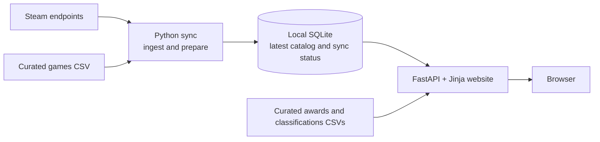
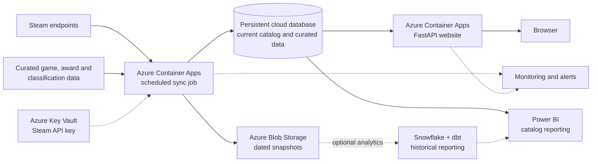

# Game Librarian

Game Librarian is a small, personal game discovery website for games sold on Steam. It ranks the catalog games
released in the last four years (by production tier, then positive Steam reviews), offers collections (Game of the
Year winners, award winners and nominees, highly rated indies, big-budget games, hidden gems, recent releases) and
several sort orders, and shows, for each game, a short description, Steam's positive share, verified award results
from several organizations and AA / AAA / Indie labels backed by evidence. A details view adds a balanced sample of
Steam reviews, a trailer clip, a browser-local wishlist button and "More games like this" (shared Steam tags). The
**Dashboard** page analyzes the same data as HTML charts and tables; an optional Power BI project in `reporting/`
shows the same pages in Power BI Desktop.

- **Backend:** FastAPI, with server-rendered Jinja templates and two small scripts (`static/app.js`,
  `static/wishlist.js`) that progressively enhance filters, the details dialog, the trailer clip and the wishlist.
  Every page except the wishlist also works without them.
- **Storage:** one SQLite file, written by separate commands (`sync`, `candidates`).
- **Catalog:** hand-picked games (`curated/games.csv`) plus games promoted through a reviewed candidate workflow
  (`curated/promoted_games.csv`). Every catalog game is a verified Steam app.
- **Not included (by design):** RAG, LLMs, prediction models, machine-learned recommendations, wiki links or lore,
  download mirrors or repack sites, screenshot galleries, Steam account sign-in, and anything displayed from IGDB.

## Contents

1. [Setup](#setup)
2. [Credentials](#credentials)
3. [Commands](#commands)
4. [Growing the catalog](#growing-the-catalog)
5. [IGDB (optional)](#igdb-optional)
6. [Using the website](#using-the-website)
7. [Collections and sort orders](#collections-and-sort-orders)
8. [Ranking](#ranking)
9. [Dashboard](#dashboard)
10. [Data sources and terms](#data-sources-and-terms)
11. [How the sync works](#how-the-sync-works)
12. [Curated awards and classifications](#curated-awards-and-classifications)
13. [Current architecture](#current-architecture)
14. [Future cloud architecture](#future-cloud-architecture)
15. [Limitations](#limitations)
16. [Verification status](#verification-status)
17. [Future work](#future-work)

## Setup

You need Python 3.11 or later. The project was tested with Python 3.12.4 on Windows 11, and version 0.4 with the
project's `.venv` (Python 3.11.9). Node.js is optional: it runs the wishlist's JavaScript tests.

```powershell
cd project
python -m venv .venv
.\.venv\Scripts\python.exe -m pip install -r requirements.txt

.\.venv\Scripts\python.exe -m game_librarian sync     # first run: about 20 minutes for the 238 catalog games
.\.venv\Scripts\python.exe -m game_librarian serve    # then open http://127.0.0.1:8000
```

On macOS or Linux, use `.venv/bin/python` instead of `.\.venv\Scripts\python.exe`.

The web app starts even when the catalog is empty, and it tells you to run `sync`. The app never calls Steam while it
serves pages. It shows the data saved by the last successful sync.

## Credentials

| Variable | Required? | Purpose |
| --- | --- | --- |
| `STEAM_API_KEY` | No | Turns on catalog discovery (`IStoreService/GetAppList`). Without it, the sync still enriches the curated games and refreshes them by age. |
| `GAME_LIBRARIAN_DB` | No | Path of the SQLite catalog. Default: `data/game_librarian.sqlite3`. |
| `GAME_LIBRARIAN_CURATED_DIR` | No | Folder with the curated CSV files. Default: `curated/`. |
| `GAME_LIBRARIAN_REVIEW_LANGUAGE` | No | Steam language code for review excerpts. Default: `english`. |
| `IGDB_CLIENT_ID` | No | Client ID of your Twitch application, for the optional IGDB candidate source. See [IGDB (optional)](#igdb-optional). |
| `IGDB_CLIENT_SECRET` | No | Client secret of the same Twitch application. Both IGDB variables must be set to use IGDB; the website and the Steam sync never need them. |

Settings are loaded automatically from the project-root `.env` file if it exists. Environment variables already set
in your shell take precedence, including empty values. For example, add this line to `.env`:

```dotenv
STEAM_API_KEY=your_key_here
```

To get a Steam Web API key:

1. Go to <https://steamcommunity.com/dev/apikey>.
2. Sign in, agree to the Steam Web API Terms of Use, and enter a domain name for the app.

The key is free, but Steam may refuse to issue one to a limited account (see Steam Support's page on limited user
accounts). Keep the key private:

- Set it as an environment variable, for example `$env:STEAM_API_KEY = "..."` in PowerShell.
- Never commit it. `.env` is git-ignored.
- The app sends the key only to `GetAppList`, the one endpoint that requires it. Candidate screening never sends it.
- Settings are printed without secrets: `Settings` hides the Steam key and both IGDB values from `repr()`.

## Commands

All commands run from the project folder with the virtual environment's Python.

| Command | What it does |
| --- | --- |
| `python -m game_librarian sync` | Discovers changes (when a key is set) and refreshes stale details, tags, covers and reviews for the curated games. |
| `python -m game_librarian sync --force` | Refreshes every curated game, even recent ones. |
| `python -m game_librarian sync --limit 5` | Syncs only the first 5 curated games. Use it for a quick test. |
| `python -m game_librarian sync --appid 1086940` | Syncs one curated game. You can repeat `--appid`. |
| `python -m game_librarian sync --skip-reviews` / `--skip-discovery` | Leaves out one part of the sync. |
| `python -m game_librarian serve [--port 8000] [--reload]` | Runs the web app at <http://127.0.0.1:8000>. |
| `python -m game_librarian status` | Shows catalog counts and the most recent sync runs with their outcomes. |
| `python -m game_librarian check-curated` | Validates the curated CSV files and lists problems with their file and line. |
| `python -m game_librarian export-report [--out DIR]` | Writes the Power BI report's CSV tables (default `reporting/data/`) from the catalog and curated files, and points the report at that folder. Run it after `sync`. |
| `python -m game_librarian candidates add --source discovery\|awards\|igdb [--limit N]` | Collects candidate games (see [Growing the catalog](#growing-the-catalog)). Never changes the catalog. |
| `python -m game_librarian candidates screen [--limit N] [--min-reviews 50] [--min-positive 70] [--recheck-days D]` | Checks due candidates against Steam, 50 apps per request, and applies the inclusion rules. |
| `python -m game_librarian candidates list [--status S] [--source X]` / `show --appid N` | Shows candidates, their status and the reason for it. |
| `python -m game_librarian candidates promote --appid N [--appid M]` / `--all-eligible [--limit 20]` | Appends reviewed candidates to `curated/promoted_games.csv`. The next `sync` enriches them. |
| `python -m game_librarian candidates reject --appid N --reason "..."` / `match --id N --appid M` | Records a "no", or confirms the Steam app of a title-only candidate. |
| `python -m pytest` | Runs the test suite (Python, plus the wishlist's JavaScript tests when Node.js is installed). It needs no network access and no key. |

Exit codes for `sync`:

| Code | Meaning |
| --- | --- |
| 0 | success |
| 1 | failed: nothing was refreshed, or the run stopped |
| 2 | partial: some requests failed; the last good data is kept |
| 130 | interrupted with Ctrl+C |

To keep the data fresh, run `sync` once a day with Windows Task Scheduler (set "Start in" to this folder) or with
cron. Run only one sync at a time. `sync` never screens or promotes candidates: growing the catalog is always a
separate, deliberate step.

## Growing the catalog

The discovery index holds about 200,000 Steam apps, but only catalog games are enriched and shown. Candidates
are how a game joins the catalog. Every step is bounded, saved as it goes, and safe to stop and rerun.

| Step | Command | What happens |
| --- | --- | --- |
| 1. Collect | `candidates add --source awards` | Every verified award row mapped to a Steam app that is not in the catalog yet. The curator's mapping is the match. |
| | `candidates add --source discovery --limit 500` | The next 500 discovery-index apps that are neither candidates nor catalog games, lowest app id first. The order says nothing about quality; it only makes runs resumable. Needs a populated index (`sync` with `STEAM_API_KEY`). |
| | `candidates add --source igdb --limit 100` | Optional: popular PC games from IGDB (see below). |
| 2. Screen | `candidates screen --limit 200` | One `IStoreBrowseService/GetItems` request per 50 candidates. Each batch is saved before the next request. |
| 3. Review | `candidates list --status eligible` / `--status needs_review`, `candidates show --appid N` | Each candidate shows its Steam facts, its sources and the reason for its status. |
| 4. Promote | `candidates promote --appid N ...` or `--all-eligible --limit 20` | Appends rows to `curated/promoted_games.csv` (`steam_appid`, `title`, `source`, `match_method`, `evidence`, `promoted_on`). |
| 5. Enrich | `sync`, or `sync --skip-discovery --appid N ...` for just the new games | Fetches details, tags, media and reviews, like for every other catalog game. |

**Inclusion rules** (`candidates.EligibilityRules`; `screen` takes `--min-reviews` and `--min-positive`):

- Steam returns store data for the app in the US store and shows it.
- Steam lists it as a game (store type 0). DLC, demos, software, videos, soundtracks and other products are
  ineligible.
- Steam sells it or offers it for free now. Delisted games (for example *MultiVersus*, the original *Death
  Stranding*) are ineligible.
- It is released: not "coming soon", and its release date is not after today.
- At least **50** Steam reviews and at least **70%** positive. These are modest on purpose, so lesser-known games
  qualify; raise or lower them per run.
- A game Steam marks with adult-only or frequent sexual content (content descriptors 3 and 4) passes the rules but
  waits as `needs_review`, so a person decides.
- An award or a production label is never required. Games without a verified label show "Unclassified".

**Statuses:** `pending` (not screened), `eligible`, `needs_review`, `ineligible` (the reason says which rule),
`error` (the request failed; retried by later runs, at most 3 times in a row), `promoted`, `rejected`.

**Matching.** A candidate is screened only when its Steam app id comes from a reliable identifier: the discovery
index itself, a curator's verified award mapping, or the Steam id IGDB records. A title alone is never enough: a
title-only candidate stays `needs_review` with the Steam apps to check (apps whose normalized title is identical),
until you confirm one with `candidates match --id N --appid M`. A game found by several sources is one candidate
that lists every source.

**Small pilot first.** For example:

```powershell
.\.venv\Scripts\python.exe -m game_librarian candidates add --source awards
.\.venv\Scripts\python.exe -m game_librarian candidates add --source discovery --limit 200
.\.venv\Scripts\python.exe -m game_librarian candidates screen --limit 300
.\.venv\Scripts\python.exe -m game_librarian candidates list --status eligible --limit 50
.\.venv\Scripts\python.exe -m game_librarian candidates list --status ineligible --limit 50   # check the reasons
```

Look at the reasons and a few Steam pages. If the rules look right, promote a handful, run `sync`, and check the
website before larger batches (`--limit 2000` and so on; a run of 2,000 candidates is 40 requests).

**Recovery.** Ctrl+C or a crash loses at most the batch in flight; run the same command again. After three failed
requests in a row the run stops and records `failed` or `partial` in `candidate_runs` (`candidates list` shows the
last runs). `--recheck-days 30` screens eligible and ineligible candidates again, for example after a game collects
more reviews. A promoted game is removed by deleting its row from `curated/promoted_games.csv`; the next `sync`
hides it, like any game removed from a curated list. Promotion never changes `curated/games.csv`.

**Limits.** Screening uses `IStoreBrowseService/GetItems`, which Valve does not document; if it changes, screening
fails safely (candidates stay `error` and are retried). Candidate state lives in the SQLite file (`data/`, git-ignored);
promotions are durable because they are written to `curated/promoted_games.csv`. Rejections live only in the
database. The discovery index is not complete: some visible Steam games, such as *Fall Guys* and *HITMAN 2*, were
missing from it on 2026-11-15.

## IGDB (optional)

IGDB is an optional extra source of candidates. Without credentials nothing changes: the website, `sync` and the
other candidate sources work as before, and `candidates add --source igdb` explains how to enable it.

1. Sign in to Twitch (two-factor authentication must be on) and register an application in the Twitch Developer
   Console. Use `http://localhost` as the OAuth redirect URL and the **Confidential** client type, then create a
   client secret.
2. Add both values to the project `.env` (never commit it):
   ```dotenv
   IGDB_CLIENT_ID=your_client_id
   IGDB_CLIENT_SECRET=your_client_secret
   ```
3. Run `python -m game_librarian candidates add --source igdb --limit 100`, then `candidates screen`.

How it works (`game_librarian/igdb.py`, from the IGDB API documentation read on 2026-11-15):

- Server-side client-credentials authentication: a POST to `https://id.twitch.tv/oauth2/token` with the client
  ID and secret in the form body (never in a URL). The token stays in memory for the run and is renewed before it
  expires or once if IGDB rejects it. It is never stored, logged, exported or shown, and error messages are
  scrubbed of the ID, secret and token.
- Requests: `POST https://api.igdb.com/v4/games` with an Apicalypse query for PC games of the main, standalone
  expansion, remake, remaster, expanded and port types, with at least 20 ratings, most rated first. IGDB allows 4
  requests per second and 500 results per query; the client sends one request at a time, at least 0.3 s apart,
  in pages of up to 500, and retries 429 and 5xx answers (2, 4 and 8 s).
- Steam matching uses `external_games` with `external_game_source = 1` (Steam; this replaced the deprecated
  `category` field, with the same values). One Steam id: the candidate gets that app. No Steam id, or several:
  a title-only candidate that waits for review.
- Stored per candidate: the IGDB id and a source note (name and year) for provenance. Nothing from IGDB is shown
  on the website, copied over Steam or curated data, or exported to the report.

**Terms.** IGDB is free for non-commercial use under the Twitch Developer Services Agreement (last modified
2024-12-04). IGDB's FAQ allows storing data locally and asks commercial partners for visible attribution; the
agreement asks that any display of its data be attributed with a clear path to the source. Because Game Librarian
displays no IGDB data, no attribution is shown. If you later display IGDB fields or images, check those terms and
the rights to each field first. If the agreement ends, delete the stored IGDB ids (the `igdb_id` column).

**Checked live on 2026-11-15** with real credentials: Twitch issued a token, and one IGDB query returned 100 games
with the fields and filters above. 30 were already in the catalog, 66 became new candidates, and 4 merged with
existing candidates. 47 of the new candidates had exactly one Steam id in IGDB, and screening found 39 eligible and
8 ineligible. Most ineligible ones are no longer sold, such as the original *Grand Theft Auto III* and *Rocket
League*; one is not a game (Steam store type 14). The other 19 wait for review because IGDB lists several Steam
apps or none for them (for example *Portal*, *Dark Souls* and *Diablo II*). See
[Verification status](#verification-status) for what was promoted.

## Using the website

The page has a black header with **GAME LIBRARIAN** and **Wishlist** and **Dashboard** links, a "Discover." headline, a filter
sidebar and the catalog.

- **Catalog cards.** Two per row on wide screens, one on phones. Each card shows the four-year rank (or "Unranked" / "Not in the four-year ranking"),
  the portrait cover from Steam's CDN, the title, the verified production label (AAA, AA, Indie, or "Unclassified"
  when no verified evidence exists), three Steam tags, one short description, the release date, the positive review count with the positive share and
  total reviews, verified award badges and a **View on Steam** button (new tab). Awards to an earlier version than the
  edition Steam sells say "for the original release".
- **Short description.** The first sentence of Steam's short description. A first sentence under 60 characters
  takes the next one; anything over 160 characters is cut at a word boundary with "…". The text is shortened, never
  rewritten.
- **Search and filters.** Name search (case-, accent- and punctuation-insensitive); production label (any of
  AAA / AA / Indie / Unclassified); awards (organization, category, award year, winners only); game modes; genres
  and Steam tags (a game must have every selected tag). Every option shows how many games it would leave. Checkbox
  and menu changes apply at once; **Apply filters** does the same without JavaScript. On phones the filters fold
  behind a "Search & filters" button.
- **Award filters.** Several organizations use a category called "Game of the Year", so the **Organization** menu
  tells them apart: choose an organization, a category, both, or an award year (the ceremony or edition year, not
  the release year). The results keep only games with a matching verified result.
- **Game modes.** Steam's game-mode categories (Single-player, Online Co-op, …), kept separate from community tags.
  Selecting several modes keeps only games with all of them. A game whose Steam page lists no mode data is left out
  when a mode is selected, and its details say "Not listed on Steam": missing data is not shown as "unsupported".
  Selected modes stay in every search, sort, view, collection, page and details link.
- **Wishlist.** **Add to wishlist** / **Remove from wishlist** in the details, and **Wishlist** in the header. This
  is Game Librarian's own list, not your Steam wishlist. It is saved in browser local storage: only in this browser
  on this device, never synced across browsers or devices, never sent to the server, and erased when the site's
  browser data is cleared (or by some private windows). It needs JavaScript; if the browser blocks storage, the
  details and the wishlist page say so instead of showing a button that cannot work. Damaged stored data is read as
  an empty list.
- **Views and collections.** **Top-ranked · last four years** (the default) lists only games released in the
  four-year window. **All games** lists the whole catalog, A–Z by default. The **Collections** row offers six
  more lists (see [Collections and sort orders](#collections-and-sort-orders)). All share the search, filters,
  sort orders and pagination; a search that matches only older games links to All games.
- **Sort.** Production tier, then positive reviews (the four-year ranking order); most positive Steam reviews; best
  player reception; newest release; name A–Z. Each view has its own default; a sort you choose stays when you switch
  views.
- **Pagination.** 12 games per page with numbered pages, Previous and Next. Every link keeps the search, filters and
  sort. There is no infinite scrolling and no "Load more" button.
- **Details.** Click a card (or its Details button, or press Enter on it) to open the details dialog. The URL gains
  `game=<appid>`, so the browser's Back button closes the dialog and the link can be shared. Escape, the close button
  and a click outside also close it; focus and the scroll position return to the card. Without JavaScript the
  Details link opens a full page with a "Back to results" link that keeps the filters and returns to the card.
- **Details content.** Rank, title, verified labels (each links to its evidence), tags (each filters the catalog),
  developer, publisher, release date, genres, modes and platforms, Steam's short description, verified awards with
  their sources and any "for the original release" note, a large **View on Steam** button, the review summary, up
  to three positive and three negative review excerpts (shortened to about 280 characters, marked "shortened",
  attributed to Steam users), a link to all reviews on Steam, the full store description (collapsed), and **More
  games like this**.
- **More games like this.** Up to four other catalog games that share at least three of the game's ten most-voted
  Steam tags, each with its reason ("Shares Roguelike, Deckbuilding and Strategy tags"). Tags on more than half of
  the catalog's games (today only "Singleplayer") and content tags (Sexual Content, Nudity, Gore, Violent, Mature,
  NSFW) are not counted. More shared tags come first, then more positive Steam reviews, then the title. A game with
  no qualifying match says so instead of showing weak suggestions. In the dialog, a suggestion opens in place (Back
  still returns to the list, and focus returns to the original card on close); on the full page it is a normal
  link that keeps the list's search, filters and page.
- **Preview clip.** On the right, a muted looping clip that Steam cuts from one of the game's store trailers
  ("microtrailer"). Trailers titled with "gameplay" are preferred, and only trailers Steam marks as suitable for all
  ages are used. The caption names the trailer and says that trailers are made by the publisher and may not show
  actual gameplay. A Pause / Play button (keyboard accessible) controls it; with "reduce motion" turned on, the clip
  does not start by itself. Games without a clip show the first all-ages store screenshot, or the header image.
- **Error states** are spelled out: an empty catalog, no matches, store details Steam no longer returns, failed
  refreshes (older data stays visible), reviews not fetched, failed or nonexistent, a failed last sync, and curated
  rows with problems.

## Collections and sort orders

Collections are rules over stored, verified data (`game_librarian/catalog.py`). A game without the data a rule
needs is left out, never guessed. Review counts are Steam's (all languages, Steam purchasers): a rough measure of
how many people found a game, not of its sales.

| Collection | Rule | Default sort |
| --- | --- | --- |
| Game of the Year winners | A verified **win** in an organization's top category: Game of the Year (The Game Awards, Game Developers Choice Awards, The Steam Awards) or Best Game (BAFTA). Cards name the organization and year. | Newest release |
| Award winners & nominees | At least one verified award result. Narrow it with the Organization, Category and Award year filters. | Newest release |
| Highly rated indies | A verified **Indie** label, at least **500** Steam reviews and at least **90%** positive. | Best player reception |
| Big-budget games | A verified **AAA** or **AA** label. Few games have one yet, so this list is short. | Most positive reviews |
| Hidden gems | At least **90%** positive and between **500 and 20,000** Steam reviews. | Best player reception |
| Recent releases | An exact Steam release date in the **last 365 days**, today included (rolling). Steam dates a game that left Early Access by its full release. | Newest release |

| Sort | Order | Missing data |
| --- | --- | --- |
| Production tier, then positive reviews | The four-year ranking: AAA, then AA, then Indie and Unclassified together; more positive reviews first. | Games outside the window or Unranked follow A–Z. |
| Most positive Steam reviews | The count of positive reviews, highest first. | Games without a usable review summary come last. |
| Best player reception | Games with at least **500** reviews first, highest positive share first (ties: more reviews), so a handful of reviews cannot lead. Games with fewer reviews follow in the same order. | Then games without review data. |
| Newest release | Exact Steam release dates up to today, newest first. | Unreleased games and games without an exact date follow A–Z. |
| Name (A–Z) | Library order: case, accents, punctuation and a leading "The", "A" or "An" are ignored. | — |

Every order breaks ties by title, then by Steam app id, so it is repeatable. The sort values used before this
version (`reviews`, `positive`) still work as `most-positive` and `reception`.

**Ranks are global.** The number on a card is always the game's place in the four-year ranking of the whole catalog.
No collection, filter, sort or page recalculates it; outside the Top-ranked view it is labeled "in the four-year
ranking", and a game without one says "Unranked" (in the window, no usable review count) or "Not in the four-year
ranking".

## Ranking

The default **Top-ranked games** view ranks only games released in the last four years. The ranking is a discovery
ordering, not an objective judgment of quality.

1. **Window.** A game is eligible when its exact Steam release date falls between the same calendar day four years
   ago and today, both included (on 9 Nov 2026: 9 Nov 2022 – 9 Nov 2026). "Today" is the date of the computer that
   runs the site, read on every request, so the window moves forward every day; no year is hard-coded. Games released
   earlier, games Steam lists as coming soon or dates after today, and games without an exact release date
   ("Q4 2026", "2026", "Coming soon") are not ranked. Dates are never guessed: only Steam's exact English forms, such
   as "Aug 3, 2023" and "3 Aug, 2023", are read.
2. **Tier.** Verified AAA games first, then verified AA games, then Indie and Unclassified games together. Labels
   follow the verification rules under [Curated awards and classifications](#curated-awards-and-classifications): a
   game without a verified label is Unclassified, and a game with two verified labels (for example AA and Indie)
   ranks in its higher tier. So an AAA game ranks above an AA game, and an AA game above an Indie or Unclassified
   game, **even when it has fewer positive reviews**.
3. **Positive reviews.** Within a tier, more positive Steam reviews rank higher. This is the count itself (all
   languages, Steam purchasers), not the positive percentage. Cards show the count, the percentage and the total.
4. **Ties** (same tier, same count) go to the title A–Z (library order: case, accents, punctuation and a leading
   "The", "A" or "An" are ignored), then to the lower Steam app ID, so every rank is distinct and repeatable.

- **Unranked:** a game in the window whose review summary was never saved, shows zero reviews (the sync stores a
  missing Steam answer as zeros, so a zero is not trusted), or has inconsistent counts. It is never treated as having
  zero positive reviews: it gets no number and is listed after the ranked games.
- **Ranks are calculated only among games in the window**, over the whole curated catalog, so search and filters
  never change a game's rank. They are recalculated on every page load and every export.
- **All games** lists every catalog game. Only games in the four-year ranking carry a number, labeled "in the
  four-year ranking"; other games say "Not in the four-year ranking", and their details say why.
- **Awards are not part of the rank.** They stay visible and filterable.
- **Limits:** counting positive reviews favors popular games and games released earlier in the window, which have
  had more time to collect reviews. Steam dates a game that left Early Access by its full release (Valheim and
  Palworld show 2026), so reviews from its Early Access years count too. Labels and award coverage depend on the
  curated data: only 5 games are verified AAA and 2 AA, so most games share the third tier.
- The Power BI export calculates the same ranking, with the window ending on the export day.

The ⓘ button next to "Top-ranked games" explains this on the page.

## Dashboard

The header's **Dashboard** link opens an HTML version of the Power BI report. It needs no account, no Power BI and
no export: each page load calculates it from the catalog, with the ranking window ending today. Run `sync`, then
reload the page.

| Page | URL | Shows | Filters |
| --- | --- | --- | --- |
| Player reception | `/dashboard` | Games with review data, total Steam reviews, the review-weighted and the average game positive rate; review volume against positive share (one dot per game, reviews on a log scale); both rates by production label; the four-year ranking; games per positive-share band | Tag or genre, production label, award status |
| Awards | `/dashboard/awards` | Award entries, winners, nominees, catalog games with awards and the share of entries in the catalog; entries per ceremony year (winners and nominees); how each award's entries match Steam; every verified entry with its source link | Year, award (organization · category), result, match to Steam |
| About the data | `/dashboard/about` | Definitions, the ranking rules, the loaded data and the award coverage, calculated from the curated files | — |

- **Same numbers as Power BI.** The dashboard (`game_librarian/dashboard.py`) aggregates the same tables that
  `export-report` writes (`report_export.collect_tables`), using the measure definitions in
  [`reporting/README.md`](reporting/README.md). A test checks that its cards equal the measures calculated from an
  export of the same data. A game counts once, however many tags or awards it has.
- **Filters** apply to every chart and table on their page. They are kept in the address, so a filtered view can be
  bookmarked. A value that does not exist, such as an unknown tag, is ignored. Filters hide games but never
  renumber the four-year ranking.
- **Charts** are plain HTML and CSS: no chart library and no JavaScript (with JavaScript, a menu applies its filter
  at once; without it, select **Apply**). Point at a dot, column or bar segment for its details. A chart that shows
  values only as positions has a **Show the numbers** table. Colors come from a palette that was checked for
  contrast and color blindness against the page background.
- **Removed in this version:** the `GAME_LIBRARIAN_DASHBOARD_URL` setting and the embedded Power BI frame. The
  Dashboard page no longer shows a Power BI report, and the setting is ignored if it is still in `.env`.

### Power BI version (optional)

`reporting/` holds a Power BI Project with the same three pages: **Player Reception**, **Awards Explorer** and
**About the data**. Its tables, relationships, measures and publishing steps are documented in
[`reporting/README.md`](reporting/README.md).

**Works locally (no account needed):**

1. `python -m game_librarian sync`
2. `python -m game_librarian export-report`
3. Open `reporting\GameLibrarian.pbip` in Power BI Desktop (free, Windows) and select **Refresh**.

**Needs an account or more setup:** publishing to the Power BI service, refreshing there (an on-premises data
gateway for the `reporting\data` folder, or republishing from Desktop) and sharing (usually a Pro or Premium Per
User license). Re-running `sync` or `export-report` never updates a published report by itself, and nothing in
this project refreshes a published report automatically.

**Version 0.4 changes to the report data:** `games.csv` adds `catalog_source` ("Hand-picked" or "Promoted
candidate") and `top_award_wins`; `awards.csv` adds `award_name` (organization · category) and `is_top_award`.
The model gained the columns `Games[Catalog Source]`, `Games[Top Award Wins]`, `Awards[Award]` and
`Awards[Is Top Award]` and the measure `Promoted games`; the Awards Explorer's category slicer, bar chart and table
now use `Award`, so the Game of the Year categories of different organizations stay apart. Review counts still
live only in `Games`, so a game with many awards or tags is counted once (a test checks this). Power BI Desktop
opened and refreshed this version on 2026-11-15 (see `reporting/README.md`).

## Data sources and terms

### Which Steam endpoint provides each field

The catalog endpoint does **not** provide descriptions, images, tags, reviews, awards or classifications, so each
field has its own source:

| Field | Endpoint | Documented by Valve? | Notes |
| --- | --- | --- | --- |
| Discovery: new and changed apps | `api.steampowered.com/IStoreService/GetAppList/v1` | Yes ([Steamworks Web API reference](https://partner.steamgames.com/doc/webapi/IStoreService)) | Needs a key. Paginated (`last_appid`, up to 50,000 per page), incremental (`if_modified_since`). Returns appid, name, `last_modified`, `price_change_number`. The older `ISteamApps/GetAppList/v2` now returns 404. |
| Review summary and helpful reviews | `api.steampowered.com/IUserReviewsService/GetAppReviews/v1` | Yes ([reference](https://partner.steamgames.com/doc/webapi/IUserReviewsService)) | No key needed. Replaces the deprecated `store.steampowered.com/appreviews/<appid>?json=1`, which now redirects to the store front page. Score fields come only with `review_type` All, so totals take a separate request. |
| Description, header image, developer, publisher, genres, game modes, platforms, release date | `store.steampowered.com/api/appdetails` | **No** (public, long used, undocumented) | One app per request. About 200 requests per 5 minutes is the commonly observed limit; Valve publishes none. |
| Community tags (by vote weight), portrait cover, trailer clips ("microtrailers"), screenshots | `api.steampowered.com/IStoreBrowseService/GetItems/v1` | **No** | Up to 50 apps per request. Clip files are served from `video.akamai.steamstatic.com/store_trailers/`, the folder appdetails uses for its trailer streams (checked 2026-11-09; 15 sampled games all resolved). |
| Tag id → tag name | `api.steampowered.com/IStoreService/GetTagList/v1` | **No** (not on the IStoreService page) | One request per sync. |
| Candidate screening: app type, visibility, purchase option, release, review summary, content descriptors | `api.steampowered.com/IStoreBrowseService/GetItems/v1` | **No** | 50 apps per request, no key. Fields checked live on 2026-11-15 (type 0 game, 1 demo, 4 DLC; `best_purchase_option` or `is_free` for sale; `reviews.summary_filtered`). |
| Candidate suggestions and Steam ids (optional) | `api.igdb.com/v4/games` | Yes ([IGDB API docs](https://api-docs.igdb.com/)) | Needs Twitch app credentials. Used only server side; nothing is displayed. See [IGDB (optional)](#igdb-optional). |
| Awards, AA/AAA/Indie | Curated CSV files in `curated/` | Not applicable | Steam does not provide these (its store data has no structured list of Steam Awards either). See below. |

The three undocumented endpoints can change or disappear without notice. If they fail, the sync keeps the last good
values and marks the run `partial` or `failed`. No documented Valve API was found for store descriptions, images or
tags.

### Terms checked (2026-11-09)

I read Valve's terms on 2026-11-09. This summary is not legal advice.

**[Steam Web API Terms of Use](https://steamcommunity.com/dev/apiterms)** (last updated July 2010):

| Term | How the app meets it |
| --- | --- |
| Steam Data may be distributed "to end users for their personal use". | Game Librarian is built and documented as a personal tool. |
| Steam Data must be provided "as is", with disclaimers like the terms' sections 7 and 8. | The page footer says so. |
| The app must not appear endorsed by or affiliated with Valve, and the data must not appear to come from a third party. | The footer attributes the data to Steam and says the project is not affiliated with Valve. |
| The API key must stay confidential. | The key is read from the environment and never stored or logged. |
| Calls are limited to 100,000 per day, and use must not degrade Steam. | A full sync of 160 games makes about 650 requests, spaced at least 1–1.5 s apart per host. |
| Links to Valve must not use `nofollow`. | "View on Steam" links use only `rel="noopener"`. |

**[Steam branding guidelines](https://partner.steamgames.com/doc/marketing/branding):** Steam trademarks may not be
primary or prominent on non-Valve material. The app uses no Steam logo, only the text "View on Steam", and shows
Valve's trademark notice in the footer.

How each kind of content is handled:

- **Descriptions** are publisher content. They are stored as plain text in the local database for display, with
  formatting stripped and no rewriting.
- **Cover images, screenshots and trailer clips** are not downloaded or stored. The browser loads them from Steam's
  CDN, and a clip loads only when you open a game's details. Trailers are publisher content; the page names each
  trailer and does not present it as gameplay footage.
- **Review excerpts** are user content. They are shortened (600 characters at most, marked "shortened") and spoilers
  are removed. They are attributed to Steam users, and the reviewers' Steam IDs and profiles are not stored.

**Not verified:** I found no Valve terms that specifically cover the undocumented store endpoints. I also could not
confirm whether public, non-personal redistribution of store descriptions or review excerpts is permitted. Treat this
as a personal tool. Review the terms, or ask Valve, before deploying it publicly.

### Curated sources

- **Award results:** each organization's official results pages, except The Game Awards' nominees and its
  2014–2017 winners, which cite the press articles that Wikipedia's
  [The Game Award for Game of the Year](https://en.wikipedia.org/wiki/The_Game_Award_for_Game_of_the_Year) article
  cites (Polygon, GameSpot, Variety, The Hollywood Reporter, Deadline and IGN). Every row links to the page that
  confirms it; the exact coverage is under [Curated awards and classifications](#curated-awards-and-classifications).
  Award names and results are facts; no organization's logo or artwork is used.
- **AA / AAA labels:** news reports or records specific to each game. See the next section.

## How the sync works

```text
curated/games.csv ──┐
                    ├─► sync ─► discovery (key) ─► details + tags + covers ─► reviews ─► SQLite catalog
Steam endpoints ────┘            (pages)           (only games that are due)              (one transaction per game)
```

- **Stable identity.** The Steam app ID is the primary key. When Steam renames a game, the same row is updated. In
  the real data, app 292030 is now titled "The Witcher 3: Wild Hunt — Remastered". Search matches both the Steam
  name and the curated title.
- **Incremental updates.**
  - With a key, discovery requests only apps modified since the last successful discovery, page by page. It stores
    them in a discovery index (`discovered_apps`) and marks curated games whose `last_modified` changed.
  - Details are refreshed when discovery reports a change, or when they are 7 days old.
  - Reviews are refreshed when they are 24 hours old.
  - A refresh that failed is retried at the next sync, whatever its age.
  - Data that is still fresh is skipped without calling Steam.
- **Polite requests.** Every request has a timeout (20 s, 10 s to connect). Each host has a minimum gap between
  requests: 1.5 s for the store, 1 s for the API.
- **Retries.** Timeouts, 429 and 5xx responses are retried up to 4 times, waiting 2, 4 and 8 s. A `Retry-After`
  header is honored. Other 4xx responses fail at once.
- **Steam unavailable.** After 3 failed requests in a row, the sync stops calling Steam. The run is recorded as
  `failed` (or `partial` if something succeeded), and every stored value stays as it was. A run interrupted by a
  crash is marked `failed` when the next run starts.
- **Recorded outcomes.** Each run is saved in `sync_runs` with its start and end time, its status (`success`,
  `partial` or `failed`), its counts and its first errors. You can view them with `status` and in the sidebar.
- **Curated data is never written by a sync.** The sync only reads `games.csv` and `promoted_games.csv`. The web app
  reads the award and classification files directly, so no sync can overwrite them. The tests check this byte for
  byte. The only command that writes a curated file is `candidates promote`, which appends to `promoted_games.csv`.
- **Discovery vs enrichment.** Discovery can index the whole Steam catalog. Only catalog games (`games.csv` and
  `promoted_games.csv`) are enriched with details and reviews and shown in the app; an indexed app becomes a
  catalog game only through the candidate workflow. The sidebar reports the counts separately.

## Curated awards and classifications

Edit the CSV files in `curated/` with any spreadsheet tool. Then run `python -m game_librarian check-curated`. The
web app picks up changes without a restart; new games appear after the next `sync`.

**`games.csv`**: `steam_appid`, `title`, `note`. These are the 160 games to enrich:

- every Game of the Year winner and nominee from 2014 to 2025 that Steam sells (51 apps)
- most Best Independent Game nominees (47 apps)
- 62 well-known games chosen for genre coverage

This starter list is not a ranking. **`promoted_games.csv`** lists the games added through the candidate workflow
(see [Growing the catalog](#growing-the-catalog)); only `candidates promote` writes to it, and `check-curated`
validates it. A Steam app listed in both files keeps its `games.csv` row.

**`awards.csv`**: `organization`, `year`, `category`, `result` (`winner` / `nominee`), `award_title`, `steam_appid`,
`steam_mapping`, `mapping_note`, `source_url`, `review_status`, `checked_on`, `checked_by`.

- **341 rows, 304 of them mapped to a Steam app.** Coverage, exactly (the "year" is the ceremony or edition year as
  the organization names it, never the game's release year):

  | Organization | Category | Years | Rows | Source of every row |
  | --- | --- | --- | --- | --- |
  | The Game Awards | Game of the Year | 2014–2025 | 68 | Winners 2018–2025: the official rewind pages (`thegameawards.com/rewind/year-<year>`). Nominees, and winners 2014–2017: press coverage (Polygon, GameSpot, Variety, The Hollywood Reporter, Deadline, IGN), because the official rewind pages list winners only and have no pages before 2018. |
  | The Game Awards | Best Independent Game ("Best Indie Game" 2020–2022, as the sources name it) | 2014–2025 | 61 | As above. |
  | BAFTA Games Awards | Best Game | 2019–2026 | 48 | The official category page, <https://www.bafta.org/awards/games/best-game/> ("Through the years"). |
  | Game Developers Choice Awards | Game of the Year | 2019–2026 | 44 | 2019–2024: <https://gamechoiceawards.com/game-of-the-year-award/>; 2025: <https://gamechoiceawards.com/archive-gdca-2025/>; 2026: GDC's official nominations and winners articles on gdconf.com. "Honorable mentions" are not nominations and are left out. |
  | The Steam Awards | Game of the Year, Labor of Love, Better With Friends | 2018–2025 | 120 | Valve's official results page for each year, `https://store.steampowered.com/steamawards/<year>`. The page's finalists are recorded as nominees. 2016–2017 used other categories and formats and are not included. |

  This is an initial verified batch, not complete historical coverage. The Game Awards 2026 (10 December 2026) and
  The Steam Awards 2026 have not happened yet.
- **How the 2026-11-15 rows were checked.** The BAFTA, GDCA and Steam Awards rows were transcribed from the
  official pages with one-off scripts that read the pages' own results (for The Steam Awards, the finalists' and the
  winner's Steam app ids embedded in Valve's page); no scraper is part of the app. Every row has exactly one winner
  per organization, category and year (a test checks this). Every mapped app id was checked with Steam
  (`GetItems`: a visible game) and its name compared with the award title. Titles not found in a Steam store search
  on 2026-11-15 are mapped `none`.
- **Mapping rules for the new rows.** Steam Awards rows use the exact app id on Valve's page, never another
  edition. When that app now holds a different game, the row is kept but not attached: *Counter-Strike: Global
  Offensive* (app 730 now holds Counter-Strike 2) and *Call of Duty: Modern Warfare II* (app 1938090 is now the
  "Call of Duty" app for several games) are `none`, with the reason in `mapping_note`. Apps renamed since the award
  keep the awarded title (for example *PlayerUnknown's Battlegrounds*), and the note gives the current name. BAFTA
  and GDCA rows reuse the existing curated mapping of the same game (for example the remaster editions of *The Last
  of Us Part II* and *Marvel's Spider-Man*, marked "for the original release"). Valve now also offers *CS:GO* as a
  separate free app (4465480, in the catalog through IGDB); the Steam Awards rows for *CS:GO* follow the exact-app
  rule and are not attached to it.
- **One existing row was re-mapped on 2026-11-15.** The Game Awards 2015 nomination of *Ori and the Blind Forest*
  now points to the Definitive Edition (387290, `edition`), because Steam no longer sells the original app (261570).
- `steam_mapping` takes one of three values:
  - `same`: the Steam app is the awarded game, even if Steam renamed it.
  - `edition`: Steam sells a remaster, bundle or expanded edition of the awarded game.
  - `none`: the game is not on Steam, or is deliberately not mapped.
- `mapping_note` says why. Example: the 2016 *Overwatch* award is not mapped to Steam's current *Overwatch* app,
  because that app is the 2022 successor that replaced the awarded game.
- Rows with `none` are kept for completeness and never shown. Rows that are not `verified` are never shown and
  never become candidates; an uncertain match stays out of the badges until someone checks it.
- A nomination is never shown as a win: a nominee that won is listed only once, as the winner.

**`classifications.csv`**: `steam_appid`, `title`, `label` (`AAA` / `AA` / `Indie`), `review_status`,
`evidence_url`, `evidence_summary`, `checked_on`, `checked_by`. Each row holds one label, so a game can be both AA
and Indie. *Clair Obscur: Expedition 33* is an example.

- **Review status:**
  - `verified`: someone opened the source and it supports the label. Only these rows are displayed.
  - `needs_review`: proposed but not yet checked.
  - `rejected`: the evidence does not hold. The row is kept for the record.
- **Evidence rule for AA/AAA:** the source must be specific to the game, such as a reported budget, team size, or an
  explicit "AAA" or "AA" description. A big publisher alone is not enough. If a game is verified as both AAA and AA,
  it shows neither label and `check-curated` reports the conflict.
- **What is labeled now:**
  - **5 AAA:** *The Last of Us Part II* and *Horizon Forbidden West* (budgets disclosed in court documents),
    *Red Dead Redemption 2* (Guinness development-team record), *Baldur's Gate 3* (a team of about 400, per Larian)
    and *Black Myth: Wukong* (SCMP).
  - **2 AA:** *Clair Obscur: Expedition 33* (GamesRadar+) and *Hellblade: Senua's Sacrifice* (MCV).
  - **54 Indie:** each game was nominated in The Game Awards' independent-game category. This is one documented
    evidence standard, not the only possible one.
  - **1 rejected:** *Dave the Diver* was nominated as independent, but its developer is a team inside Nexon and its
    director rejects the label (VGC).
  - **Unknown:** every other game. This is deliberate, not a gap in the code.
- **Who checked the rows:** Claude (an AI assistant) checked every row marked `checked_by = Claude (AI assistant)` on
  2026-11-09 against the linked page. Spot-check them yourself, and put your own name in `checked_by` when you
  re-verify a row.

## Current architecture

**Implemented:** the ingestion pipeline and website run on your computer. Steam is an external online data source;
Azure, Snowflake, and Power BI are not required to run the app.



Run the sync manually or schedule it on your own machine; starting the website does not run the sync. The sync
cleans and prepares Steam data before saving the latest results in SQLite. The website reads the curated awards and
classification CSVs separately, so a sync cannot overwrite them. A Steam API key is optional for catalog discovery;
the curated games can be refreshed without it. The website's Dashboard pages and the optional Power BI report use
the same report tables: the website builds them in memory on each request, and `export-report` writes them as CSV
files for Power BI.

The implementation is organized as follows:

```text
Steam endpoints + curated/*.csv
        │
        ▼
game_librarian/sync.py      orchestration: discovery, due checks, circuit breaker, run records
game_librarian/steam.py     the only module that calls Steam: timeouts, rate limits, retries
game_librarian/prepare.py   pure functions: HTML → text blocks, BBCode cleanup, search keys, excerpts
game_librarian/curated.py   reads and validates the CSV files (read-only)
        │
        ▼
game_librarian/store.py     the storage boundary: all SQL lives here (SQLite file in data/)
        │
        ▼
game_librarian/ranking.py   pure ranking: four-year window, tiers, positive counts, tie-breaks, Unranked
game_librarian/catalog.py   pure: views, collections (membership rules) and sort orders
game_librarian/related.py   pure: "More games like this" from shared characteristic Steam tags
game_librarian/candidates.py  catalog expansion: candidate sources, Steam screening rules, review, promotion
game_librarian/igdb.py      optional IGDB client: Twitch token, pacing, retries, Steam ids (server side only)
game_librarian/web.py       FastAPI + Jinja templates; read-only; never calls Steam or IGDB
game_librarian/dashboard.py  pure: the Dashboard pages' measures, filters and chart positions
templates/, static/         the dark catalog layout, app.js and wishlist.js (no frontend framework)
game_librarian/report_export.py  the report tables (collect_tables) and their CSV export (export-report)
reporting/                  Power BI Project: TMDL semantic model + PBIR report pages
```

A separate frontend framework was not needed: the page is a read-only list with a form and links. `app.js` adds
instant filters, the details dialog (with history support) and the clip controls; without it, the same features
work through ordinary links and forms.

## Future cloud architecture

**Proposed, not built or deployed.** The goal is to make the website accessible from another device and keep its
catalog up to date even when your computer is off. The current SQLite store and sync are not yet cloud-ready.



| Component | Proposed purpose and work required |
| --- | --- |
| **Azure Container Apps website** | Host FastAPI so it can be used without the developer's computer running. Containerize the app and configure access, deployment, and a persistent data source. |
| **Scheduled sync job** | Run the ingestion pipeline regularly and update the same cloud catalog. Container Apps jobs support schedules; adapt the sync to prevent overlapping writes and retain the last successful data on failures. |
| **Persistent cloud database** | Share the current catalog between the job and website. Select a suitable service after checking student-account availability and cost, then replace or adapt the SQLite storage boundary and migrate its data. Container-local files alone are ephemeral. |
| **Curated data** | Import the current CSVs into the shared catalog or another durable, versioned source. Preserve evidence and make sure the Steam sync cannot overwrite manual curation. |
| **Azure Blob Storage** | Save dated source snapshots for recovery and future analysis. Define retention, access controls, and handling of source content before collecting history. Existing SQLite records only contain the latest values. |
| **Azure Key Vault and monitoring** | Securely provide credentials to the job and report sync failures. Choose managed identity and alerts during implementation; neither is configured today. |
| **Power BI** | Connect to a prepared catalog dataset for comparisons. For historical trends, build a reporting dataset from snapshots collected over time. The report and automated refresh are not built. |
| **Snowflake + dbt, optional** | If practicing cloud warehousing or historical analysis, load snapshots into Snowflake and use dbt to build and test reporting tables. The website should not depend on a Snowflake trial to serve the catalog. |

Suggested rollout: (1) choose and provision the persistent store, migrate the catalog, host the website and
schedule syncs; (2) add snapshots, recovery and monitoring; (3) prepare Power BI reporting and optionally add
Snowflake/dbt. Verify each stage before moving on. No historical trend can be reconstructed from snapshots that were
never collected.

**Accounts and costs:** Azure for Students may provide credits and selected free allowances to eligible students;
check the current offer and the selected database's availability and pricing. Hosting, storage, monitoring and
Power BI sharing can incur costs or require licenses. Snowflake's trial is time-limited and paid usage can follow an
upgrade. Set spending alerts, and do not assume an alert stops charges. Review Steam's terms and confirm rights to
display descriptions and review excerpts before making the site publicly accessible; the current project is a
personal tool and those public-use rights have not been confirmed.

## Limitations

- **Discovery is not verified against live Steam.** No API key was available during development, so
  `IStoreService/GetAppList` was implemented from Valve's documentation and tested only with simulated responses.
- **Undocumented endpoints.** Three Steam endpoints are undocumented (see the table above) and may break or be rate
  limited without notice.
- **Reviews are a sample, not an analysis.**
  - Excerpts are English only by default.
  - They are ranked by Steam's helpfulness for the past year; Steam already pushes memes and low-quality reviews
    down.
  - Reviews under 20 characters are skipped, and excerpts are cut at 600 characters.
  - The overall percentage is rounded down, like the store.
- **Search** is a case-, accent- and punctuation-insensitive substring match on names, with no typo tolerance.
- **Curated catalog.** 160 hand-picked games plus the promoted candidates, not all of Steam. Ranks are positions
  in this catalog only. Only games sold (or free) on Steam can be candidates; a game that is not on Steam never
  appears as a catalog entry, even when it won an award (its award row is kept with `steam_mapping` none).
- **Coverage.** Most AA / AAA / Indie values are unknown by design (shown as "Unclassified"); candidates join the
  catalog without a label. Awards cover the organizations, categories and years listed under
  [Curated awards and classifications](#curated-awards-and-classifications).
- **Candidate screening** relies on an undocumented Steam endpoint and on Steam's US store; a game that is
  region-locked out of the US store is screened as unavailable. Screening facts are a snapshot: `--recheck-days`
  refreshes them. Steam data cannot tell that a live-service game has shut down while its store page stays; review
  such candidates before promoting them.
- **Related games** depend on Steam's community tags, which players vote on; tags can be broad or change over time.
- **Gameplay media.** Steam offers no reliable gameplay footage: every clip is cut from a publisher trailer and is
  labeled as such. 2 of 160 games have no all-ages clip and show a still image; 3 have no all-ages screenshot.
  Clip URLs follow a CDN folder observed on 2026-11-09 that Valve could change; the poster image then remains.
- **Stale or missing reviews.** Review totals are as fresh as the last sync, with no history. Older data is marked
  "(may be out of date)" in the details; a game without a usable summary is Unranked.
- **Media fingerprint.** The first sync after this version reports every game as "changed", because the stored
  fingerprint now includes trailer and screenshot data.
- **Power BI scatter.** Its horizontal axis is linear, so games with under 1M reviews sit close together.
- **Remasters and editions** show the original game's awards with "for the original release". AAA evidence for a
  remaster refers to the original game, and the evidence summary says so.
- **Image-only descriptions.** Some store pages build their description entirely from images and video. On
  2026-11-09 this applied to *Cyberpunk 2077*, *The Witcher 3* and *Kingdom Come: Deliverance II*. For these, the
  About section shows only Steam's short description and says that no longer text exists. Nothing is invented to
  fill the gap.
- **Covers** load from Steam's CDN. If it is unreachable, entries show alt text, and all text still works.
- **Freshness.** The catalog is only as fresh as the last `sync`. Nothing refreshes automatically unless you
  schedule it.
- **Test warning.** Starlette 1.x prints a deprecation warning saying its test client prefers a package named
  `httpx2`. The tests pass with `httpx` 0.28, so no extra dependency was added.

## Verification status

**Automated tests (`python -m pytest`, 248 tests, no network needed; run with Python 3.11.9 in this project's
`.venv` on 2026-11-15; 247 Python tests plus one that runs the 4 wishlist JavaScript tests with Node.js 24):**
the Dashboard pages (each card against the measures calculated from an export of the same data, filters and
unknown filter values, ranks kept under filters, award entries with sources, the log-scale scatter, stacked
columns and bars, round axis steps, number formats, an empty catalog, escaped game names);
candidate inclusion rules at their edges, duplicate merging across sources, title-only and multiple-Steam-id
matches waiting for review, bounded and resumable screening (50 apps per request, failures retried, stop after 3
failed requests, no repeat requests), promotion and its refusals, the README pilot end to end; IGDB authentication,
token reuse and renewal, pacing, retries, paging and Steam ids against mocked answers, and that no secret reaches
URLs, errors, output, the database or `repr()`; award coverage, one winner per category and year, organization
names and top-award categories; every collection rule and sort order with missing data and ties; related games
(order, explanations, missing tags, self-exclusion); multiple mode filters kept across links; the wishlist page and
storage (add, remove, reload, damaged data, blocked or full storage); the report export (sources, top-award wins,
no double counting across organizations, the model reading exactly the exported columns); and also search; tag, label and award filters and their
option counts; sorting; pagination that keeps every parameter; out-of-range pages; the four-year ranking (window
edges, future and undated games, tiers, positive counts, ties, missing and inconsistent counts, stable ranks under
filters) and the All games view; the export columns matching the Power BI model; card and details
content; edition-award notes; hidden unverified data; the trailer-clip choice (gameplay title preferred, all-ages
only) and still-image fallback; HTML escaping; no network use while serving; the sync (incremental refresh, failures, media kept
when a request fails); upgrading an existing catalog database; and the report export (one row per game, bridge
tables, award statuses, no secrets written, parameter update).

**Checked on 2026-11-15 against live Steam and the real catalog:**

- Pilot: `candidates add --source awards` (50 new candidates; 8 more results merged into them), `candidates add
  --source discovery --limit 200`, `candidates screen --limit 300`: 250 candidates in 5 requests, no errors, 202
  eligible and 48 ineligible (for example *Elden Ring Shadow of the Erdtree* as DLC; *Fall Guys*, *MultiVersus*,
  *HITMAN 2* and the original *Death Stranding* as not sold; *Battlefield 6* at 62% positive).
- The 38 eligible **award** candidates were promoted with `candidates promote`, and `sync --skip-discovery --appid
  ...` enriched all 38 (78 operations, no failures). The 164 eligible **discovery** candidates (mostly early Valve
  and id Software games) were left for your review.
- **IGDB, live** (see [IGDB (optional)](#igdb-optional)): `candidates add --source igdb --limit 100` and `candidates
  screen`. 39 eligible IGDB candidates were promoted, among them 3 that were also discovery candidates (*Half-Life*,
  *BioShock*, *Call of Duty 4*). The sync enriched all 39 (80 operations, no failures). Three eligible IGDB
  candidates were not promoted, because a newer edition is already in the catalog: the original *Skyrim* (72850),
  *Mass Effect* (17460) and *Mass Effect 3* (1238020).
- The Game Awards 2015 nomination of *Ori and the Blind Forest* now maps to the Definitive Edition (387290, as an
  `edition` mapping), because Steam no longer sells the original app (261570). The awards source then added the
  Definitive Edition as a candidate; it was screened eligible, promoted and synced.
- The catalog now shows **238 games** (160 hand-picked + 78 promoted). Real-catalog render: Game of the Year winners
  21, award winners and nominees 161, highly rated indies 48, big-budget games 7, hidden gems 25, recent releases 3;
  Top-ranked 64 of 238. "More games like this" for *Balatro*: *Slay the Spire*, *Loop Hero*, *Inscryption*, *Into
  the Breach*; for *Detroit: Become Human*: *Heavy Rain* first.
- **Headless Microsoft Edge**, driven through the DevTools protocol (13 checks, all passed): a card opens the dialog
  and the URL keeps the filters; a related game opens inside the dialog with the list context, focus on its title
  and no extra history entry; the wishlist button saves to local storage and shows its storage note; closing returns
  to the list URL and focus to the original card; the wishlist page lists the game after a reload, and Remove empties
  it.
- `export-report` wrote 238 games and 341 award rows. **Power BI Desktop 2.159** opened the updated project
  without errors and refreshed it, and 26 measure results matched an independent calculation from the CSV files
  (see `reporting/README.md`).
- **HTML dashboard**, with the same data. Its cards show the values Power BI Desktop calculated:
  - Player reception: 234 games with review data, 47,515,291 reviews, 89.4% review-weighted and 90.8% average
    positive rate.
  - Awards: 341 entries, 64 winners, 277 nominees, 161 catalog games with awards and 86% matched to the catalog.
  - A new export after the refactoring was byte-for-byte identical to the one Power BI checked.
  - In headless Edge at 390 px and 1,280 px, no dashboard page scrolls sideways; long tables scroll inside their
    own box.

**Manual review needed:**
- The 161 eligible discovery candidates (`candidates list --status eligible --source discovery`).
- The 3 eligible IGDB candidates listed above.
- The 19 IGDB candidates waiting for review (`candidates list --status needs_review`). IGDB listed several Steam
  apps or none for them. Confirm one with `candidates match --id N --appid M`, or use `candidates reject`.
- The AI-checked award rows from 2026-11-15 (spot-check them against the linked pages).

**Checked on 2026-11-09/10 against live Steam and the real catalog:**

- A forced details sync (`sync --force --skip-reviews --skip-discovery`) refreshed 160/160 games in 165 requests
  with no failures; 158 got a trailer clip (40 from gameplay-titled trailers) and 157 a screenshot. For 15 sampled
  games, every clip (webm and mp4), poster and screenshot URL returned HTTP 200.
- **Headless Microsoft Edge 157** at 1920, 1440, 1280, 900 and 390 px: two cards per row down to 900 px, one on a
  phone, no horizontal scrolling. Driven through the DevTools protocol: a card click and Enter on Details open the
  dialog; Escape, the close button and the Back button close it; focus returns to the card and the scroll position
  is unchanged; filters survive in the URL; a `?game=` link opens the dialog; the clip plays muted and loops, the
  Pause button works from the keyboard, and with reduced motion the clip stays paused until Play; a game without a
  clip shows a screenshot; no console errors.
- **Power BI Desktop 2.159** opened and refreshed `reporting/GameLibrarian.pbip`, and 24 measure results matched an
  independent calculation (see `reporting/README.md`).

**Not verified:** publishing, refreshing and embedding the report in the Power BI service (they need an account);
discovery behavior over many days; browsers other than Edge; a formal accessibility audit (keyboard and
reduced-motion behavior were tested); macOS and Linux; whether Valve's terms allow anything beyond personal use.

## Future work

- Cloud-hosted website, scheduled sync, persistent storage and optional reporting pipeline (see the architecture above).
- Dated snapshots of review totals, which would make trend pages in the report possible.
- More award categories and years for the included organizations, and more AA / AAA / Indie evidence.
